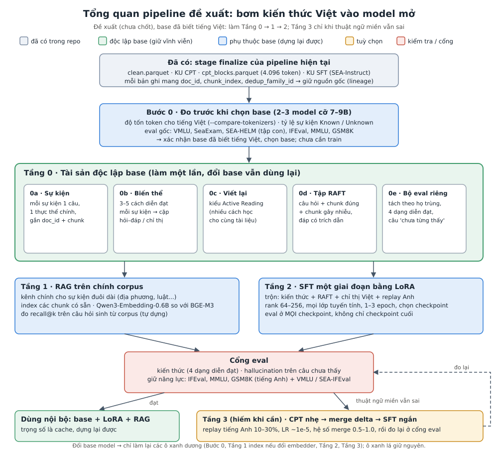
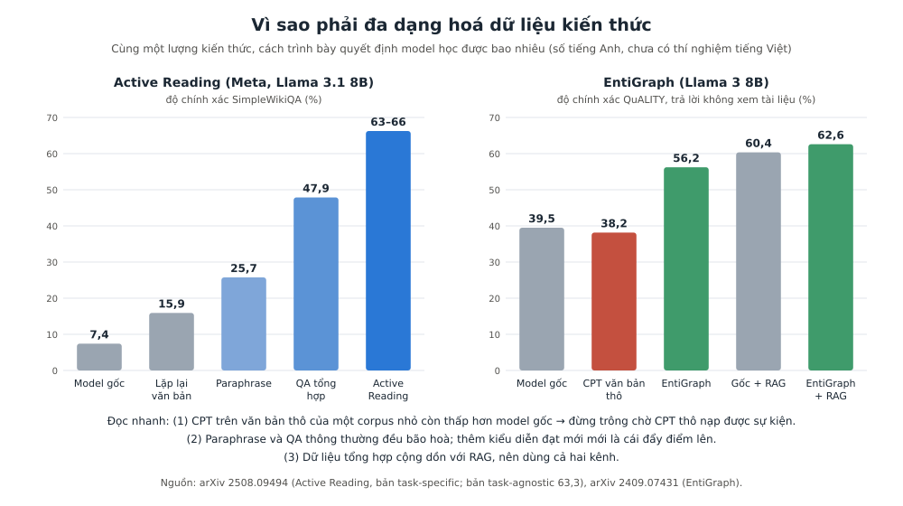
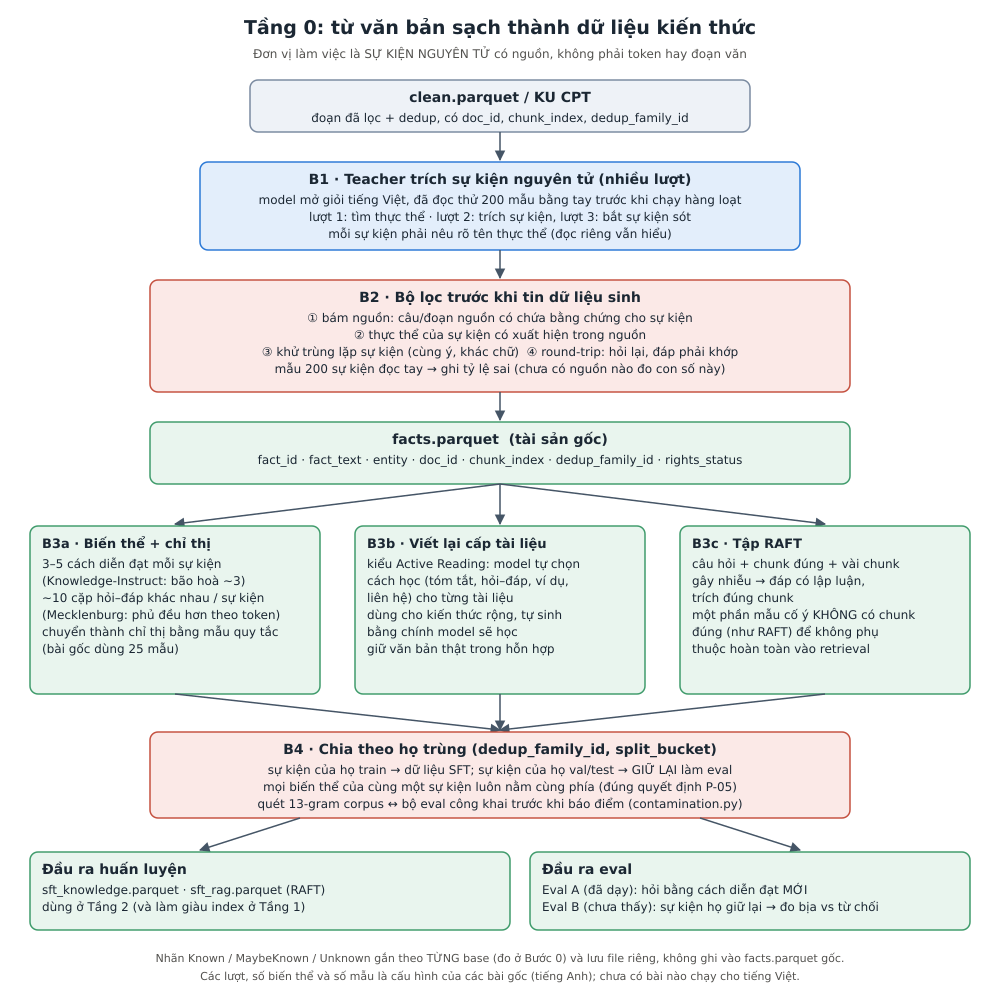
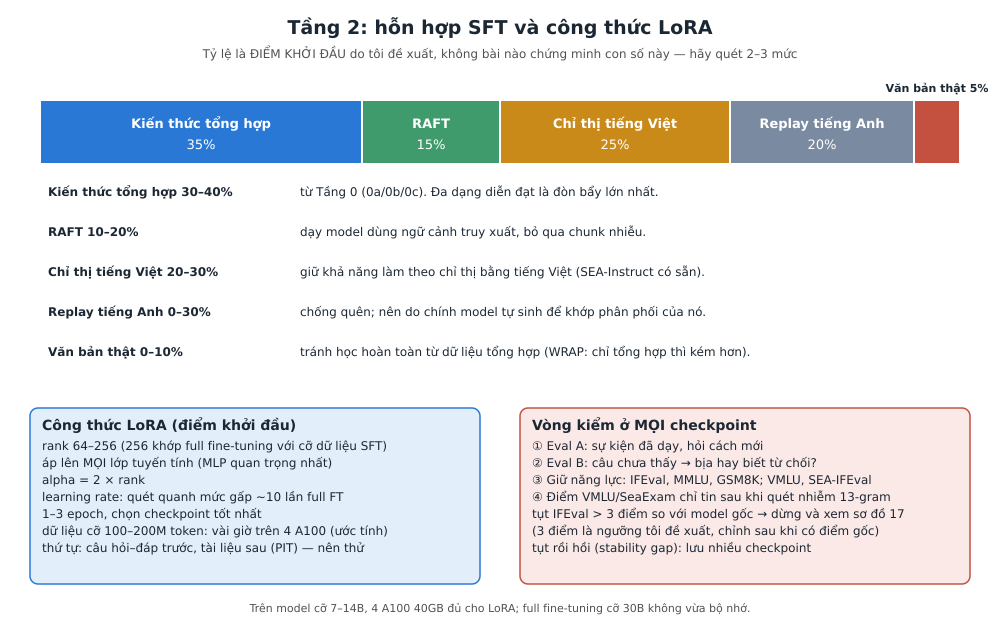
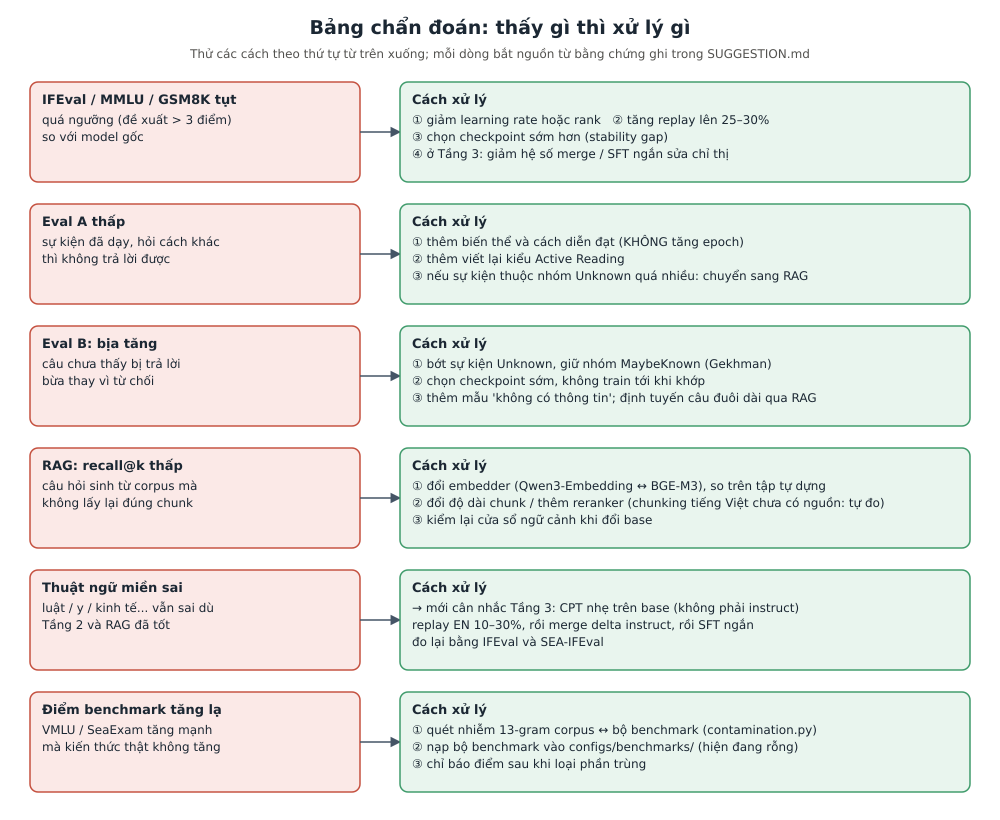

# SUGGESTION: pipeline đề xuất để đưa kiến thức tiếng Việt vào model mã nguồn mở

> **Trạng thái: đề xuất, chưa phải quyết định.** Chưa có dòng nào trong `docs/DECISION_LOG.md` cho tài liệu này và chưa có code.
> Nguồn: báo cáo khảo sát `reports/Knowledge injection cho SFT tiếng Việt.md` và 5 ghi chú trong `research_notes/Knowledge injection cho SFT tiếng Việt/`.
> Những chỗ là **suy luận / con số của tôi** (không phải kết quả bài báo) được ghi rõ là "đề xuất" hoặc "ước tính".
> **Gặp từ lạ (RAFT, Active Reading, delta merge, LoRA, replay...) thì xem mục 2 "Thuật ngữ".** Các ví dụ tiếng Việt trong tài liệu này (Chùa Một Cột...) chỉ là ví dụ minh hoạ, không phải dữ liệu thật của corpus.

## 1. Tóm tắt trong một phút

**Tiền đề (chủ dự án nhắc lại, 2026-10-20): model base đã biết tiếng Việt; mục tiêu chỉ là củng cố thêm kiến thức và bối cảnh văn hoá Việt, không phải dạy ngôn ngữ.** Tiền đề này không đổi lõi pipeline (Tầng 0 → 1 → 2), nhưng làm Tầng 3 (CPT nhẹ để sửa ngôn ngữ) gần như không còn cần, xem mục 5.

Công ty muốn củng cố kiến thức và bối cảnh văn hoá Việt cho một model mã nguồn mở, mà chưa chọn base model, và lo CPT tốn compute lẫn làm model quên cách lập luận / làm theo chỉ thị.

Đề xuất: **tách hai việc khác nhau** rồi giải mỗi việc bằng công cụ hợp với nó.

| Việc cần làm | Ví dụ câu hỏi | Công cụ đề xuất | Lý do ngắn |
|---|---|---|---|
| Văn phong, cách dùng từ, kiến thức phổ biến (lịch sử lớn, địa lý, văn hoá đại chúng) | "Chùa Một Cột ở đâu, do ai xây?" | **SFT bằng LoRA**, dữ liệu kiến thức được làm đa dạng | model nền thường đã "biết mờ mờ", SFT giúp lấy ra đúng cách |
| Sự kiện hiếm (địa phương, văn bản luật cụ thể, nhân vật ít tên tuổi) | "Điều khoản X của một nghị định ít người nhắc tới nói gì?" | **RAG** trên chính corpus, kèm dữ liệu kiểu RAFT để model biết dùng tài liệu truy xuất | SFT mỏng học sự kiện mới rất chậm và làm model bịa nhiều hơn |
| Nếu sau hai bước trên thuật ngữ chuyên ngành (luật, y, kinh tế...) vẫn sai | "Giải thích thuật ngữ chuyên ngành Y" mà model dùng sai từ | **CPT nhẹ trên base**, rồi merge và SFT ngắn (tuỳ chọn, mặc định bỏ) | vì base đã biết tiếng Việt, chỉ làm khi đo thấy thiếu; đây là bước dễ gây quên nhất |

Điểm quan trọng nhất cho ràng buộc "chưa chốt base": **dữ liệu và bộ eval mang sang được khi đổi base; trọng số thì không.** Vì vậy việc đầu tiên không phải là train, mà là dựng các tài sản dữ liệu (Tầng 0).

Thứ tự công việc tóm gọn: **Bước 0** (đo, chọn base) → **Tầng 0** (làm dữ liệu) → **Tầng 1** (RAG) → **Tầng 2** (SFT bằng LoRA) → **Tầng 3** (CPT nhẹ + merge, chỉ khi cần).



## 2. Thuật ngữ

Mục này giải thích bằng lời đơn giản mọi từ chuyên môn dùng trong tài liệu. Mỗi từ có thêm cột "Trong dự án này" để biết nó nằm ở đâu. Ba khái niệm khó nhất (RAFT, Active Reading, delta merge) được giải thích dài hơn ở cuối mục, có ví dụ.

### 2.1. Khái niệm nền

| Thuật ngữ | Nghĩa đơn giản | Trong dự án này |
|---|---|---|
| **Model / trọng số (weights)** | Model là một khối rất nhiều con số (hàng tỷ). Các con số này gọi là trọng số; "huấn luyện" là chỉnh các con số đó. | Đổi trọng số = đổi hành vi model. Vì vậy trọng số gắn chặt với một base cụ thể, còn dữ liệu thì không. |
| **Token / tokenizer** | Model không đọc chữ mà đọc "mảnh chữ" gọi là token. Tokenizer là bộ cắt chữ thành token. Tiếng Việt thường tốn nhiều token hơn tiếng Anh cho cùng nội dung. | Corpus tính bằng token (≥ 300M). Mỗi base có tokenizer riêng nên cùng một văn bản có số token khác nhau; Bước 0 đo việc này. |
| **Base model** | Model mới học đọc văn bản thô để đoán chữ tiếp theo. Chưa được dạy trả lời theo chỉ thị. | Chỗ CPT được phép chạm vào. |
| **Instruct model** | Base đã được dạy thêm để làm theo yêu cầu, trả lời như trợ lý. Hãng làm sẵn, thường gọi là "-it" hoặc "-Instruct". | Khả năng làm theo chỉ thị của nó là thứ ta sợ làm mất. Không CPT trực tiếp lên instruct. |
| **Pretraining (tiền huấn luyện)** | Giai đoạn đầu tốn kém nhất: đọc hàng nghìn tỷ token để học ngôn ngữ và kiến thức thế giới. Do hãng làm. | Ta không làm; ta chỉ bổ sung lên trên. Theo Gekhman, kiến thức chủ yếu đến từ giai đoạn này. |
| **Bịa (hallucination)** | Model trả lời trôi chảy nhưng sai sự thật. | Rủi ro chính khi ép model học sự kiện nó chưa biết. |
| **Closed-book / open-book** | Closed-book: hỏi model mà không đưa tài liệu (thi không mở sách). Open-book: đưa tài liệu kèm câu hỏi (thi mở sách). | Eval A / B là closed-book. RAG là open-book. |

### 2.2. Các cách huấn luyện

| Thuật ngữ | Nghĩa đơn giản | Trong dự án này |
|---|---|---|
| **CPT (continued pretraining, huấn luyện tiếp)** | Cho base đọc thêm văn bản thô, giống pretraining nhưng nhỏ hơn. Chỉnh rất nhiều trọng số. | Tầng 3, tuỳ chọn. Chỉ trên base. Bằng chứng cho thấy CPT thô không nạp sự kiện tốt (mục 4, lý do 2). |
| **SFT (supervised fine-tuning, tinh chỉnh có giám sát)** | Cho model học từ các cặp "yêu cầu → câu trả lời mẫu". Dạy nó cách hành xử, không phải dạy nhiều kiến thức mới. | Tầng 2. Dữ liệu SFT của ta gồm cặp hỏi–đáp về sự kiện, RAFT, chỉ thị chung. |
| **Full fine-tuning** | Chỉnh toàn bộ trọng số khi SFT. Học mạnh nhưng tốn bộ nhớ và dễ quên hơn. | Không dùng (mục 4.6). |
| **LoRA** | Không sửa trọng số gốc mà gắn thêm "miếng vá nhỏ" (adapter) rồi chỉ train miếng vá. Rẻ bộ nhớ, quên ít hơn, và có thể gỡ ra. | Công cụ chính của Tầng 2. Miếng vá chỉ dùng được với đúng base đã train. |
| **Rank (r) của LoRA** | Độ "to" của miếng vá. Rank càng cao càng học được nhiều, càng tốn bộ nhớ. | Đề xuất 64–256. Dưới 16 thường học thiếu. |
| **Alpha của LoRA** | Hệ số khuếch đại miếng vá. Quy tắc thực hành: alpha = 2 × rank. | Theo Biderman. |
| **Epoch** | Một lượt model đọc hết bộ dữ liệu. 3 epoch = đọc 3 lần. | 1–3 epoch. Tăng epoch không thay được độ đa dạng (mục 4, lý do 2). |
| **Learning rate (tốc độ học)** | Mỗi bước huấn luyện chỉnh trọng số mạnh cỡ nào. Cao quá thì học nhanh nhưng quên nhiều, thấp quá thì học chậm. | LoRA thường chịu learning rate cao hơn khoảng 10 lần so với full fine-tuning (Biderman). CPT dùng thấp, cỡ 1e-5. |
| **Checkpoint** | Bản lưu model giữa chừng khi đang train. | Phải đo điểm ở **mọi** checkpoint, không chỉ cuối. |
| **Tập dev và dừng sớm (early stopping)** | Tập dev là một phần dữ liệu để thử, không dùng để học. Dừng sớm là chọn thời điểm train dừng theo điểm tập dev. Trong dự án này hiểu là: **train hết số epoch đã định (1–3), lưu mọi checkpoint, rồi chọn checkpoint tốt nhất theo nhiều thước đo**; không dừng ngay khi điểm giảm lần đầu (xem "Dừng sớm là gì" ở Tầng 2). | Gekhman: chọn checkpoint sớm làm sự kiện Unknown gần như vô hại; train đến hội tụ thì gây bịa. |
| **Replay (ôn lại)** | Trộn một phần dữ liệu cũ (tiếng Anh, chỉ thị chung) vào lúc học cái mới để model không quên cái cũ. Như học bài mới nhưng vẫn ôn bài cũ mỗi ngày. | Tầng 2: replay tiếng Anh (20%) **và** replay tiếng Việt (phần chỉ thị tiếng Việt 25%, xem Tầng 2). Tầng 3: 10–30% tiếng Anh. |
| **Quên (catastrophic forgetting)** | Học thêm cái mới làm mất khả năng cũ, ví dụ không còn làm theo chỉ thị tốt. | Rủi ro số 1 mà công ty lo. |
| **Stability gap** | Khi bắt đầu train, điểm các khả năng cũ có thể tụt xuống trước rồi mới hồi lại. | Lý do phải đo nhiều checkpoint: nhìn checkpoint cuối có thể không thấy đợt tụt giữa chừng, và ngược lại có thể dừng nhầm lúc đang tụt tạm. |

### 2.3. Merge (trộn trọng số)

| Thuật ngữ | Nghĩa đơn giản | Trong dự án này |
|---|---|---|
| **Delta (hiệu trọng số)** | Phần chênh lệch giữa model sau khi train và model gốc: `delta = trọng số sau − trọng số gốc`. Mô tả "những gì lần train đó đã thay đổi". Còn gọi task vector. | Có hai delta cần phân biệt: delta tiếng Việt (do ta CPT) và delta chỉ thị (hãng đã làm: instruct − base). |
| **Delta merge** | Lấy delta của một model cộng vào model khác cùng gốc, không train gì thêm. Giải thích đầy đủ có ví dụ ở cuối mục. | Tầng 3. |
| **Task Arithmetic / Linear** | Hai cách merge đơn giản nhất: cộng (hoặc nội suy) các delta với một hệ số. Hai nghiên cứu độc lập cho là an toàn nhất. | Cách merge đề xuất. |
| **Hệ số merge** | Số nhân đứng trước delta khi cộng (0 = không cộng, 1 = cộng đủ). Chưa có lý thuyết chọn. | Quét 0,5–1,0 và đo. |
| **Chat Vector** | Tên bài ACL 2024 làm đúng việc trên: lấy `instruct − base` rồi cộng vào model đã CPT ngôn ngữ mới. | Cơ sở của bước merge ở Tầng 3. |
| **Source-Shielded Updates** | Cách khác để khỏi merge: tìm các "cột" trọng số quan trọng cho khả năng cũ, đóng băng chúng, chỉ cho phần còn lại học. | Phương án thay thế ở Tầng 3; bài gốc dùng 200M token, gần với corpus này. |

### 2.4. Dữ liệu và cách làm dữ liệu

| Thuật ngữ | Nghĩa đơn giản | Trong dự án này |
|---|---|---|
| **Sự kiện nguyên tử (atomic fact)** | Một câu đầy đủ chỉ nói một điều, nêu rõ tên thực thể, đọc riêng vẫn hiểu. Ví dụ "Chùa Một Cột được xây năm 1049." (không phải "Nó được xây năm 1049."). | Đơn vị làm việc của Tầng 0. |
| **Teacher / student** | Teacher là model lớn hoặc mạnh dùng để sinh dữ liệu. Student là model nhỏ hơn học từ dữ liệu đó. | Teacher chưa chọn (câu hỏi 1 ở mục 11). Student là base được chọn sau Bước 0. |
| **Dữ liệu tổng hợp (synthetic data)** | Dữ liệu do model sinh ra từ văn bản nguồn, không do người viết. | Biến thể, hỏi–đáp, RAFT đều là dữ liệu tổng hợp. |
| **Paraphrase** | Viết lại cùng nội dung bằng cách diễn đạt khác. | B3a. Một cách đa dạng hoá, nhưng đơn lẻ thì kém (mục 4, lý do 2). |
| **Đa dạng hoá (multiplicity, permute)** | Cho model thấy cùng một sự kiện qua nhiều dạng: viết lại nhiều kiểu (multiplicity), đảo thứ tự các câu (permute), dịch sang ngôn ngữ khác, hỏi theo nhiều hướng. | Nguyên lý trung tâm của Tầng 0. |
| **Known / MaybeKnown / Unknown** | Cách xếp sự kiện theo việc model đã biết chưa (Gekhman): hỏi nhiều lần, đúng gần hết = Known (bản gốc chia thêm HighlyKnown / WeaklyKnown), đúng thỉnh thoảng = MaybeKnown, không bao giờ đúng = Unknown. | Bước 0 đo tỷ lệ này; quyết định sự kiện nào đi SFT, sự kiện nào đi RAG. |
| **EntiGraph** | Phương pháp (Yang và cộng sự, 2024): trích các thực thể trong tài liệu, rồi bảo model viết nhiều đoạn văn về từng cặp thực thể ("quan hệ giữa A và B"). Từ 1,3M token sách sinh ra 455M token tổng hợp. | Tham khảo cho tầng sự kiện hiếm; cho thấy CPT thô thua base. |
| **WRAP** | "Rephrasing the Web": dùng model viết lại văn bản web theo vài phong cách (dễ hiểu, kiểu Wikipedia, hỏi–đáp) để tăng dữ liệu. | Nguồn số liệu chi phí sinh dữ liệu; bài học giữ văn bản thật trong hỗn hợp. |
| **Knowledge-Instruct** | Công thức SFT-only (2025): trích sự kiện, viết 3–5 biến thể mỗi sự kiện, biến chúng thành cặp chỉ thị–đáp bằng 25 mẫu câu, trộn với dữ liệu chỉ thị chung và train một bước. | Công thức nền cho Tầng 0 và Tầng 2. |
| **Pre-Instruction-Tuning (PIT)** | Thứ tự học: học hỏi–đáp **trước**, tài liệu **sau**. Bài gốc báo thắng thứ tự thông thường 17,8%. | Thử thêm ở Tầng 2. |
| **Họ trùng (`dedup_family_id`) và `split_bucket`** | Các văn bản gần giống nhau được gom thành một "họ"; mỗi họ được gán vào đúng một nhóm train / val / test. | Chia sự kiện sao cho mọi biến thể của một sự kiện ở cùng phía, tránh lộ đề. |
| **Eval A / Eval B** | Hai bộ kiểm tra tự dựng. A: sự kiện đã dạy, hỏi bằng câu mới theo bốn dạng (gốc, paraphrase, gián tiếp, đảo chiều). B: sự kiện cố ý giữ lại chưa dạy (kể cả mọi biến thể), xem model bịa hay biết từ chối. | Mục 5, Tầng 0, bước 7. |
| **Nhiễm benchmark (contamination) và 13-gram** | Nhiễm: đề thi của benchmark đã nằm sẵn trong dữ liệu train nên điểm cao giả. 13-gram: so từng cụm 13 từ liên tiếp giữa corpus và đề thi; trùng một cụm là nghi nhiễm. | `contamination.py` đã có; `configs/benchmarks/` đang rỗng cần nạp. |

### 2.5. RAG và truy xuất

| Thuật ngữ | Nghĩa đơn giản | Trong dự án này |
|---|---|---|
| **RAG (retrieval-augmented generation)** | "Tìm rồi mới trả lời": khi có câu hỏi, hệ thống tìm vài đoạn tài liệu liên quan trong kho, đưa kèm câu hỏi cho model đọc rồi trả lời. Không đổi trọng số nên cập nhật kiến thức chỉ cần thêm tài liệu vào kho. | Tầng 1. Kênh chính cho sự kiện hiếm. |
| **Chunk** | Một đoạn văn ngắn cắt ra từ tài liệu để lưu vào kho tìm kiếm. | Corpus đã cắt chunk theo token Qwen3, mang `doc_id` để trích nguồn. |
| **Embedding / embedder** | Embedder biến một đoạn chữ thành một dãy số ("toạ độ ý nghĩa"); hai đoạn cùng ý thì toạ độ gần nhau. Nhờ vậy tìm theo nghĩa chứ không chỉ theo từ khoá. | Qwen3-Embedding-0.6B (đang dùng) so với BGE-M3. |
| **Index** | Kho các embedding đã tính sẵn để tìm nhanh. | Dựng trên chunk có sẵn. |
| **recall@k** | Trong k đoạn hệ thống tìm ra, có đoạn đúng không? recall@5 = 0,8 nghĩa là 80% câu hỏi có đoạn đúng nằm trong top 5. | Thước đo chọn embedder và cách chia chunk. |
| **Reranker** | Bước thứ hai chấm lại thứ tự các đoạn đã tìm được cho chính xác hơn. | Gợi ý khi recall@k thấp (mục 7). |

### 2.6. Đo đạc và ước tính

| Thuật ngữ | Nghĩa đơn giản | Trong dự án này |
|---|---|---|
| **IFEval / SEA-IFEval** | Bộ kiểm tra khả năng làm đúng yêu cầu có thể kiểm chứng tự động ("viết dưới 50 từ", "kết thúc bằng câu X"). SEA-IFEval là bản cho các ngôn ngữ Đông Nam Á. | Thước đo chính cho "có quên cách làm theo chỉ thị không". |
| **MMLU / GSM8K** | MMLU: thi trắc nghiệm kiến thức đa môn. GSM8K: toán đố cấp tiểu học. | Đo năng lực tổng quát và lập luận có bị tụt không. |
| **VMLU / SeaExam / SEA-HELM** | Bộ thi kiến thức tiếng Việt (VMLU), thi kiểu trường học Đông Nam Á (SeaExam), bộ đánh giá đa ngôn ngữ có cả phần văn hoá (SEA-HELM). | Đo kiến thức Việt trước và sau. |
| **VN-MTEB** | Bộ đo chất lượng embedder cho tiếng Việt. | Tham chiếu khi chọn embedder. |
| **6ND** | Công thức ước tính khối lượng tính: `6 × số tham số × số token` phép tính. Ví dụ model 8 tỷ tham số học 300M token: 6 × 8e9 × 3e8 ≈ 1,4e19. | Dùng ước tính thời gian huấn luyện. |
| **MFU** | Tỷ lệ sức tính lý thuyết của GPU thật sự dùng được; thực tế thường 30–50%. Ví dụ 4 A100 mỗi chiếc khoảng 312 TFLOPs ở bf16, MFU 40% ≈ 5e14 phép tính mỗi giây. | 1,4e19 ÷ 5e14 ≈ 29.000 giây ≈ 8 giờ cho một lượt đọc 300M token (ước tính của tôi từ hai công thức này, chưa đo thực). |
| **Cổng eval** | Tên trong sơ đồ 14 cho bước **chạy** eval ở mọi checkpoint sau Tầng 2 và Tầng 3: Eval A, Eval B (do 0e làm ra) cộng các benchmark giữ năng lực công khai (IFEval, MMLU, GSM8K, VMLU, SEA-IFEval). Đạt ngưỡng thì dùng, không đạt thì xử lý theo mục 7. 0e là *làm ra* bộ câu hỏi (một lần), cổng eval là *chạy* chúng (nhiều lần). | Mục 5, sau Tầng 2. |

### 2.7. Ba khái niệm khó, giải thích kỹ

#### RAFT (Retrieval-Augmented Fine-Tuning)

**Vấn đề nó giải quyết.** RAG chỉ có ích nếu model biết *dùng* tài liệu được đưa. Trong thực tế bước tìm đôi khi trả về đoạn sai hoặc đoạn không liên quan; một model chưa được dạy sẽ tin vào đoạn sai và trả lời sai, hoặc phớt lờ tài liệu và trả lời theo trí nhớ.

**Ý tưởng.** RAFT (Zhang và cộng sự, 2024) giống như dạy model "thi mở sách" có luyện đề. Mỗi mẫu huấn luyện gồm: một câu hỏi, vài đoạn tài liệu (trong đó có **một đoạn đúng** và **vài đoạn gây nhiễu** nhìn có vẻ liên quan nhưng không chứa đáp án), và một câu trả lời mẫu. Câu trả lời mẫu phải **lập luận từng bước và trích nguyên văn** câu trong đoạn đúng. Một phần mẫu (đề xuất, bài gốc có tham số cho tỷ lệ này) cố ý **không có đoạn đúng**, để model học cách không bám vào đoạn lạc đề.

**Ví dụ minh hoạ (không phải dữ liệu thật):**

```
Câu hỏi: Vua nào cho xây Chùa Một Cột?
[Đoạn 1] ... Chùa Một Cột ở Hà Nội do vua Lý Thái Tông cho xây năm 1049 ...   <- đoạn đúng
[Đoạn 2] ... Chùa Thiên Mụ ở Huế do chúa Nguyễn Hoàng cho dựng năm 1601 ...   <- gây nhiễu
[Đoạn 3] ... Văn Miếu được xây năm 1070 thời vua Lý Thánh Tông ...            <- gây nhiễu
Đáp mẫu: Theo đoạn 1: "Chùa Một Cột ở Hà Nội do vua Lý Thái Tông cho xây năm 1049".
         Vậy vua cho xây Chùa Một Cột là Lý Thái Tông.
```

**Vì sao dự án cần.** Kiến thức hiếm đi qua RAG (Tầng 1), nên model phải đọc tài liệu truy xuất giỏi. RAFT là "kỹ năng đọc tài liệu" được cất vào trọng số, trong khi chính kiến thức vẫn nằm ngoài, ở corpus. Vì tập RAFT chỉ gồm văn bản và không dính tokenizer nào, **dựng một lần dùng lại cho mọi base**. Nó chiếm 15% hỗn hợp SFT khởi điểm. Chưa có bài nào dùng RAFT cho tiếng Việt.

#### Active Reading (đọc chủ động)

**Vấn đề nó giải quyết.** Muốn model *nhớ và lấy ra được* một sự kiện thì phải cho nó thấy sự kiện đó dưới thật nhiều dạng. Viết lại (paraphrase) đơn thuần chỉ cho một cách nhìn nên đạt nhanh trần.

**Ý tưởng.** Active Reading (Lin và cộng sự, Meta, 2025) mô phỏng cách người học bài. Hai bước:

1. Với **mỗi tài liệu**, bảo model tự nghĩ ra một danh sách *chiến lược học* hợp với tài liệu đó, ví dụ: diễn đạt lại bằng lời khác, nối với kiến thức liên quan, tự đặt câu hỏi rồi trả lời (gọi lại từ trí nhớ), lấy ví dụ tương tự.
2. **Áp từng chiến lược** vào tài liệu để sinh ra văn bản học tập mới. Toàn bộ văn bản sinh ra được dùng để huấn luyện.

Có hai biến thể: *task-agnostic* (chiến lược chung chung) và *task-specific* (chiến lược nhắm vào loại câu hỏi sẽ gặp).

**Con số.** Trên Llama 3.1 8B, bộ SimpleWikiQA (điểm càng cao càng tốt): model gốc 7,42; lặp lại nguyên văn 15,92; paraphrase 25,74; hỏi–đáp tổng hợp 47,87; **Active Reading 63,33 đến 66,25**; và nếu đưa thẳng tài liệu vào câu hỏi (mở sách) thì 65,85. Nghĩa là học xong bằng Active Reading, model trả lời không cần sách gần ngang với trả lời có sách.

**Lưu ý quan trọng.** (1) Trong bài gốc, chính model 8B tự sinh dữ liệu cho mình; dùng model 70B làm teacher lại **không** giúp (62,26 so với 66,25). (2) Số liệu tiếng Anh; chưa ai thử cho tiếng Việt. (3) Lượng lớn: khoảng 4 tỷ từ sinh ra cho một tập tài liệu nhỏ. Với tài liệu càng nhiều thì phải chỉnh learning rate và trộn 1:1 với dữ liệu thường mới giữ được kết quả. Vì thế trong pipeline này nó là bước B3b, dùng cho kiến thức *rộng*, còn sự kiện nguyên tử đi qua B3a.

#### Delta merge (trộn delta)

**Bối cảnh.** Hãng công bố hai bản của cùng một model: **base** (B) và **instruct** (I). Phần chênh `Δ_chỉ_thị = I − B` chính là "những gì hãng đã dạy để model làm theo chỉ thị". Giả sử ta CPT base bằng văn bản tiếng Việt, được model C = B + `Δ_việt`. C đã giỏi tiếng Việt hơn nhưng không còn biết làm theo chỉ thị (vì ta không có dữ liệu và công sức như hãng).

**Delta merge** là tận dụng chính phần chênh của hãng, cộng vào C mà không phải train thêm:

```
Base B ──(ta CPT tiếng Việt)──►  C = B + Δ_việt
Base B ──(hãng dạy chỉ thị)───►  I = B + Δ_chỉ_thị      (tải sẵn về, không tốn công)

Merge:   M = C + α × Δ_chỉ_thị = C + α × (I − B)        (α là hệ số merge, quét 0,5–1,0)
```

M vừa mang kiến thức tiếng Việt của C vừa mang khả năng làm theo chỉ thị của I. Việc cộng chỉ tốn vài phút trên CPU, không cần GPU.

**Điều kiện bắt buộc.** B, C, I phải **cùng một gốc và cùng tokenizer**, nếu không các con số không ứng với nhau và kết quả vô nghĩa. Vì vậy delta không mang qua base khác họ được (Param Delta báo chuyển trong cùng họ, Llama 3 → Llama 3.1 ở 70B, giữ khoảng 95%).

**Giá phải trả.** Hai delta có thể "đạp chân nhau". Merge and Conquer (2026) báo IFEval tụt khoảng 14 điểm ở cặp Qwen3 8B – tiếng Tây Ban Nha (80,66 → 66,83) và Llama 3.1 8B – tiếng Tây Ban Nha (63,83 → 50,08). Vì thế sau merge luôn phải đo lại và thường cần một SFT ngắn để sửa chỉ thị. Hệ số α không có công thức: Chat Vector gốc cho thấy cùng hệ số 0,5 cho kết quả tốt (7,89) sau SFT nhưng sụp đổ (4,61) khi không SFT, nên phải quét.

**Trong dự án này.** Chỉ dùng ở Tầng 3 (tuỳ chọn). Bằng chứng tốt nhất cho merge là 7–14B dense, vài tỷ token CPT, chủ yếu đo hiểu ngôn ngữ; chưa có kết quả cho Gemma, MoE hay tiếng Việt.

## 3. Ràng buộc và hệ quả

| Ràng buộc | Nghĩa là gì | Hệ quả cho thiết kế |
|---|---|---|
| Chưa chốt base model | Trọng số (LoRA, checkpoint CPT, delta) gắn với một base; đổi base là làm lại. Dữ liệu thì không gắn. | Tài sản dữ liệu phải độc lập tokenizer. Chỉ quyết định base sau khi đo (Bước 0). |
| Corpus đích ≥ 300M token sạch | Rất nhỏ so với các dự án CPT khu vực: Sailor2 dùng 500B token (gấp khoảng 1.700 lần), SEA-LION v3 dùng 200B (gấp khoảng 670 lần). | Không thể làm CPT để dạy ngôn ngữ. Nhưng đủ để rút ra sự kiện và dựng tập RAFT. |
| 4× A100 40GB | Mỗi GPU 40 GB. Ước tính thô của tôi: trọng số bf16 của model 8B nặng khoảng 16 GB; full fine-tuning cần khoảng 16 byte mỗi tham số (trọng số, gradient, trạng thái optimizer), tức khoảng 128 GB cho 8B, chiếm gần hết 160 GB của cả 4 GPU. LoRA chỉ train miếng vá nhỏ nên nhẹ hơn nhiều. | LoRA trên model 7–9B thoải mái, 14B sát bộ nhớ. Full fine-tuning cỡ 30B không vừa. Sinh dữ liệu tổng hợp sẽ là khoản tốn nhất. |
| Sợ quên khả năng lập luận / làm theo chỉ thị | Mọi cách chỉnh trọng số đều có thể làm tụt IFEval, GSM8K. Mức tụt khác nhau theo cách làm (mục 4, lý do 3). | Ưu tiên LoRA, replay, và đo IFEval ở **mọi** checkpoint. Chỉ CPT trên base, không CPT trên model instruct. |
| Nguồn corpus có quyền chưa rõ (stbook, giáo trình) | Không biết có được dùng để huấn luyện không. | Mọi sự kiện sinh ra phải mang `rights_status` của tài liệu gốc, để sau này lọc được nếu cần. |
| Gần như không có nghiên cứu cho tiếng Việt | Hầu hết bài báo chạy trên tiếng Anh, có ít bài tiếng Thái, Indonesia, Basque... | Mọi con số dưới đây là từ ngôn ngữ khác. Cần thí nghiệm nhỏ để kiểm (mục 8). |

## 4. Vì sao chọn cách này

Cách đọc mục này: có **5 lý do**, nối với nhau thành một chuỗi suy luận. Mỗi lý do có bốn ý: *bằng chứng* (bài nào, đo gì, ra số gì), *nghĩa là gì cho dự án*, *chỗ chưa chắc*, và *nếu hoá ra sai thì đổi gì*. Sau 5 lý do là bảng các hướng khác đã cân nhắc nhưng không chọn (mục 4.6).

Chuỗi suy luận tóm gọn:

1. Sự kiện model chưa biết thì SFT mỏng học kém và gây bịa → sự kiện hiếm đi qua RAG, SFT chỉ dùng cho phần model đã biết mờ.
2. Nhưng "đã biết mờ" cũng chỉ lấy ra được nếu dữ liệu đa dạng → phải có Tầng 0 làm dữ liệu đa dạng, không tăng epoch.
3. Chỉnh trọng số luôn có giá (quên chỉ thị) → LoRA, replay, đo từng checkpoint, và hạn chế CPT.
4. Base đã biết tiếng Việt → bài toán là củng cố kiến thức, không cần CPT ngôn ngữ.
5. Chưa chốt base → giữ dữ liệu bất biến, coi trọng số như cache.

### 4.1. Lý do 1: SFT mỏng không nạp được sự kiện mới, và còn có hại

**Điều dễ nghĩ nhầm.** Nhiều người nghĩ cứ cho model đọc/học thật nhiều thì nó sẽ nhớ. Thực tế một model đã pretrain có "kiến thức" gần như cố định; bước tinh chỉnh nhỏ chủ yếu dạy nó cách lấy ra những gì nó đã có.

**Bằng chứng.**

- **Gekhman và cộng sự (EMNLP 2024).** Thí nghiệm trên PaLM 2-S, hỏi đáp không có tài liệu (closed-book), bộ EntityQuestions. Họ xếp từng sự kiện theo mức model đã biết (HighlyKnown 24%, MaybeKnown 23%, WeaklyKnown 17%, Unknown 36% trong bộ của họ) rồi huấn luyện với tỷ lệ khác nhau. Bốn phát hiện:
  1. Sự kiện **Unknown được học chậm hơn nhiều** so với sự kiện Known.
  2. Khi model cuối cùng khớp được chúng, **tỷ lệ bịa trên những điều nó đã biết tăng gần tuyến tính** theo tỷ lệ Unknown.
  3. Dừng sớm theo tập dev (tức chọn checkpoint sớm, xem Tầng 2) thì Unknown gần như vô hại (bỏ hẳn Unknown cho kết quả gần như giống). Train đến hội tụ thì hại: trong bảng của họ nhóm chỉ-Unknown rơi còn 25,8 điểm so với 37,5 lúc dừng sớm.
  4. Bất ngờ: chỉ train trên sự kiện HighlyKnown **không** phải tốt nhất; nhóm MaybeKnown (model biết thỉnh thoảng) cho điểm cao nhất lúc dừng sớm (43,6 so với 40,5 của HighlyKnown). Nhóm này là chỗ SFT có ích nhất.

  Kết luận của tác giả: kiến thức đến chủ yếu từ pretraining; fine-tuning chủ yếu dạy cách dùng kiến thức sẵn có.
- **Ovadia và cộng sự (EMNLP 2024).** So fine-tuning không giám sát với RAG cho kiến thức mới: RAG thắng ở mọi trường hợp, cả với kiến thức đã gặp lẫn hoàn toàn mới. **Soudani và cộng sự** thấy RAG thắng rõ nhất ở những sự kiện ít phổ biến nhất.
- **Mặt còn lại, để công bằng.** Mecklenburg và cộng sự thấy SFT với khoảng 10 cặp hỏi–đáp mỗi sự kiện đạt trong vòng 16% so với RAG trên sự kiện sau mốc huấn luyện; Knowledge-Instruct (SFT dạng sự kiện) đạt trung bình 73,6 so với 38,9 của CPT thô. Vậy "SFT mỏng" ở đây nghĩa cụ thể là *mỗi sự kiện chỉ một câu hỏi–đáp một dạng, train nhiều epoch*. SFT *dày và đa dạng* làm được nhiều hơn, đó chính là lý do 2.

**Nghĩa là gì cho dự án.** Chia sự kiện thành hai đường theo mức model đã biết:

| Mức biết | Đường đi | Vì sao |
|---|---|---|
| Known / MaybeKnown | SFT bằng LoRA (Tầng 2) | an toàn, có ích; dạy cách lấy ra đúng |
| Unknown / đuôi dài | RAG (Tầng 1) + RAFT | khỏi ép trọng số học thứ khó học và dễ gây bịa |

**Chỗ chưa chắc.** Gekhman chỉ thử một model (PaLM 2-S) và tiếng Anh. Chưa có ai đo Known/Unknown cho sự kiện tiếng Việt. Suy luận của tôi, chưa kiểm: sự kiện đuôi dài của Việt Nam (địa phương, văn bản luật cụ thể) sẽ có tỷ lệ Unknown cao.

**Nếu sai thì đổi gì.** Bước 0 đo tỷ lệ này trên chính các base. Nếu Unknown rất ít thì RAG ít việc và SFT gánh gần hết; nếu Unknown rất nhiều thì RAG trở thành kênh chính và SFT chỉ còn dạy văn phong và cách dùng tài liệu (RAFT).

### 4.2. Lý do 2: cái quyết định model học được bao nhiêu là độ đa dạng của dữ liệu, không phải thêm epoch

**Hiện tượng.** Model có thể *nhớ vẹt* một câu mà không *lấy ra được* khi bị hỏi cách khác. Ví dụ model thuộc câu "Chùa Một Cột được xây năm 1049" nhưng bị hỏi "Công trình nào ở Hà Nội được xây năm 1049?" thì bó tay, vì thông tin được lưu theo đúng trật tự câu nó đã thấy.

**Bằng chứng, theo mức từ ống nghiệm đến thực tế.**

- **Physics of Language Models 3.1 (Allen-Zhu & Li).** Thí nghiệm có kiểm soát: 100.000 tiểu sử người *tổng hợp* (mỗi bài khoảng 73 token, sinh từ khoảng 50 mẫu câu), model nhỏ huấn luyện từ đầu, rồi hỏi về những người chưa bị hỏi lúc học. Độ chính xác khi hỏi:

  | Cách đưa dữ liệu | Độ chính xác |
  |---|---|
  | mỗi người một bài tiểu sử | 9,7% |
  | một bài + xáo thứ tự câu 1 lần | 4,4% |
  | một bài + xáo thứ tự câu 5 lần | 70% |
  | 5 bài viết khác nhau cho mỗi người | 41% |
  | 5 bài khác nhau + xáo thứ tự | **96,6%** |
  | thêm bản dịch tiếng Pháp | khoảng 40% |

  Đáng chú ý: một model 682M train khoảng 1.350 lượt trên dữ liệu không làm đa dạng vẫn gần như 0% khi hỏi. Nghĩa là **tăng số epoch không thay được đa dạng**. Phân tích bên trong model cho thấy khi không đa dạng hoá, thông tin về một người chỉ "đọc ra được" ở những token xa phía sau tên; khi đa dạng, thông tin bám ngay sau tên thực thể. Giới hạn: model nhỏ, tiểu sử tổng hợp, huấn luyện từ đầu, không phải model 8B đã pretrain.
- **Active Reading trên Llama 3.1 8B (model thật).** Bảng điểm SimpleWikiQA đầy đủ ở mục 2.7: lặp lại nguyên văn 15,92; paraphrase 25,74; hỏi–đáp tổng hợp 47,87; Active Reading 63–66. Thêm hai điểm đáng nhớ: paraphrase và hỏi–đáp **bão hoà** khi tăng lượng dữ liệu còn Active Reading tiếp tục tăng đến khoảng 4 tỷ từ; và hỏi–đáp tổng hợp có độ phủ đáp án cao nhất mà vẫn thua, tức **đa dạng thắng độ phủ**.
- **EntiGraph (Llama 3 8B, sách thật).** Từ 1,3M token của 265 cuốn sách, model được CPT. Điểm trả lời không mở sách: model gốc 39,49; **CPT trên văn bản thô 38,15 (thấp hơn cả model gốc)**; CPT trên 455M token tổng hợp đa dạng 56,22. Cho RAG vào: model gốc 60,35; EntiGraph + RAG 62,60. Mức tăng 16,73 điểm của EntiGraph bằng hơn 80% mức tăng nhờ RAG (20,86), và hai kênh cộng dồn.

  Vì sao CPT thô tệ? Tác giả giải thích: phân phối hẹp làm hại khả năng chung, và dữ liệu thiếu đa dạng (liên quan "reversal curse": học "A là B" nhưng không trả lời được "ai là B?").

**Nghĩa là gì cho dự án.**

- Đừng ném `clean.parquet` vào CPT rồi trông chờ model nhớ sự kiện. Sự kiện phải qua Tầng 0 trước.
- Mỗi sự kiện cần 3–5 cách diễn đạt (lợi ích bão hoà quanh 3 trong Knowledge-Instruct) và khoảng 10 cặp hỏi–đáp (Mecklenburg). Hai bài dùng hai con số khác nhau nên thử cả hai trên mẫu nhỏ.
- Cần cả cấp tài liệu (Active Reading) cho kiến thức rộng và cấp sự kiện cho kiến thức cụ thể.
- Cần một số câu hỏi *đảo chiều* ("công trình nào được xây năm 1049?") để tránh reversal curse.



**Chỗ chưa chắc.** Mọi số liệu ở trên đều bằng tiếng Anh. Chưa có so sánh trực tiếp giữa EntiGraph, Active Reading và Knowledge-Instruct trên cùng dữ liệu và model. Một nhận xét thứ cấp (chưa đọc bản gốc) cho rằng một phần lợi ích của đa dạng hoá có thể là *đánh thức lại* kiến thức model đã có chứ không phải học mới. Với dự án này điều đó chấp nhận được: mục tiêu của ta vốn là củng cố kiến thức model đã biết mờ (mục 1).

**Nếu sai thì đổi gì.** Nếu thí nghiệm trên mẫu nhỏ cho thấy đa dạng hoá ít giúp Eval A cho tiếng Việt, ta dịch trọng tâm sang RAG và RAFT, giảm đầu tư vào sinh biến thể.

### 4.3. Lý do 3: rủi ro chính không phải compute mà là quên khả năng làm theo chỉ thị

**Compute thật ra rẻ.** Dùng công thức 6ND ở mục 2.6: model 8B học 300M token cần khoảng 1,4e19 phép tính; 4 A100 ở MFU 40% làm được khoảng 5e14 phép tính mỗi giây, tức khoảng 8 giờ cho một lượt đọc hết 300M token (ước tính của tôi, chưa đo trên máy thật; thực tế thêm epoch và hao phí nên "nửa ngày đến một ngày"). SFT 100–200M token chỉ vài giờ.

**Cái đắt là cái giá khi chạm vào trọng số.**

- **Merge and Conquer (2026).** CPT khoảng 3,5–3,8B token mỗi ngôn ngữ (Basque, Galicia, Catalan, Tây Ban Nha), rồi merge với bản instruct. Điểm hiểu ngôn ngữ tăng nhưng IFEval tụt khoảng 14 điểm ở một số cặp: Qwen3 8B – tiếng Tây Ban Nha 80,66 → 66,83; Llama 3.1 8B – tiếng Tây Ban Nha 63,83 → 50,08. Cặp Basque thì rất khác nhau theo model: tụt khoảng 11 trên Qwen3 8B nhưng chỉ 0,2 trên Llama 3.1 8B. Nghĩa là mức quên **phụ thuộc cặp model–ngôn ngữ, không đoán trước được**, phải đo.
- **Jindal và cộng sự.** CPT khoảng 1B token trên Llama 3/3.1 và Qwen 2/2.5: model instruct tụt tối đa khoảng 10 điểm IFEval, trung bình 3; còn model **base** tụt rất ít. Đây là lý do chọn "CPT chỉ trên base" (số liệu lấy từ tóm tắt, chưa kiểm bản gốc).
- **DiSC (2026).** Tinh chỉnh trực tiếp model instruct bằng kiến thức mới làm mất khoảng 8–15 điểm IFEval; ví dụ Qwen2.5-7B-Instruct kiến thức cập nhật tăng từ 15,5 lên 40,9 nhưng IFEval tụt 14,9, toán tụt 25,4, code tụt 9,2. Thêm KL regularization hay on-policy cũng tụt xấp xỉ; LoRA giảm quên nhưng cũng giảm lợi ích. Nhóm tác giả đề xuất một phương pháp riêng (context distillation) gần như không tụt. Số liệu từ tóm tắt, chưa kiểm bản gốc.
- **Source-Shielded Updates.** Đóng băng các cột trọng số quan trọng cho khả năng cũ: quên giảm từ khoảng 20% xuống khoảng 3% (7B: 3,4% so với 20,3% của full fine-tuning).
- **Knowledge-Instruct (trộn một bước).** Khi trộn dữ liệu kiến thức với dữ liệu chỉ thị chung (Orca) trong cùng một lần SFT, điểm chung trung bình là 63,9, so với 61,0 của model gốc và 60,4 của CPT thô; GSM8K 75,7 so với 65,5–69,6 của các biến thể CPT. Tức dữ liệu chỉ thị trộn vào *bảo vệ* khả năng cũ.
- **Replay.** Các dự án lớn đều trộn dữ liệu cũ vào: Sailor khoảng 30%, Sailor2 khoảng 20%, Merge and Conquer khoảng 8% token tiếng Anh; Ibrahim và Zheng khuyến nghị 5–30%.
- **Stability gap (Guo và cộng sự).** Điểm có thể tụt ở đầu quá trình rồi hồi lại, nên một checkpoint đơn lẻ không nói lên gì.
- **LoRA.** Biderman và cộng sự: LoRA học ít hơn full fine-tuning (chênh nhiều nhất khi dữ liệu cỡ CPT, hàng chục tỷ token) nhưng quên ít hơn; rank cao (khoảng 256) thu hẹp khoảng cách. Thinking Machines ("LoRA Without Regret") thấy ở dữ liệu cỡ SFT, LoRA đủ rank thì ngang full fine-tuning. Một bài 2026 cho rằng kết quả "quên ít hơn" có thể do chọn learning rate; ta chưa kiểm chứng riêng.

**Nghĩa là gì cho dự án.** Bốn biện pháp rẻ nhất: (1) LoRA thay full fine-tuning; (2) trộn replay tiếng Anh (khởi điểm 20%, sẽ quét cả mức 0%) và replay tiếng Việt (phần chỉ thị tiếng Việt 25%); (3) CPT, nếu có làm, chỉ trên base; (4) đo IFEval, MMLU, GSM8K ở mọi checkpoint với ngưỡng "tụt ≤ 3 điểm" (đề xuất của tôi, chỉnh sau Bước 0).

**Chỗ chưa chắc.** Merge and Conquer dùng quy mô CPT gấp khoảng 10 lần corpus này; Jindal và DiSC mới biết qua tóm tắt. Chưa có số đo quên cho tiếng Việt và cho Gemma.

**Nếu sai thì đổi gì.** Nếu LoRA vẫn làm IFEval tụt hơn ngưỡng ở nhánh A (mục 8), giảm rank hoặc learning rate, tăng replay lên 25–30% (bảng chẩn đoán ở mục 7). Nếu vẫn không đủ, chuyển sang phương án kiểu Source-Shielded hoặc dừng SFT kiến thức, chỉ dùng RAG.

### 4.4. Lý do 4: model đã biết tiếng Việt, nên đây là bài toán củng cố kiến thức chứ không phải dạy ngôn ngữ

**Bằng chứng.**

- **Sailor2 (ablation ở mục 8.2 của bài gốc).** Cùng một quy trình hậu huấn luyện được áp lên hai model: Qwen2.5-7B nguyên bản và Sailor2-8B (đã CPT khoảng 500B token cho 13 ngôn ngữ Đông Nam Á). Điểm Sea-WildBench:

  | Ngôn ngữ | Qwen2.5-7B nguyên bản | Sailor2-8B (đã CPT) | Chênh |
  |---|---|---|---|
  | Việt | 0,34 | 0,40 | 0,06 |
  | Khmer | 0,11 | 0,43 | 0,32 |
  | Lào | 0,21 | 0,56 | 0,35 |

  CPT 500B token giúp tiếng Việt ít hơn nhiều so với Khmer và Lào, vì tiếng Việt vốn đã có nhiều dữ liệu trong pretraining. Lưu ý: cột bảng được ghép từ văn bản PDF nên cần đối chiếu bảng gốc.
- **PhoGPT so với VinaLLaMA.** Trên ViTruthfulQA (199 câu, trong đó 147 câu riêng cho Việt Nam): PhoGPT-4B-Chat đạt 43,5 điểm ở câu riêng cho Việt Nam, còn VinaLLaMA-7B chỉ 8,2. PhoGPT huấn luyện từ đầu trên khoảng 102B token tiếng Việt bản địa; VinaLLaMA được huấn luyện thêm khoảng 800B token trong đó hơn 500B là token tổng hợp. Trên VIVID (1.636 thành ngữ, tục ngữ), VinaLLaMA-7B chỉ 0,13 so với 2,46 của GPT-4o.

**Nghĩa là gì cho dự án.**

- Phần thiếu của model chủ yếu là kiến thức bối cảnh Việt, không phải ngữ pháp hay từ vựng. Vì thế mặc định bỏ Tầng 3.
- Lượng token tổng hợp nhiều **không** bảo đảm kiến thức Việt. Nên chỉ rút sự kiện từ văn bản bản địa (SEA, stbook, giáo trình), không để teacher tự "nhớ" rồi viết.
- Bước 0 phải xác nhận lại tiền đề bằng điểm gốc VMLU / SEA-HELM.

**Chỗ chưa chắc.** Đây là chỉ dấu gián tiếp từ hai bộ test nhỏ (199 câu). PhoGPT và VinaLLaMA khác nhau nhiều thứ cùng lúc (kích cỡ, từ đầu hay thích nghi, dữ liệu), nên không tách riêng được yếu tố "bản địa so với tổng hợp". Không phải bằng chứng chắc.

**Nếu sai thì đổi gì.** Nếu Bước 0 cho điểm gốc tiếng Việt thấp ở các base thì tiền đề sai và Tầng 3 (CPT nhẹ) quay lại là cần thiết, khi đó các lựa chọn ở mục 4.6 (CPT) được xem lại.

### 4.5. Lý do 5: đổi base thì chỉ mất phần rẻ

Nên coi **dữ liệu là tài sản**, còn **trọng số là cache** (tạo lại được khi cần).

| Tài sản | Mang sang base mới được? | Phải làm gì khi đổi base |
|---|---|---|
| Corpus sạch, sự kiện, QA, biến thể | Có | Có thể lọc lại, không phải sinh lại |
| Tập RAFT | Có | Chỉ train lại bước SFT |
| Bộ eval (A, B) | Có | Không |
| Index RAG | Có, nếu giữ nguyên embedder | Dựng lại nếu đổi embedder |
| LoRA, checkpoint CPT, delta merge | **Không** | Train lại; có phương pháp chuyển adapter (Trans-LoRA, Param Delta) nhưng chưa kiểm ở quy mô này |

Param Delta báo rằng chuyển delta trong cùng họ model (Llama 3 sang Llama 3.1, 70B) giữ khoảng 95% hiệu năng. Với base khác họ hoặc khác tokenizer thì không dùng được.

**Chỗ lưu ý.** Base mới có thể đã biết nhiều hơn base cũ, nên trước khi tiêm lại phải chạy lại Bước 0 (đo Known / Unknown), vì SFT trên sự kiện model đã biết là chế độ an toàn.

**Nếu sai thì đổi gì.** Không có kịch bản "sai" ở đây; đây là lý do kiến trúc, không phải dự đoán. Nó chỉ ép ta kỷ luật: Tầng 0 không dùng bất cứ định dạng nào riêng của một tokenizer hay một chat template.

### 4.6. Các hướng đã cân nhắc nhưng không chọn (mặc định)

| Hướng | Vì sao không chọn | Khi nào xem lại |
|---|---|---|
| CPT lớn kiểu Sailor2 / SEA-LION | Cần 200–500B token và nhiều node chạy nhiều ngày (SEA-LION v3: khoảng 8 node × 8 GPU, 6–10 ngày); corpus ta nhỏ hơn hàng trăm lần; mục tiêu lại không phải dạy ngôn ngữ | Bước 0 cho thấy mọi base đều yếu tiếng Việt |
| CPT thô trên 300M token | EntiGraph: CPT thô (38,15) còn thấp hơn model gốc (39,49) | Chỉ khi muốn quen thuật ngữ miền (Tầng 3), không để nhớ sự kiện |
| Full fine-tuning | Tốn bộ nhớ gấp nhiều lần, quên nhiều hơn; LoRA rank cao khớp ở quy mô SFT (Biderman, Thinking Machines) | LoRA học thiếu dù đã tăng rank, trong khi quên vẫn trong ngưỡng |
| Chỉ RAG, không train | Không đổi được văn phong; model chưa biết cách dùng tài liệu tốt nếu không có RAFT; hỏi nhiều bước thì chậm | Dùng làm **mốc so sánh** ở mục 8 |
| SFT mỏng (mỗi sự kiện một dạng) | Lý do 1 và 2: học chậm, gây bịa | Không |
| Mở rộng từ vựng tokenizer (kiểu Vi-Mistral-X) | Tiết kiệm khoảng 2,2 lần token (2,07M so với 4,52M) nhưng VMLU trung bình chỉ 30,32, xếp 7/10; còn cần CPT để học token mới và làm hỏng merge delta nếu từ vựng đổi | Khi chi phí suy luận tiếng Việt thật sự là điểm nghẽn |
| Mở rộng khối/MoE upcycling (Sailor2, MoE-LPR) | Cần CPT hàng tỷ token và đổi kiến trúc nên khó theo kịp bản base mới | Khi công ty quyết CPT thật lớn |
| Để teacher "tự nhớ" rồi viết kiến thức | Dễ bịa; WRAP cho rằng giữ nguồn trong đầu ra giảm rủi ro, và tác giả nói viết lại không tạo ra kiến thức mới | Không |

## 5. Pipeline chi tiết

### Bước 0. Đo trước khi chọn base (không cần train)

Làm với 2–3 ứng viên cùng cỡ 7–9B (ví dụ một model họ Gemma, một họ Qwen, một họ Llama; chọn phiên bản cụ thể khi bắt đầu, vì danh sách model thay đổi nhanh).

| Đo gì | Cách làm | Dùng để |
|---|---|---|
| Độ tốn token cho tiếng Việt | `run_pipeline.py --compare-tokenizers` (đã có) trên mẫu corpus | tính ngân sách token và chi phí thật cho từng base |
| Tỷ lệ sự kiện Known / MaybeKnown / Unknown | lấy ~1.000 sự kiện từ Tầng 0, hỏi mỗi sự kiện nhiều lần (có ví dụ mẫu), phân nhóm theo số lần đúng, theo Gekhman | biết bao nhiêu kiến thức cần SFT, bao nhiêu phải đi RAG; chọn base |
| Điểm gốc | VMLU, SeaExam, SEA-HELM (tập con), IFEval, MMLU, GSM8K | điểm so sánh để đặt ngưỡng "tụt bao nhiêu thì dừng" |

**Quy trình thăm dò Known / Unknown (đề xuất, các tham số do tôi chọn, chưa kiểm):**

1. Với mỗi sự kiện nguyên tử, viết một câu hỏi mà đáp án đúng là một cụm ngắn (ví dụ "Chùa Một Cột được xây năm nào?" → "1049"). Chỉ dùng sự kiện có đáp án ngắn để chấm tự động được.
2. Đưa vài ví dụ hỏi–đáp mẫu (few-shot) vào trước câu hỏi để model biết dạng trả lời.
3. Hỏi mỗi câu nhiều lần (đề xuất 10–16 lần) với độ ngẫu nhiên vừa phải, và thêm một lần nghiêm ngặt (ít ngẫu nhiên nhất).
4. Đếm tỷ lệ lần đúng: đúng gần hết = Known, đúng thỉnh thoảng = MaybeKnown, không bao giờ đúng = Unknown. Cắt ngưỡng cụ thể sau khi xem phân phối thực.
5. Báo tỷ lệ mỗi nhóm cho từng base.

**Cách đọc kết quả (suy luận của tôi):**

| Thấy gì | Nghĩa là | Làm gì |
|---|---|---|
| Known + MaybeKnown chiếm đa số | Base đã biết mờ nhiều kiến thức Việt | SFT bằng LoRA là chế độ an toàn, RAG chỉ phần nhỏ |
| Unknown chiếm đa số | Base chưa biết kiến thức Việt đuôi dài | RAG là kênh chính; SFT chủ yếu dạy văn phong và cách dùng tài liệu (RAFT); giảm sự kiện Unknown trong SFT |
| Điểm gốc VMLU / SEA-HELM thấp | Tiền đề "base đã biết tiếng Việt" sai | Xem lại Tầng 3 (CPT nhẹ), hoặc chọn base khác |
| Base A hơn base B rõ ở cả ba phép đo | Có ứng viên tốt hơn | Chọn base A |

Vì base đã biết tiếng Việt, các số đo này còn có thêm một việc: xác nhận tiền đề (điểm gốc VMLU / SEA-HELM đủ cao) và cho biết **kiến thức Việt cụ thể** còn thiếu đến đâu. Suy luận của tôi (chưa có nghiên cứu đo cho tiếng Việt): tỷ lệ Known / MaybeKnown sẽ cao hơn trường hợp model chưa biết ngôn ngữ, nên SFT là chế độ an toàn hơn (theo Gekhman, SFT trên sự kiện model đã biết thì ít gây bịa). Tỷ lệ Unknown quyết định bao nhiêu kiến thức phải đi qua RAG.

Bằng chứng nghiêng về Gemma (SEA-HELM tiếng Việt cao hơn Qwen2.5 và Llama 3.1 ở cỡ 7–9B, và từ vựng lớn hơn) và Qwen (nền của công thức CPT lớn nhất đã công bố), nhưng chưa có số cho thế hệ model mới. **Đừng chọn base theo bảng xếp hạng cũ; hãy chọn theo số đo này.**

### Tầng 0. Tài sản độc lập base

Đơn vị làm việc là **sự kiện nguyên tử** (một câu đầy đủ, một thực thể chính, có nguồn). Hiện `knowledge.py` chỉ có đơn vị "cả đoạn văn" (CPT) và "cặp hỏi–đáp" (SFT, chỉ từ SEA-Instruct), nên đây là một tầng mới đặt sau `finalize`.



*Đối chiếu tên bước giữa chữ và sơ đồ:* B1 = 0a (sự kiện), B3a = 0b (biến thể), B3b = 0c (viết lại), B3c = 0d (RAFT), 0e = bộ eval (bước 7). B2 (lọc) và B4 (chia) là bước phụ trợ nằm giữa các ô đó.

1. **Trích sự kiện (B1).** Teacher mở, nhiều lượt: tìm thực thể, trích sự kiện, bắt sự kiện sót (Knowledge-Instruct). Mỗi sự kiện phải nêu rõ tên thực thể để đọc riêng vẫn hiểu. *Vì sao nhiều lượt:* một lượt trích thường bỏ sót; lượt sau hỏi "còn sự kiện nào chưa nêu không?" để bắt sót. *Vì sao nêu tên:* sự kiện sẽ bị tách khỏi đoạn văn và đứng riêng, "Nó được xây năm 1049" mất nghĩa.
2. **Lọc (B2).** Bốn lớp: có bằng chứng trong nguồn (trích được câu gốc), thực thể xuất hiện trong nguồn, khử trùng lặp, hỏi lại phải ra đáp án cũ (cho model trả lời câu hỏi sinh từ sự kiện, nếu đáp án không khớp thì sự kiện có vấn đề). Đọc tay 200 sự kiện để biết tỷ lệ sai. **Chưa có bài nào đo tỷ lệ sai khi dùng teacher mở**, nên con số này phải tự đo trước khi chạy hàng loạt.
3. **Sinh biến thể (B3a).** 3–5 cách diễn đạt mỗi sự kiện (lợi ích bão hoà quanh 3 theo Knowledge-Instruct) và khoảng 10 cặp hỏi–đáp khác nhau mỗi sự kiện (Mecklenburg). Hai bài dùng hai con số khác nhau, nên thử cả hai trên mẫu nhỏ.
4. **Viết lại cấp tài liệu (B3b).** Kiểu Active Reading (mục 2.7), cho kiến thức rộng. Dùng chính model sẽ học để tự sinh; trong bài gốc teacher 70B không giúp học viên 8B. *Hệ quả:* B3b phải chạy lại cho mỗi base, còn B1–B3a thì dùng chung được.
5. **Tập RAFT (B3c).** Câu hỏi, chunk đúng, vài chunk gây nhiễu, đáp có lập luận và trích dẫn (mục 2.7). Một phần mẫu cố ý không có chunk đúng. Chunk gây nhiễu lấy từ chính kho chunk, ưu tiên những chunk mà embedder xếp gần câu hỏi nhưng không chứa đáp án (nhiễu "khó").
6. **Chia theo họ trùng (B4).** Dùng `dedup_family_id` / `split_bucket` đã có. Sự kiện của họ train thành dữ liệu SFT. Sự kiện của họ val/test **giữ lại** làm eval. Mọi biến thể của một sự kiện nằm cùng phía. *Vì sao:* nếu bản gốc nằm ở eval mà bản viết lại nằm ở train thì eval đã "lộ đề".
7. **Bộ eval (0e), hai loại.** Mục đích: biết model có thật sự học được không, và có bịa không. Cả hai loại đều là closed-book (hỏi, không đưa tài liệu).

   - **Eval A, "đã dạy".** Lấy sự kiện thuộc họ train (đã nằm trong dữ liệu SFT), rồi hỏi bằng một câu **mà dữ liệu train chưa có**. Hỏi bốn dạng cho cùng một sự kiện:

     | Dạng | Ví dụ cho sự kiện "Chùa Một Cột xây năm 1049" |
     |---|---|
     | Gốc (sát câu trong nguồn) | "Chùa Một Cột được xây vào năm nào?" |
     | Paraphrase (diễn đạt khác) | "Ngôi chùa đứng trên một cột đá ở Hà Nội được dựng khi nào?" |
     | Gián tiếp (hỏi vòng, qua mô tả) | "Vua Lý Thái Tông cho dựng chùa theo giấc mơ vào năm nào?" |
     | Đảo chiều (hỏi ngược từ đáp án) | "Ngôi chùa nào ở Hà Nội được dựng năm 1049?" |

     Quy tắc quan trọng: các câu hỏi Eval A phải **viết riêng** và không được trùng câu nào trong dữ liệu train (kiểm bằng độ giống văn bản). Nếu không, ta đo khả năng thuộc vẹt chứ không đo khả năng lấy ra. Điểm Eval A cao ở dạng "gốc" nhưng thấp ở "gián tiếp" hoặc "đảo chiều" nghĩa là model mới thuộc vẹt (mục 4.2).
   - **Eval B, "chưa thấy".** "Chưa thấy" nghĩa là **sự kiện đó, kể cả mọi biến thể của nó, chưa từng nằm trong dữ liệu ta huấn luyện**. Vì cả họ trùng bị giữ lại (bước 6) nên không có biến thể nào lọt sang train. Lưu ý: "chưa thấy" chỉ có nghĩa *ta chưa dạy*; model vẫn có thể đã biết sự kiện đó từ pretraining. Với mỗi câu, có ba kết quả:

     | Model trả lời | Ý nghĩa | Đánh giá |
     |---|---|---|
     | Đúng | Biết từ pretraining | bình thường |
     | "Tôi không chắc / không có thông tin" | Biết là mình không biết | **tốt** |
     | Sai, tự tin | Bịa | **xấu** |

     Đo tỷ lệ bịa (câu trả lời sai chia tổng số câu) cho cả **base gốc** làm mốc và model sau SFT. Nếu SFT làm tỷ lệ bịa tăng so với base gốc thì đúng hiện tượng Gekhman cảnh báo: SFT đã ép model "biết" thứ nó không biết (đề xuất cách đo của tôi). Chấm được vì mỗi sự kiện đều có đáp án và nguồn.
   - Cả hai bộ cần phần đọc tay để không tự chấm dữ liệu tự sinh.

**Vì sao dùng cả ba loại dữ liệu B3a, B3b, B3c cùng lúc, không chọn một?** Ba thứ này không phải ba cách làm cùng một việc, và cũng không chỉ là "đổi cách paraphrase": B3a gồm cả paraphrase lẫn hỏi–đáp theo từng sự kiện.

| | Làm gì | Giúp việc gì | Bằng chứng | Chi phí | Dùng lại khi đổi base |
|---|---|---|---|---|---|
| **B3a** biến thể + hỏi–đáp theo sự kiện | Mỗi sự kiện nguyên tử viết thành 3–5 cách nói và khoảng 10 hỏi–đáp | Nạp kiến thức **cụ thể** (năm, tên, nơi chốn) | Knowledge-Instruct, Mecklenburg | Rẻ nhất trên mỗi token huấn luyện | Có |
| **B3b** Active Reading | Viết lại **cả tài liệu** theo nhiều chiến lược học | Nạp kiến thức **rộng và liên kết** (bối cảnh, nhân quả giữa các sự kiện, thứ mà sự kiện rời không chứa) | Active Reading 63–66 điểm so với hỏi–đáp tổng hợp 47,87 và paraphrase 25,74 | Đắt nhất (bài gốc dùng khoảng 4 tỷ từ) | Không (phải do chính base sinh) |
| **B3c** RAFT | Câu hỏi + chunk đúng + chunk nhiễu + đáp trích dẫn | **Không nạp kiến thức.** Dạy kỹ năng đọc tài liệu truy xuất cho kênh RAG | RAFT (Zhang 2024) | Trung bình | Có |

Nói gọn: B3a và B3b cùng nhắm vào việc *đưa kiến thức vào trọng số* nhưng ở hai cấp độ (sự kiện và tài liệu), còn B3c nhắm vào việc khác hẳn là *dùng tài liệu bên ngoài*, nên chỉ B3c mới phục vụ được kênh RAG của sự kiện hiếm (Tầng 1). Pipeline có hai kênh (tham số và RAG), mỗi kênh cần dữ liệu riêng.

**B3a khác paraphrase thường ở đâu.** Paraphrase "trần" (đối thủ trong bài Active Reading, 25,7 điểm) chỉ viết lại cả tài liệu bằng lời khác. B3a theo Knowledge-Instruct làm thêm: trích sự kiện nguyên tử có nêu tên thực thể, lọc trùng, viết 3–5 biến thể mỗi sự kiện, đổi thành cặp chỉ thị–đáp bằng mẫu câu, và trộn với dữ liệu chỉ thị chung trong cùng một lần SFT. Vì cũng đưa dữ liệu về dạng hỏi–đáp nên B3a gần "hỏi–đáp tổng hợp" (47,9 trong bài Active Reading) hơn là paraphrase trần. Suy luận của tôi (chưa kiểm): paraphrase và hỏi–đáp đều bão hoà khi thêm dữ liệu (Knowledge-Instruct bão hoà quanh 3 biến thể) còn Active Reading thì không, nên B3b có thể thêm được phần B3a không với tới.

**Phần chưa chắc, nói thẳng:**
- Việc dùng **cả ba** là lựa chọn mặc định của tôi để không bỏ sót, **chưa được chứng minh là cần cả ba**. Chưa có bài nào so trực tiếp các phương pháp này trên cùng dữ liệu và cùng model.
- Active Reading thắng paraphrase và hỏi–đáp tổng hợp **trong chính bài của nó** (SimpleWikiQA, Llama 3.1 8B base). Điều đó **không** có nghĩa nó hơn Knowledge-Instruct: hai bài dùng benchmark, model và lượng dữ liệu khác nhau (Knowledge-Instruct: Companies QA 81,8 và PopQA 76,8 trên Llama-3.1-8B-Instruct), nên không so được số tuyệt đối. Về hiệu quả cũng phải chọn trục: trên mỗi token huấn luyện thì kiểu sự kiện (Knowledge-Instruct) cao hơn, trên mỗi token nguồn thì Active Reading và EntiGraph cao hơn nhưng tốn ngân sách sinh dữ liệu hơn nhiều. Vì vậy chưa thể nói B3b làm phần lớn việc và B3a thừa. Ngược lại B3b rất đắt và phải chạy lại cho mỗi base, còn B3a thì rẻ và mang sang được, nên bỏ B3a chưa chắc là tiết kiệm.
- Cách kiểm: ở thí nghiệm nhánh A (mục 8), chạy nhiều hỗn hợp trên mẫu nhỏ (chỉ B3a; chỉ B3b; B3a + B3b; có và không có B3c) rồi so Eval A, Eval B và điểm RAG. Nếu bỏ B3b mà Eval A gần như không đổi thì tiết kiệm được khoản đắt nhất.

**Ví dụ chạy qua cả tầng** (minh hoạ, không phải dữ liệu thật của corpus). Đoạn nguồn:

> *"Chùa Một Cột ở Hà Nội do vua Lý Thái Tông cho xây năm 1049, theo giấc mơ thấy Phật Bà Quan Âm ngồi trên đài sen."*

| Bước | Kết quả |
|---|---|
| B1 trích sự kiện | F1 "Chùa Một Cột nằm ở Hà Nội." F2 "Chùa Một Cột được xây năm 1049." F3 "Vua Lý Thái Tông cho xây Chùa Một Cột." F4 "Vua Lý Thái Tông cho xây Chùa Một Cột sau giấc mơ thấy Phật Bà Quan Âm ngồi trên đài sen." |
| B2 lọc | Một sự kiện sai kiểu "Chùa Một Cột được xây năm 1070" bị loại vì không có trong nguồn. F1–F4 giữ lại, mỗi cái kèm câu gốc làm bằng chứng và `doc_id`, `rights_status` của sách. |
| B3a biến thể của F2 | "Năm 1049 là năm Chùa Một Cột ra đời." / Hỏi: "Chùa Một Cột xây năm nào?" Đáp: "Năm 1049." / Hỏi đảo chiều: "Công trình nào ở Hà Nội được xây năm 1049?" Đáp: "Chùa Một Cột." |
| B3b viết lại cả tài liệu | Cùng đoạn, viết thành: một đoạn kể lại, một đoạn nối với lịch sử nhà Lý, một dãy câu hỏi tự kiểm tra, v.v. (Active Reading). |
| B3c RAFT | Câu hỏi "Vua nào cho xây Chùa Một Cột?", chunk đúng + hai chunk nhiễu về chùa/miếu khác, đáp trích nguyên văn (ví dụ ở mục 2.7). |
| B4 chia | F1–F4 thuộc họ trùng X, được gán `split_bucket = train`. Tất cả biến thể của F1–F4 đi cùng. Một chùa khác (họ Y) giữ lại làm Eval B. |
| 0e eval | Eval A hỏi bằng câu **không có trong dữ liệu train**, ví dụ "Ngôi chùa đứng trên một cột đá ở Hà Nội được dựng khi nào?" (khác với các câu ở B3a). Eval B hỏi về chùa họ Y; đáp tốt = đúng hoặc "tôi không chắc", đáp xấu = bịa tên. Chi tiết bốn dạng câu hỏi và cách chấm ở bước 7. |

**Gợi ý lược đồ bảng `facts.parquet` (đề xuất):** `fact_id`, `text`, `entity`, `doc_id`, `evidence_span` (câu gốc), `rights_status`, `dedup_family_id`, `split_bucket`, `filter_flags`. Mục đích: lần ngược được mọi sự kiện về nguồn và quyền sử dụng, phù hợp mục tiêu ≥ 95% lineage của dự án.

Dữ liệu SFT tiếng Việt chung (replay chỉ thị) có sẵn: partition tiếng Việt của SEA-Instruct-2602 đã nằm trong KU SFT. Phần replay tiếng Anh nên do chính model ứng viên tự sinh để khớp phân phối của nó. Với replay tiếng Việt, đề xuất thêm một phần cũng do model tự sinh (xem "Điểm yếu của bản đề xuất hiện tại" ở dưới và câu hỏi 6 ở mục 11).

**Quét nhiễm.** `contamination.py` đã quét 13-gram nhưng `configs/benchmarks/` hiện rỗng. Cần nạp VMLU, SeaExam, SEA-HELM... vào đó **trước** khi báo bất kỳ điểm nào, vì corpus web tiếng Việt có thể chứa chính các bộ test.

### Tầng 1. RAG

**Cách hoạt động khi dùng thật:**

1. Câu hỏi của người dùng → embedder biến thành toạ độ.
2. Tìm trong index k chunk gần nhất (đề xuất k từ 3 đến 8; chỉnh sau khi đo).
3. Ghép k chunk vào prompt cùng câu hỏi.
4. Model (đã SFT bằng RAFT) trả lời và trích `doc_id` của chunk nó dùng.

**Việc cần làm:**

- Index các chunk đã có (chunk cắt theo token Qwen3, mang `doc_id` nên trích dẫn được nguồn).
- So **Qwen3-Embedding-0.6B** (đã dùng trong pipeline) với **BGE-M3** trên tập truy xuất tự dựng: sinh câu hỏi từ một chunk, rồi đo recall@k (chunk gốc có nằm trong k kết quả không). Một nghiên cứu Khmer cho BGE-M3 thắng, một nghiên cứu khác cho Qwen3 thắng, nên kết quả phụ thuộc dữ liệu. VN-MTEB là điểm tham chiếu.
- Chưa có nguồn nào về cách chia chunk tốt cho tiếng Việt hay chi phí phục vụ RAG so với fine-tuning. Phải tự đo.
- Cửa sổ ngữ cảnh: tổng độ dài k chunk + câu hỏi không được vượt cửa sổ của base; kiểm lại khi đổi base.

### Tầng 2. SFT một giai đoạn bằng LoRA



**Hỗn hợp dữ liệu khởi điểm** (đề xuất của tôi, không bài nào chứng minh). "Một giai đoạn" nghĩa là trộn tất cả vào một lần train thay vì train kiến thức trước, chỉ thị sau.

| Thành phần | Tỷ lệ | Ví dụ nếu tổng 150M token | Vì sao có phần này |
|---|---|---|---|
| Kiến thức tổng hợp (B3a + B3b) | 35% | khoảng 52M | phần nạp kiến thức, đa dạng hoá |
| RAFT (B3c) | 15% | khoảng 22M | dạy model đọc tài liệu truy xuất, phối hợp với Tầng 1 |
| Chỉ thị tiếng Việt (replay tiếng Việt) | 25% | khoảng 37M | giữ khả năng làm theo chỉ thị và trả lời bằng tiếng Việt. Nguồn: SEA-Instruct-2602 phần tiếng Việt, và (đề xuất thêm) một phần do chính model tự sinh bằng tiếng Việt |
| Replay tiếng Anh (model tự sinh) | 20% | khoảng 30M | giữ lập luận, toán, code, khả năng chung (replay) |
| Văn bản thật | 5% | khoảng 7M | dữ liệu tổng hợp thuần dễ làm lệch phong cách, WRAP thấy trộn thật tốt hơn toàn tổng hợp |

Quét 2–3 mức quanh các con số này, trong đó **replay tiếng Anh nên có thêm mức 0%** (và 10%) để kiểm xem có cần phần này không, vì bằng chứng cho nó đến từ bài toán thêm ngôn ngữ mới chứ chưa từng kiểm cho trường hợp củng cố kiến thức tiếng Việt. Cơ sở: replay 5–30% (Ibrahim, Zheng); không dùng toàn dữ liệu tổng hợp (WRAP); trộn một bước (Knowledge-Instruct).

**Vì sao replay có cả tiếng Anh lẫn tiếng Việt, và tiếng Việt chiếm nhiều hơn.** Mục tiêu của ta là model dùng tiếng Việt, nên phần giữ khả năng tiếng Việt là lớn nhất: dòng "Chỉ thị tiếng Việt" 25% (cộng 5% văn bản thật tiếng Việt) **chính là replay tiếng Việt**, tức dữ liệu cũ kiểu "làm theo chỉ thị bằng tiếng Việt" trộn vào để model không quên khi học sự kiện mới. Tiếng Anh chỉ chiếm 20% vì hai lý do: (1) lập luận, toán, code của model chủ yếu được học từ dữ liệu tiếng Anh, nên đây là phần dễ bị mất nhất khi ta chỉ cho nó thấy tiếng Việt; (2) các bằng chứng replay trong nghiên cứu (Ibrahim, Zheng, Sailor) là replay tiếng Anh cho bài toán thêm ngôn ngữ mới, nên con số 5–30% bắt nguồn từ đó. Việc giữ tiếng Việt thì đo trực tiếp bằng VMLU và SEA-IFEval ở mọi checkpoint (Bước 0 lấy điểm gốc).

**Điểm yếu của bản đề xuất hiện tại (thừa nhận):** phần replay tiếng Anh do chính model tự sinh (khớp phân phối của nó), nhưng phần chỉ thị tiếng Việt lấy từ SEA-Instruct (phân phối khác: văn phong, độ dài, mức lịch sự khác model). Bản chất replay tốt nhất là dữ liệu mà model *vốn đã giỏi*; dữ liệu ngoài có thể kéo phong cách model lệch đi. Vì vậy đề xuất thêm: một phần replay tiếng Việt cũng do chính base/instruct ứng viên tự sinh (cho nó trả lời các câu hỏi tiếng Việt thường ngày rồi dùng chính câu trả lời đó). Tỷ lệ chia giữa SEA-Instruct và tự sinh chưa có bằng chứng, nên quét thử (câu hỏi 6 ở mục 11).

**Cấu hình LoRA (theo Biderman; Thinking Machines):**

| Tham số | Giá trị đề xuất | Vì sao |
|---|---|---|
| Rank | 64–256 | rank thấp (≤ 16) học thiếu; rank cao gần bằng full fine-tuning |
| Lớp áp dụng | mọi lớp tuyến tính (cả MLP lẫn attention) | chỉ attention kém hơn nhiều; phần lớn lợi ích đến từ MLP |
| Alpha | 2 × rank | quy tắc thực hành |
| Learning rate | quét quanh mức gấp ~10 lần full fine-tuning, chọn mức cao nhất vẫn ổn định | LoRA chịu được và cần learning rate cao hơn |
| Epoch | 1–3 | sự kiện đa dạng không cần lặp nhiều; nhiều epoch tăng nguy cơ bịa |
| Chọn checkpoint ("dừng sớm") | train hết 1–3 epoch, lưu mọi checkpoint, chọn sau theo nhiều thước đo | Gekhman: train tới khi khớp hoàn toàn thì gây bịa; chọn checkpoint sớm tránh được |

- **Kích cỡ:** SFT 100–200M token trên model 7–8B mất vài giờ trên 4 A100 (ước tính 6ND), nên chạy thử rất rẻ.
- **Thử thêm:** cho câu hỏi–đáp đứng trước tài liệu (Pre-Instruction-Tuning thắng thứ tự thông thường 17,8% trong bài gốc).
- **Đo ở mọi checkpoint**, không chỉ cuối: điểm có thể tụt rồi hồi (stability gap).

**Dừng sớm là gì, và vì sao không bị mắc bẫy "tụt rồi hồi".** Lo ngại hợp lý: nếu dừng ngay khi điểm giảm lần đầu thì ta bỏ lỡ đoạn điểm hồi lại. Vì vậy trong dự án này "dừng sớm" **không có nghĩa là ngắt máy khi điểm giảm**:

1. Luôn train hết số epoch đã định (1–3). SFT chỉ mất vài giờ nên không có lý do ngắt giữa chừng.
2. Lưu checkpoint đều đặn (ví dụ mỗi 5–10% số bước) và đo toàn bộ bộ thước đo ở mỗi checkpoint.
3. Sau khi train xong mới nhìn **cả đường cong** và chọn checkpoint. Đoạn tụt rồi hồi (stability gap) lộ ra ngay trên đường cong nên không bị bỏ sót.
4. Chọn theo nhiều thước đo cùng lúc, không theo một thước: Eval A (học được chưa), Eval B (bịa chưa), IFEval / MMLU / GSM8K / VMLU / SEA-IFEval (quên chưa). Chọn checkpoint tốt nhất trong những checkpoint mà mọi thước giữ quanh ngưỡng "tụt ≤ 3 điểm".
5. Nếu muốn có ngắt tự động để tiết kiệm GPU thì dùng **patience**: chỉ ngắt khi điểm xấu đi liên tục nhiều checkpoint liền nhau, không ngắt vì một lần giảm.

Còn "dừng sớm" của Gekhman nhắm một hiện tượng khác: khớp sự kiện Unknown xảy ra ở **cuối** quá trình (sau 5–10 epoch trong thí nghiệm của họ), nên chọn checkpoint trước đó là tránh được. Hai hiện tượng nằm ở hai đầu: tụt tạm thời ở **đầu** (stability gap, thấy trên đường cong rồi hồi), và bịa tăng ở **cuối** (khớp sự kiện không biết). Chỉ cần ta không ngắt vội và có đường cong đủ dày, cả hai đều thấy được. Lưu ý thêm: bằng chứng stability gap (Guo et al.) chủ yếu từ CPT; chưa có số đo riêng cho LoRA SFT cỡ này, nên đường cong đủ dày là cách kiểm.

Không có nghiên cứu nào so "SFT kiến thức rồi SFT chỉ thị" với "trộn một bước", nên trộn một bước là lựa chọn **có bằng chứng**, không phải **hơn hẳn**.

**Cổng eval (tên trong sơ đồ 14).** Có hai việc khác nhau, không phải hai bộ eval trùng nhau:

| | 0e · Bộ eval riêng | Cổng eval |
|---|---|---|
| Là gì | **Làm ra** Eval A và Eval B | **Chạy** Eval A, Eval B và các benchmark giữ năng lực công khai |
| Khi nào | Một lần, ở Tầng 0 | Ở mọi checkpoint, sau Tầng 2 và sau Tầng 3 |
| Đầu ra | Dữ liệu, độc lập base | Đạt hoặc không đạt, để chọn checkpoint |

Nhóm benchmark giữ năng lực (IFEval, MMLU, GSM8K, VMLU, SEA-IFEval) là bộ công khai nên 0e không làm ra chúng; chúng chỉ xuất hiện ở cổng eval. Checkpoint đạt khi cả ba nhóm cùng ổn: Eval A đủ cao, Eval B không bịa hơn base gốc, và năng lực chung không tụt quá ngưỡng (đề xuất 3 điểm).

### Tầng 3 (tuỳ chọn, mặc định bỏ). Chỉ khi thuật ngữ chuyên ngành vẫn sai

Vì base đã biết tiếng Việt, **không làm Tầng 3 để dạy ngôn ngữ**. Điều kiện kích hoạt hẹp hơn: sau Tầng 2, thuật ngữ của một miền cụ thể (luật, y, kinh tế...) vẫn sai **dù** Eval A tốt và RAG lấy đúng tài liệu. Lưu ý: CPT thô không nạp sự kiện (xem mục 4, lý do 2), nên nếu có làm thì chỉ để làm quen với văn phong và thuật ngữ miền, không phải để nhớ sự kiện.

1. **CPT nhẹ trên base** (không phải instruct), dữ liệu là văn bản thật (`cpt_blocks.parquet`, khối 4.096 token đã có) trộn 10–30% replay tiếng Anh cộng một phần chỉ thị. Learning rate thấp (khoảng 1e-5 như SEA-LION v3), hoặc LoRA rank 256. *Vì sao trên base:* base quên ít khi CPT (Jindal), còn instruct tụt khả năng làm theo chỉ thị.
2. **Merge** delta của bản instruct chính thức vào model đã CPT (delta merge, mục 2.7) bằng Task Arithmetic hoặc Linear (hai nghiên cứu độc lập cho là an toàn nhất). Quét hệ số 0,5–1,0 vì không có lý thuyết đặt hệ số. *Vì sao merge:* khỏi phải tự làm bộ dữ liệu chỉ thị lớn như hãng.
3. **SFT ngắn tiếng Việt** để sửa chỉ thị (vì merge thường không cải thiện, có khi còn làm tụt khả năng làm theo chỉ thị bằng tiếng Việt) rồi đo lại IFEval và SEA-IFEval.
4. **Phương án khác để không phải merge:** Source-Shielded Updates (đóng băng các cột quan trọng cho năng lực nguồn). Bài gốc dùng quy mô 200M token, gần với corpus này.

Ở dưới ~10B token CPT, merge thắng "CPT rồi SFT" trên 7 ngôn ngữ ít tài nguyên (Tao et al.); corpus 300M nằm hẳn ở phía có lợi cho merge. Nhưng chưa có kết quả merge cho Gemma hay MoE, và chưa ai thử trực tiếp cho tiếng Việt.

## 6. Gắn vào repo hiện tại

| Thành phần | Đã có | Cần thêm (đề xuất, chưa code) |
|---|---|---|
| Corpus sạch, dedup, lineage | `clean.parquet`, `dedup_family_id`, `split_bucket` | giữ nguyên |
| Đơn vị tri thức | KU CPT (cả đoạn), KU SFT (từ SEA-Instruct) | bảng `facts.parquet` (sự kiện nguyên tử, có `rights_status`) |
| Sinh dữ liệu | chưa có | gói mới, ví dụ `vi_corpus/inject/` (trích sự kiện, lọc, biến thể, RAFT) và `scripts/inject/` |
| Chia train/eval | `split_bucket` theo họ trùng | áp cho sự kiện; tách Eval A / Eval B |
| Quét nhiễm benchmark | `contamination.py` | nạp benchmark vào `configs/benchmarks/` (hiện rỗng) |
| Đếm token theo tokenizer | `--compare-tokenizers` | dùng cho Bước 0 |
| Huấn luyện, eval model | chưa có | script riêng, không đặt trong pipeline ETL (vì ETL là xử lý dữ liệu, huấn luyện là việc khác, chạy riêng) |
| Index RAG | chunk + embedding có sẵn | index truy xuất + tập eval truy xuất |

Lưu ý GPU: sinh dữ liệu và OCR cùng tranh 4 A100. Ước tính thô: 1B token tổng hợp mất khoảng 3–4 ngày trên 4 GPU (ngoại suy từ số đo của WRAP trên Mistral-7B, khoảng 3M token mỗi giờ mỗi A100 với vLLM, một cấu hình khác, và chưa tính tiếng Việt tốn token hơn). Phép tính: 3M × 4 GPU = 12M token/giờ, 1B ÷ 12M ≈ 83 giờ ≈ 3,5 ngày.

## 7. Chẩn đoán: thấy gì thì xử lý gì



Cùng nội dung bảng trên, viết thành chữ và kèm lý do. Thử các cách theo thứ tự từ trên xuống.

| Thấy gì | Nghĩa là | Xử lý (theo thứ tự) | Vì sao |
|---|---|---|---|
| IFEval / MMLU / GSM8K tụt quá ngưỡng (đề xuất > 3 điểm so với model gốc) | Model đang quên | ① giảm learning rate hoặc rank ② tăng replay lên 25–30% ③ chọn checkpoint sớm hơn trên đường cong ④ ở Tầng 3: giảm hệ số merge hoặc SFT ngắn sửa chỉ thị | thay đổi nhẹ trước, rẻ trước; stability gap nên checkpoint sớm có thể tốt hơn |
| Eval A thấp: sự kiện đã dạy mà hỏi cách khác thì không trả lời được | Model chỉ thuộc vẹt, chưa lấy ra được | ① thêm biến thể và cách diễn đạt (**không** tăng epoch) ② thêm viết lại kiểu Active Reading ③ nếu sự kiện Unknown quá nhiều: chuyển sang RAG | lý do 2: đa dạng quyết định, epoch không giúp |
| Eval B: bịa tăng, câu chưa thấy bị trả lời bừa thay vì từ chối | Model bị ép học thứ nó không biết | ① bớt sự kiện Unknown, giữ MaybeKnown (Gekhman) ② chọn checkpoint sớm, không dùng checkpoint train tới khi khớp hoàn toàn ③ thêm mẫu "không có thông tin"; định tuyến câu đuôi dài qua RAG | lý do 1: Unknown gây bịa |
| RAG: recall@k thấp (câu hỏi sinh từ corpus mà không lấy lại đúng chunk) | Truy xuất yếu | ① đổi embedder (Qwen3-Embedding ↔ BGE-M3), so trên tập tự dựng ② đổi độ dài chunk / thêm reranker ③ kiểm lại cửa sổ ngữ cảnh khi đổi base | kết quả embedder phụ thuộc dữ liệu; chunking tiếng Việt chưa có nguồn nên tự đo |
| Thuật ngữ miền (luật / y / kinh tế...) vẫn sai dù Tầng 2 và RAG đã tốt | Thiếu làm quen với thuật ngữ miền | Mới cân nhắc Tầng 3: CPT nhẹ trên base, replay EN 10–30%, rồi merge delta instruct, rồi SFT ngắn, đo lại bằng IFEval và SEA-IFEval | Tầng 3 là bước dễ quên nhất nên để cuối |
| Điểm benchmark tăng lạ (VMLU / SeaExam tăng mạnh mà kiến thức thật không tăng) | Có thể benchmark lọt vào dữ liệu train | ① quét nhiễm 13-gram corpus ↔ bộ benchmark (`contamination.py`) ② nạp bộ benchmark vào `configs/benchmarks/` (hiện đang rỗng) ③ chỉ báo điểm sau khi loại phần trùng | điểm cao do lộ đề không có giá trị |

Ngưỡng "tụt quá 3 điểm" là đề xuất của tôi (Jindal et al. báo mức tụt trung bình khoảng 3 điểm IFEval khi tinh chỉnh trực tiếp model instruct, cũng là số lấy từ tóm tắt). Chỉnh lại khi có điểm gốc ở Bước 0.

## 8. Thí nghiệm nên chạy để thay phỏng đoán

Chạy trên **một** base 7–9B, cùng bộ eval, ba nhánh cộng một mốc:

| Nhánh | Nội dung | Chi phí ước tính |
|---|---|---|
| Mốc (không train) | Chỉ RAG trên base nguyên bản | gần như chỉ dựng index |
| A | LoRA SFT kiến thức (Tầng 2) | vài giờ huấn luyện, sau khi có dữ liệu |
| B (tuỳ chọn) | CPT nhẹ trên base + merge + SFT ngắn (Tầng 3) | nửa ngày đến một ngày CPT cho 300M token, cộng merge và SFT |
| C (tuỳ chọn) | A + B | cộng hai nhánh trên |

Đo song song: Eval A (kiến thức đã dạy, bốn dạng diễn đạt: gốc, paraphrase, gián tiếp, đảo chiều), Eval B (sự kiện chưa dạy: bịa so với từ chối), VMLU / SEA-HELM, và IFEval / MMLU / GSM8K ở từng checkpoint. Với tiền đề base đã biết tiếng Việt, **nhánh A và nhánh chỉ RAG (không train, làm mốc) là phần cốt lõi**; B và C chỉ chạy nếu A cho thấy còn thiếu thuật ngữ miền.

**Các biến thể cần quét bên trong nhánh A** (chạy trên mẫu dữ liệu nhỏ, mỗi lần chỉ vài giờ; các mức dưới đây là đề xuất):

| Hỏi gì | Các mức thử |
|---|---|
| Cần loại dữ liệu kiến thức nào? | chỉ B3a; chỉ B3b; B3a + B3b; có và không có B3c (RAFT) |
| Cần replay tiếng Anh không? | 0%, 10%, 20% |
| Replay tiếng Việt lấy từ đâu? | chỉ SEA-Instruct; SEA-Instruct + một phần model tự sinh |
| Thứ tự dữ liệu | thông thường; hỏi–đáp trước, tài liệu sau (PIT) |

Với mỗi cấu hình: train hết số epoch, lưu mọi checkpoint, chạy cổng eval ở từng checkpoint rồi chọn checkpoint tốt nhất. Không quét đầy đủ mọi tổ hợp; quét từng hàng một quanh cấu hình khởi điểm của mục 5 để giữ số lần chạy ít.

**Cách đọc kết quả (đề xuất, ngưỡng cụ thể do chủ dự án chốt, mục 11 câu 5):**

| Kết quả | Kết luận gợi ý |
|---|---|
| A hơn mốc rõ ở Eval A và không làm IFEval/MMLU/GSM8K tụt quá ngưỡng | Dùng A + RAG |
| A không hơn mốc ở Eval A | Đa dạng hoá chưa đủ cho tiếng Việt hoặc sự kiện quá nhiều Unknown: dựa vào RAG, xem lại Tầng 0 |
| A hơn mốc nhưng Eval B bịa tăng | Giảm sự kiện Unknown, chọn checkpoint sớm hơn, thêm mẫu từ chối |
| A tốt nhưng thuật ngữ miền vẫn sai | Mới chạy nhánh B |
| B hơn A ở thuật ngữ miền nhưng IFEval tụt | Chỉnh hệ số merge hoặc SFT sửa chỉ thị; nếu vẫn tụt thì bỏ B |

Thứ tự việc, không gắn mốc thời gian: (1) Bước 0 trên 2–3 base; (2) chạy Tầng 0 trên mẫu nhỏ (vài nghìn tài liệu), đọc tay, đo tỷ lệ sai; (3) chạy đầy đủ; (4) thí nghiệm 3 nhánh; (5) chọn.

## 9. Rủi ro chính

| Rủi ro | Vì sao đáng lo | Cách giảm |
|---|---|---|
| Dữ liệu tổng hợp chứa sự kiện sai | Model học cả sự kiện sai và còn lặp lại nhiều lần qua biến thể | lọc 4 lớp, đọc tay mẫu, đo tỷ lệ sai trước khi chạy hàng loạt, chỉ trích xuất từ văn bản nguồn (không sinh tự do) |
| Teacher mở yếu tiếng Việt | Trích sự kiện sai hoặc diễn đạt gượng | kiểm tay mẫu nhỏ trước; chưa có nguồn nào đo teacher tiếng Việt |
| Tự chấm dữ liệu tự sinh | Model chấm bài do chính nó tạo thì điểm cao giả | tách eval theo họ trùng, có phần đọc tay |
| Điểm benchmark bị thổi phồng do nhiễm | Corpus web có thể chứa chính đề thi | nạp benchmark vào `configs/benchmarks/`, quét 13-gram trước khi báo điểm |
| Quên khả năng làm theo chỉ thị | Mất tính hữu dụng của model (mục 4, lý do 3) | LoRA, replay, CPT chỉ trên base, đo IFEval từng checkpoint |
| Quyền sử dụng sách / giáo trình chưa rõ | Có thể không được dùng để huấn luyện | sự kiện kế thừa `rights_status`; lọc được sau bằng rights gate |
| Đổi base giữa chừng | Mất trọng số đã train | giữ Tầng 0 độc lập tokenizer; chỉ làm lại phần xanh dương |

## 10. Paper cần đọc

Mọi link dưới đây đã được kiểm: mở được và (với arXiv) tiêu đề khớp với tên ghi ở đây. **Nội dung và số liệu tôi lấy từ các ghi chú nghiên cứu, chưa tự đọc lại toàn văn từng bài.** Dấu ⚠ là bài mà số liệu trong báo cáo khảo sát chỉ lấy từ tóm tắt, cần đọc bản gốc trước khi trích.

### Ưu tiên 1: đọc trước khi chốt thiết kế

| Paper | Dùng cho | Vì sao đọc |
|---|---|---|
| [Does Fine-Tuning LLMs on New Knowledge Encourage Hallucinations?](https://arxiv.org/abs/2405.05904) (Gekhman 2024) | Bước 0, Tầng 2 | cách phân nhóm Known/Unknown; lý do dừng sớm và giữ nhóm MaybeKnown |
| [Physics of Language Models 3.1: Knowledge Storage and Extraction](https://arxiv.org/abs/2309.14316) (Allen-Zhu & Li) | Tầng 0 | vì sao phải làm đa dạng dữ liệu. Lưu ý: model nhỏ, dữ liệu tiểu sử tổng hợp |
| [Knowledge-Instruct](https://arxiv.org/abs/2504.05571) | Tầng 0, Tầng 2 | công thức SFT-only nhẹ nhất: trích sự kiện, paraphrase, chuyển thành chỉ thị, trộn một bước |
| [Learning Facts at Scale with Active Reading](https://arxiv.org/abs/2508.09494) | Tầng 0 (B3b) | cách viết lại tài liệu cho kiến thức rộng |
| [Fine-Tuning or Retrieval? Comparing Knowledge Injection in LLMs](https://arxiv.org/abs/2312.05934) (Ovadia) | Tầng 1 | RAG so với fine-tuning cho kiến thức mới |
| [RAFT: Adapting Language Model to Domain Specific RAG](https://arxiv.org/abs/2403.10131) | Tầng 0 (B3c) | cách dựng tập huấn luyện dùng tài liệu truy xuất |
| [Merge and Conquer](https://arxiv.org/abs/2603.28263) (2026) | Tầng 3 | cái giá của merge ở IFEval |

### Ưu tiên 2: đọc khi làm bước tương ứng

| Paper | Dùng cho | Ghi chú |
|---|---|---|
| [Synthetic continued pretraining](https://arxiv.org/abs/2409.07431) (EntiGraph) | Tầng 0 | CPT thô thấp hơn base; tổng hợp cộng dồn với RAG |
| [Injecting New Knowledge into LLMs via SFT](https://arxiv.org/abs/2404.00213) (Mecklenburg) | Tầng 0 | đơn vị là sự kiện, ~10 QA mỗi sự kiện |
| [Instruction-tuned LMs are Better Knowledge Learners](https://arxiv.org/abs/2402.12847) (PIT) | Tầng 2 | thứ tự: hỏi–đáp trước, tài liệu sau |
| [LoRA Learns Less and Forgets Less](https://arxiv.org/abs/2405.09673) (Biderman) | Tầng 2 | cấu hình LoRA, quên ít hơn |
| [Simple and Scalable Strategies to Continually Pre-train LLMs](https://arxiv.org/abs/2403.08763) (Ibrahim) | Tầng 2, 3 | replay, re-warm learning rate |
| [Breaking Language Barriers: Cross-Lingual Continual Pre-Training at Scale](https://arxiv.org/abs/2407.02118) (Zheng) | Tầng 3 | tỷ lệ replay tiếng Anh 5–30% |
| [Source-Shielded Updates](https://arxiv.org/abs/2512.04844) | Tầng 3 | đóng băng thay cho merge, quy mô 200M token |
| [Unlocking the Potential of Model Merging for Low-Resource Languages](https://arxiv.org/abs/2407.03994) (Tao) | Tầng 3 | khi nào merge thắng CPT rồi SFT |
| [Sailor2](https://arxiv.org/abs/2502.12982) | Bước 0, Tầng 3 | công thức khu vực lớn; ablation CPT cho tiếng Việt (bảng cần đối chiếu) |
| [SEA-LION](https://arxiv.org/abs/2504.05747) | Bước 0, Tầng 3 | CPT 200B token, merge cuối, so Gemma / Llama |
| [SEA-HELM](https://arxiv.org/abs/2502.14301) | Bước 0 | bộ eval đa ngôn ngữ có SEA-IFEval và phần văn hoá |
| [Qwen3 Embedding](https://arxiv.org/abs/2506.05176), [BGE-M3](https://arxiv.org/abs/2402.03216), [VN-MTEB](https://arxiv.org/abs/2507.21500) | Tầng 1 | chọn embedder, có benchmark tiếng Việt |
| Chat Vector ([ACL 2024](https://aclanthology.org/2024.acl-long.590.pdf)) | Tầng 3 | merge delta instruct; không thắng ở mọi cặp ngôn ngữ |
| Thinking Machines, [LoRA Without Regret](https://thinkingmachines.ai/blog/lora/) | Tầng 2 | hướng dẫn thực hành LoRA (blog; link mở được, tiêu đề khớp) |

### Ưu tiên 3: tham khảo bối cảnh

| Paper | Dùng để |
|---|---|
| [Rephrasing the Web (WRAP)](https://arxiv.org/abs/2401.16380) | ước tính chi phí sinh dữ liệu; giữ văn bản thật trong hỗn hợp |
| [Understanding Finetuning for Factual Knowledge Extraction](https://arxiv.org/abs/2406.14785) (Ghosal) | fine-tune trên sự kiện mờ làm giảm factuality |
| [Fine Tuning vs. RAG for Less Popular Knowledge](https://arxiv.org/abs/2403.01432) (Soudani) | RAG thắng ở sự kiện hiếm nhất |
| [RAG vs Fine-tuning: Pipelines, Tradeoffs, Case Study on Agriculture](https://arxiv.org/abs/2401.08406) | hai kênh cộng dồn |
| [Efficient Continual Pre-training by Mitigating the Stability Gap](https://arxiv.org/abs/2406.14833) | vì sao phải đo nhiều checkpoint |
| ⚠ [Balancing Continuous Pre-Training and Instruction Fine-Tuning](https://arxiv.org/abs/2410.10739) (Jindal) | IFEval tụt khi tinh chỉnh model instruct |
| ⚠ [Updating Parametric Knowledge with Context Distillation Retains Post-Training Capabilities](https://arxiv.org/abs/2602.16093) (DiSC) | cập nhật kiến thức mà giữ năng lực hậu huấn luyện (chỉ mới biết tiêu đề và tóm tắt, đáng đọc) |
| ⚠ [CapTrack](https://arxiv.org/abs/2603.06610) | quên khác nhau theo họ model |
| [PhoGPT](https://arxiv.org/abs/2311.02945), [VIVID](https://arxiv.org/abs/2608.03095) | bằng chứng tiếng Việt: văn bản bản địa so với token tổng hợp |
| [A Rigorous Evaluation of LLM Data Generation Strategies for Low-Resource Languages](https://arxiv.org/abs/2506.12158) | chất lượng dữ liệu sinh cho ngôn ngữ ít tài nguyên |
| [WangchanThaiInstruct](https://arxiv.org/abs/2508.15239) | dữ liệu bản địa thắng dữ liệu dịch (tiếng Thái) |
| [Trans-LoRA](https://arxiv.org/abs/2405.17258), [ParamΔ](https://arxiv.org/abs/2504.21023) | chuyển adapter / delta khi đổi base (chưa kiểm ở quy mô này) |
| [OpenSeal](https://arxiv.org/abs/2602.02266) | hướng CPT trên cặp câu song song (chưa có kết quả kiến thức) |
| [Vi-Mistral-X](https://arxiv.org/abs/2403.15470) | mở rộng tokenizer tiếng Việt: tiết kiệm token nhưng điểm VMLU thấp |
| [Memory Layers at Scale](https://arxiv.org/abs/2412.09764), [RA-DIT](https://arxiv.org/abs/2310.01352), [Self-RAG](https://arxiv.org/abs/2310.11511) | tham khảo hướng khác, không nằm trong pipeline đề xuất |

## 11. Chưa biết, và cần bạn quyết

**Chưa có bằng chứng (làm đổi quyết định nếu kết quả khác):**
- Chưa có bài nào chạy Knowledge-Instruct, Active Reading hay EntiGraph cho tiếng Việt; chưa đo Known/Unknown cho sự kiện tiếng Việt.
- Chưa có số đo độ tốn token tiếng Việt của Qwen3, Gemma 3, Llama 3.x–4 (Bước 0 sẽ đo).
- Chưa có kết quả merge cho Gemma hay MoE; chưa có benchmark văn hoá Việt chuyên dụng.
- Chưa có số đo tỷ lệ lỗi sự kiện khi lọc dữ liệu sinh từ teacher mở.
- Mọi con số compute (GPU-giờ, 3–4 ngày cho 1B token) là ước tính ngoại suy, chưa đo trên 4 A100 40GB.

**Câu hỏi cho chủ dự án (chưa có câu trả lời nên chưa quyết):**
1. Teacher dùng model nào, và giấy phép có cho phép dùng đầu ra để huấn luyện model nội bộ không?
2. Ba ứng viên base để đo ở Bước 0 là gì?
3. Sự kiện sinh từ sách có `rights_status = unknown` (stbook, giáo trình) có được dùng huấn luyện không, hay chỉ dùng RAG nội bộ?
4. Có chấp nhận nhường GPU cho việc sinh dữ liệu khi OCR hoặc embedding đang chạy không?
5. Ngưỡng giữ năng lực (đề xuất: tụt ≤ 3 điểm IFEval, MMLU, GSM8K so với model gốc) có phù hợp với yêu cầu của công ty không?
6. Replay: (a) có đồng ý thêm một phần replay tiếng Việt do chính model ứng viên tự sinh (ngoài SEA-Instruct) không; (b) có đồng ý thử mức replay tiếng Anh 0% và 10% để xem có bỏ được không? Tỷ lệ chia chưa có bằng chứng nên đề xuất là quét thử (mục 8).
