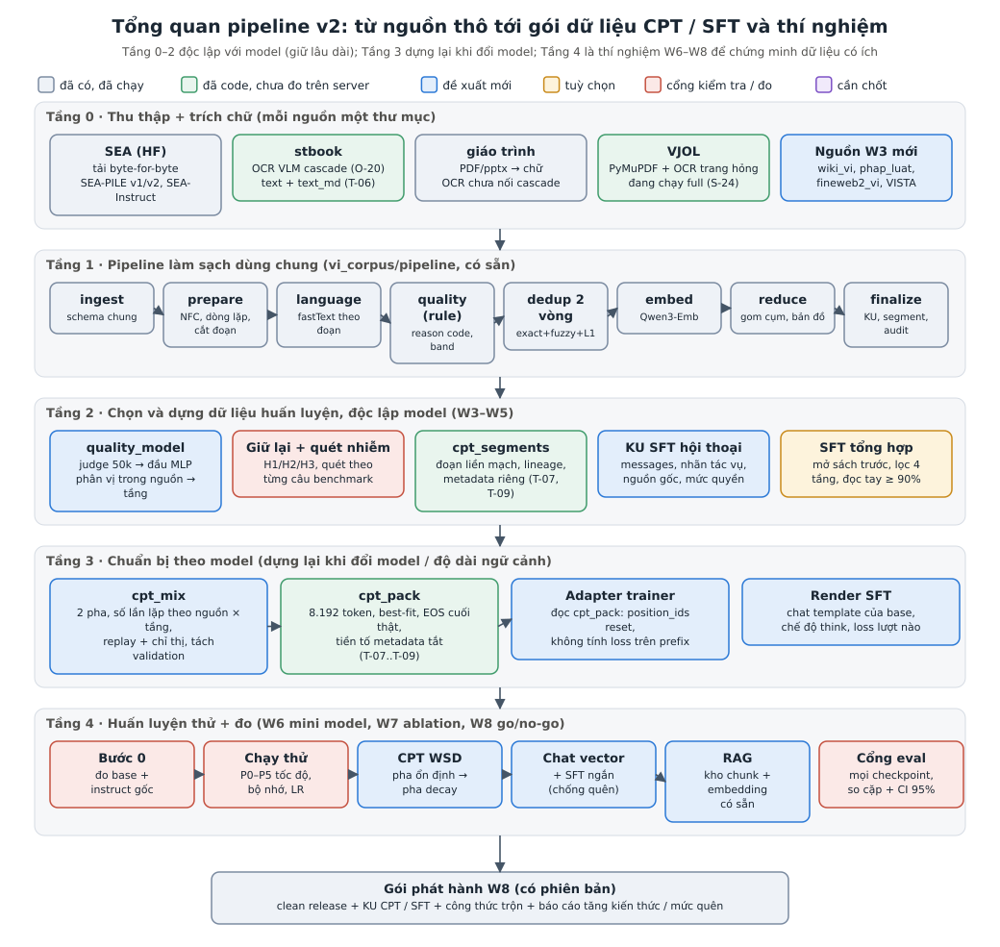
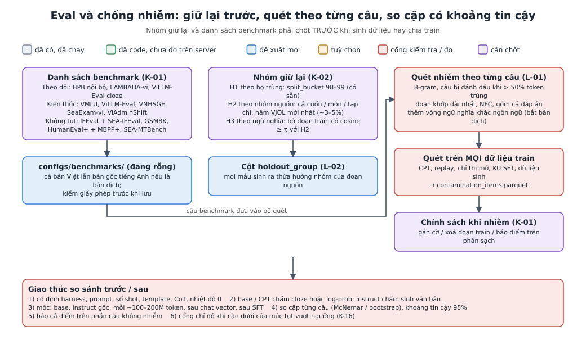
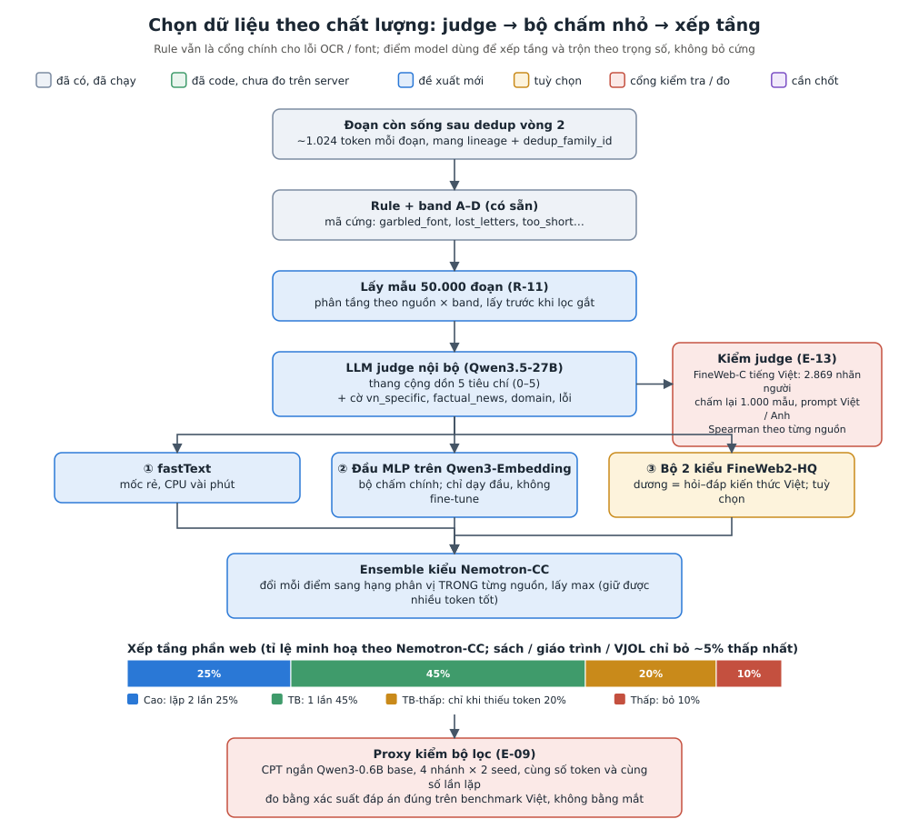
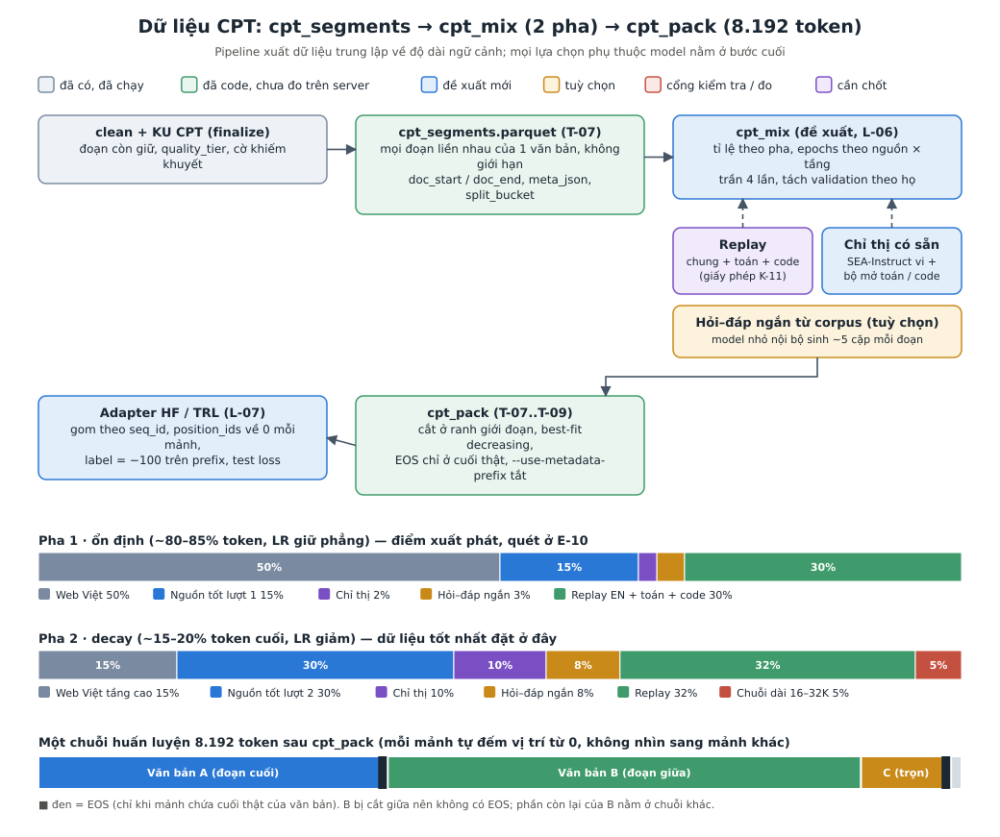
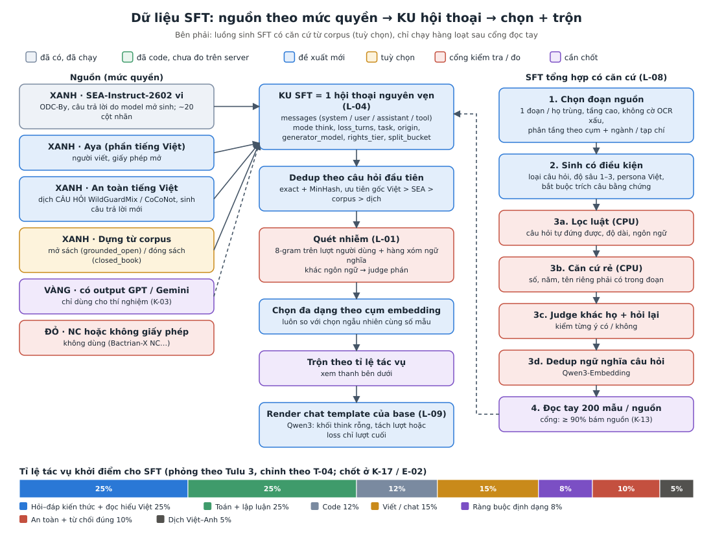
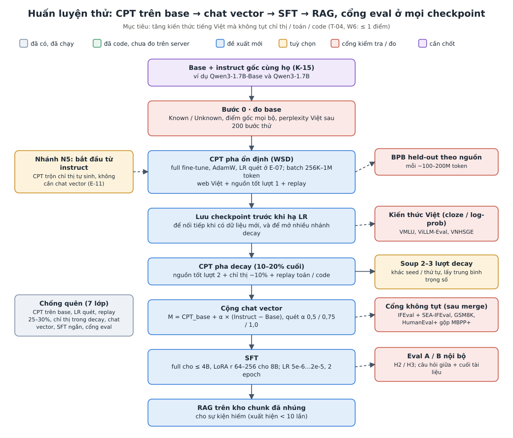
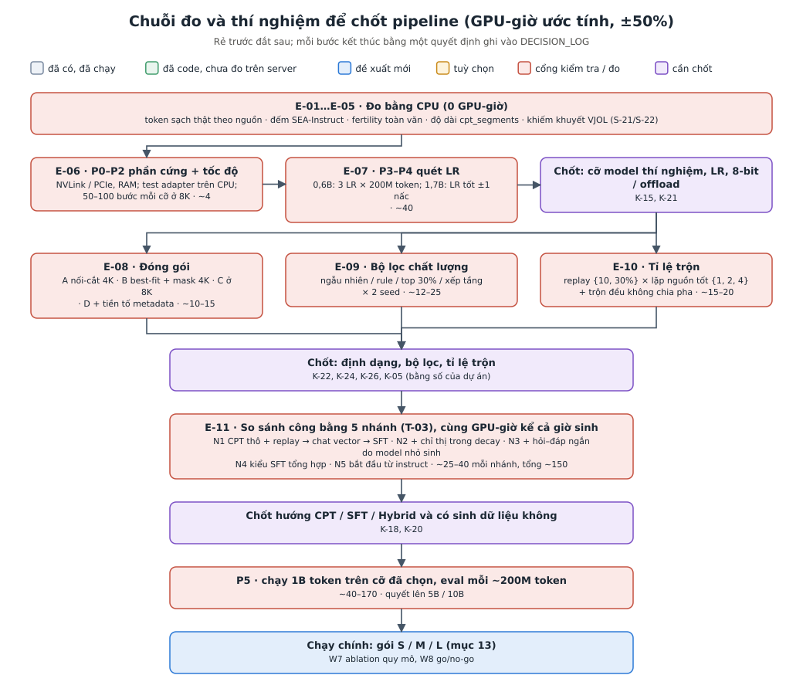

# SUGGESTION v2: pipeline dữ liệu CPT + SFT đầy đủ cho corpus tiếng Việt hàng tỷ token

> **Trạng thái: đề xuất, chưa phải quyết định.** Viết ngày 2026-11-05 theo yêu cầu của chủ dự án. Tổng hợp mọi đợt nghiên cứu: `docs/SUGGESTION.md` (bản đầu), `docs/SUGGESTION_V2_300M.md` (bản viết khi còn tưởng corpus ~300M token, đổi tên từ `SUGGESTION_V2.md`), `reports/Knowledge injection cho SFT tiếng Việt.md`, và 10 ghi chú đợt 2 trong `research_notes/*_v2.md`. Tài liệu này **thay** hai bản SUGGESTION trước ở mọi chỗ mâu thuẫn.
>
> **Các việc cần chủ dự án chốt** để chạy được hoặc chốt được pipeline này nằm ở `docs/TASKS.md`, đánh mã `K-xx` (quyết định), `E-xx` (việc đo / thí nghiệm), `L-xx` (việc code). Tài liệu này dẫn tới các mã đó.
>
> **Độ tin cậy của con số.** Mọi số GPU-giờ là **ước tính trên giấy** (công thức FLOPs + giả định MFU 25–35%), sai khoảng ±50%, chưa đo trên server. Số từ bài báo là tiếng Anh / Trung / ngôn ngữ khác; **chưa có số tiếng Việt** cho hầu hết phương pháp ở đây. Chỗ nào là suy luận của Claude thì ghi rõ.

## Mục lục

1. Tóm tắt một trang
2. Thuật ngữ
3. Bối cảnh và ràng buộc đã chốt
4. Tám nguyên tắc thiết kế
5. Kiến trúc tổng thể
6. Tầng 0–1: thu thập và làm sạch (phần còn thiếu)
7. Eval và chống nhiễm benchmark (làm trước tiên)
8. Chọn dữ liệu theo chất lượng
9. Dữ liệu CPT: segment → trộn → đóng gói
10. Dữ liệu SFT
11. Huấn luyện thử và chống quên
12. Chuỗi thí nghiệm để chốt pipeline
13. Ngân sách GPU
14. Lộ trình theo tuần (W3–W8)
15. Chỗ các bằng chứng mâu thuẫn nhau và cách phân xử
16. Rủi ro và chỗ chưa chắc
17. So với các bản trước
18. Nguồn

---

## 1. Tóm tắt một trang

**Bài toán.** Từ 4 nguồn đang có (SEA, stbook, giáo trình, VJOL) và các nguồn W3 (Wikipedia, pháp luật, FineWeb-2, VISTA), dựng ra dữ liệu để **bơm kiến thức tiếng Việt vào một model mở** bằng CPT, SFT hoặc cách lai, mà **không làm model tụt khả năng làm theo chỉ thị, toán, code**. Dữ liệu sạch dự kiến **hàng tỷ token** (mốc W7: ≥10B token sạch), không phải 300M (T-10).

**Quy mô làm đổi kết luận ở ba chỗ:**
1. **Máy là giới hạn chính, không phải dữ liệu.** CPT hết 15B token trên 4× A100 40GB mất ~3,6 ngày cho model 0,6B, ~6 ngày cho 1,7B, ~26 ngày cho 8B (mục 13). Vì vậy **chọn dữ liệu nào đáng học** quan trọng hơn gom thêm dữ liệu.
2. **Không sinh dữ liệu trên toàn corpus.** Sinh SFT cho cả 15B token mất 3–5 tháng GPU. Chỉ sinh trên phần chọn kỹ (~5% corpus đủ cho chỉ tiêu W5 "2M instruction").
3. **CPT gánh được kiến thức phổ biến.** Ở hàng tỷ token, sự kiện phổ biến tự xuất hiện nhiều lần, nhiều cách viết, đúng điều kiện để CPT nạp được. Kiến thức hiếm (xuất hiện 1–2 lần) để cho RAG hoặc dữ liệu sinh có căn cứ.

**Pipeline đề xuất có 5 tầng** (sơ đồ ở mục 5):

| Tầng | Làm gì | Trạng thái |
|---|---|---|
| 0. Thu thập + trích chữ | tải, OCR VLM, giữ thêm bản markdown `text_md` | phần lớn có; `text_md` đã code (T-06) |
| 1. Làm sạch dùng chung | ingest → prepare → language → quality (rule) → dedup 2 vòng → embed → reduce → finalize | có |
| 2. Chọn + dựng dữ liệu (độc lập model) | nhóm giữ lại + quét nhiễm theo từng câu; bộ chấm chất lượng (judge 50k → đầu MLP) → xếp tầng; `cpt_segments`; KU SFT dạng hội thoại; SFT tổng hợp có căn cứ (tuỳ chọn) | `cpt_segments` đã code; còn lại đề xuất |
| 3. Chuẩn bị theo model | `cpt_mix` 2 pha; `cpt_pack` 8.192 token; adapter cho trainer; render SFT theo chat template | `cpt_pack` đã code; còn lại đề xuất |
| 4. Huấn luyện thử + đo | Bước 0 đo base → chạy thử P0–P5 → CPT lịch WSD → chat vector → SFT → RAG, cổng eval ở mọi checkpoint | đề xuất (W6–W8) |

**Việc nên làm ngay, chỉ cần CPU:** điền danh sách benchmark và sửa bước quét nhiễm (đang quét danh sách rỗng); đếm token sạch thật theo nguồn; đếm SEA-Instruct; đổi KU SFT sang hội thoại nguyên vẹn; viết adapter `cpt_pack`. Sau đó chạy thử ~45 GPU-giờ (P0–P4) rồi chuỗi thí nghiệm ~200 GPU-giờ trước khi chạy chính.

**Quyết định lớn nhất còn mở:** ngân sách GPU thật (K-14) và cỡ model thí nghiệm (K-15). Hai số này quyết định gói S / M / L ở mục 13.

---

## 2. Thuật ngữ

Giải thích bằng lời đơn giản. Cột "Trong dự án" cho biết nó nằm ở đâu.

### 2.1. Khái niệm nền

| Thuật ngữ | Nghĩa đơn giản | Trong dự án |
|---|---|---|
| **Token / tokenizer** | Model không đọc chữ mà đọc "mảnh chữ" gọi là token; tokenizer là bộ cắt chữ thành token. | Đếm bằng tokenizer Qwen3 (R-35): ~1,37 token mỗi âm tiết tiếng Việt. |
| **Fertility** | Số token trung bình cho một âm tiết (hoặc một từ). Càng thấp càng tiết kiệm. | Qwen3 đã tốt với tiếng Việt, chỉ kém Llama-3 / Gemma-2 ~5%. |
| **Mở rộng từ vựng** | Thêm token mới vào tokenizer cho ngôn ngữ đích, rồi phải dạy model các token đó. | **Không làm** (mục 16, K-10): lợi chủ yếu là tốc độ, rủi ro quên lớn. |
| **Base model** | Model mới học đoán chữ tiếp theo trên văn bản thô, chưa được dạy làm theo yêu cầu. | Chỗ CPT chạm vào. |
| **Instruct model** | Base đã được hãng dạy thêm để trả lời như trợ lý. | Khả năng của nó là thứ sợ làm mất. |
| **Chế độ suy nghĩ (thinking)** | Model viết ra chuỗi suy luận trong thẻ `<think>` trước khi trả lời. Qwen3 có cả hai chế độ. | Mặc định không dùng (K-17). |
| **Trọng số (weights)** | Các con số (hàng tỷ) tạo nên model; huấn luyện là chỉnh chúng. | |
| **Bịa (hallucination)** | Model trả lời trôi chảy nhưng sai sự thật. | Rủi ro chính khi SFT dạy kiến thức mới. |
| **Mở sách / đóng sách** | Mở sách: đưa tài liệu kèm câu hỏi. Đóng sách: chỉ hỏi, model phải tự nhớ. | `grounded_open` / `closed_book` ở mục 10. |

### 2.2. Các cách huấn luyện

| Thuật ngữ | Nghĩa đơn giản | Trong dự án |
|---|---|---|
| **CPT (continued pretraining)** | Cho base đọc thêm văn bản thô, như tiền huấn luyện nhưng nhỏ hơn. | Trục chính để nạp kiến thức phổ biến. |
| **SFT (supervised fine-tuning)** | Dạy model từ các mẫu "yêu cầu → câu trả lời mẫu". Chủ yếu dạy cách hành xử. | Sau CPT; dữ liệu ở mục 10. |
| **Hybrid / midtraining** | Trộn dữ liệu chỉ thị (hỏi–đáp) vào chính lúc CPT, thường ở giai đoạn cuối. | Pha 2 của `cpt_mix` (mục 9.3). |
| **Full fine-tune** | Chỉnh toàn bộ trọng số. | Mặc định cho CPT ở quy mô tỷ token. |
| **LoRA** | Không sửa trọng số gốc, chỉ dạy một "miếng vá" nhỏ gắn thêm. Rẻ bộ nhớ. | Cho SFT model 8B khi thiếu bộ nhớ; **không** cho CPT tỷ token (kém xa full). |
| **Epoch / số lần lặp** | Một lượt đọc hết dữ liệu. Lặp 2 lần = đọc 2 lần. | Web 1 lần; nguồn tốt 2 lần, trần 4 (mục 9.4). |
| **Learning rate (LR)** | Mỗi bước chỉnh trọng số mạnh cỡ nào. Cao học nhanh nhưng dễ quên. | Phải quét (E-07), mục 15 có mâu thuẫn. |
| **Lịch WSD** | Warmup – Stable – Decay: tăng LR ngắn, giữ phẳng lâu, rồi hạ dần ở 10–20% cuối. | Mặc định; dữ liệu tốt nhất đặt ở pha hạ LR. |
| **Batch** | Số token xử lý trong một bước cập nhật. | 256–512K token khi < 2B token; ~1M khi 5–15B. |
| **Checkpoint** | Bản lưu model giữa chừng. | Lưu trước khi hạ LR để nối tiếp khi có dữ liệu mới. |
| **Replay (ôn lại)** | Trộn dữ liệu "cũ" (tiếng Anh, toán, code) để model không quên. | 25–30% điểm xuất phát (mục 9.3). |
| **Catastrophic forgetting (quên)** | Học cái mới làm mất khả năng cũ. | Phải giữ: chỉ thị, toán, code (T-04). |
| **Chat vector** | Lấy phần chênh `instruct − base` cộng vào model vừa CPT, để trả lại khả năng chat mà không phải dạy lại. | Bước sau CPT (mục 11). |
| **Model soup** | Lấy trung bình trọng số của vài lượt chạy ngắn khác nhau để ổn định hơn. | Tuỳ chọn cho pha decay. |
| **Overtrained base ("quá no")** | Model nhỏ đã được tiền huấn luyện rất lâu (Qwen3 ~36T token) thường nhạy hơn khi bị huấn luyện tiếp. | Lý do không ra quyết định chỉ từ 0,6B. |

### 2.3. Dữ liệu và pipeline

| Thuật ngữ | Nghĩa đơn giản | Trong dự án |
|---|---|---|
| **Đoạn (chunk)** | Mẩu văn bản ~1.024 token (tối đa 2.048), cắt ưu tiên ở tiêu đề. | Đơn vị lọc, chấm, nhúng, dedup (D-10). |
| **Segment (đoạn liền mạch)** | Mọi đoạn liền nhau còn giữ của cùng một văn bản, nối lại, không giới hạn độ dài. | `cpt_segments.parquet` (T-07). |
| **Knowledge unit (KU)** | Đơn vị dữ liệu huấn luyện có đủ nguồn gốc: KU CPT (một đoạn), KU SFT (một hội thoại, đề xuất). | Chỉ tiêu "candidate" / "instruction" đếm theo KU (R-09). |
| **Lineage (nguồn gốc)** | Mỗi mẫu biết nó đến từ file nào, trang nào, nguồn nào. | KPI ≥95%. |
| **Dedup exact / fuzzy / semantic** | Bỏ bản trùng: giống hệt; gần giống chữ (MinHash); giống ý (embedding). | 2 vòng (`dedup.py`, `dedup_global.py`). |
| **Họ trùng (`dedup_family_id`)** | Nhóm các văn bản gần giống nhau; cả họ luôn rơi cùng một phía train / test. | Chống lộ đề. |
| **`split_bucket`** | Số 0–99 tính từ họ trùng; ví dụ 0–89 train, 90–97 val, 98–99 test. | Dùng ở `cpt_pack --buckets`. |
| **Nhóm giữ lại (holdout)** | Phần dữ liệu cố ý không cho model thấy để đo xem nó có học thật không. | H1 / H2 / H3 ở mục 7. |
| **Rights tier (mức quyền)** | Xanh: được dùng; vàng: chỉ thí nghiệm; đỏ: không dùng. | Đề xuất, K-03. |
| **`text_md`** | Bản markdown gốc của OCR (giữ tiêu đề `#`, bảng, công thức), cạnh chữ thuần `text`. | Đã lưu từ T-06; pipeline chưa đọc. |
| **Metadata prefix** | Dòng "Tiêu đề / Tạp chí / Năm…" đặt trước văn bản khi huấn luyện (cách MeCo). | Thu sẵn, tắt mặc định (T-09). |

### 2.4. Chọn dữ liệu theo chất lượng

| Thuật ngữ | Nghĩa đơn giản | Trong dự án |
|---|---|---|
| **Rule / band** | Luật cứng (quá ngắn, lỗi font, sai ngôn ngữ…) cho mỗi đoạn một mã lý do và một band A–D. | Có sẵn (`quality.py`), là cổng chính cho lỗi OCR. |
| **LLM judge** | Một model lớn đọc đoạn văn và chấm điểm theo bảng tiêu chí (rubric). | Qwen3.5-27B chấm 50.000 đoạn (R-11, R-12). |
| **Rubric cộng dồn** | Mỗi tiêu chí đạt được cộng 1 điểm (0–5), ổn định hơn hỏi thẳng một điểm. | Đề xuất thay bản nháp Q6-thang (K-06). |
| **Bộ chấm nhỏ (quality classifier)** | Model rẻ học bắt chước điểm của judge để chấm cả corpus. | Đầu MLP trên Qwen3-Embedding (mục 8). |
| **Đầu MLP trên embedding đóng băng** | Giữ nguyên model embedding, chỉ dạy thêm một mạng nhỏ 1 lớp ẩn ở trên. | Thắng fastText và thắng fine-tune cả model (JQL, FineWeb2-HQ). |
| **Ensemble** | Gộp nhiều bộ chấm; ở đây đổi mỗi điểm sang hạng phân vị rồi lấy max. | Cách Nemotron-CC. |
| **Phân vị trong nguồn** | Xếp hạng đoạn so với các đoạn cùng nguồn, thay vì so với ngưỡng tuyệt đối. | Tránh "nguồn này luôn điểm cao". |
| **Xếp tầng (tier)** | Chia dữ liệu thành cao / TB / TB-thấp / thấp; tầng cao được lặp nhiều hơn, tầng thấp bỏ. | Thay cho "bỏ cứng dưới ngưỡng". |
| **Proxy (model thử)** | Huấn luyện ngắn một model nhỏ để so các lựa chọn dữ liệu trước khi chạy thật. | Qwen3-0.6B / 1.7B. |
| **Khớp số lần lặp** | Khi thu nhỏ thí nghiệm, phải giữ số lần mỗi đoạn được lặp như lượt thật, nếu không kết quả lệch. | Quy tắc cho E-09, E-10. |

### 2.5. CPT và đóng gói

| Thuật ngữ | Nghĩa đơn giản | Trong dự án |
|---|---|---|
| **Độ dài ngữ cảnh / chuỗi** | Số token model nhìn cùng lúc trong một mẫu huấn luyện. | 8.192 (T-08). |
| **Packing (đóng gói)** | Ghép nhiều văn bản ngắn vào một chuỗi đủ dài để không phí chỗ. | `cpt_pack`. |
| **Best-fit decreasing** | Xếp mảnh to trước, mỗi mảnh vào chuỗi còn chỗ trống vừa nhất. Ít phải cắt văn bản hơn. | Đọc hiểu +4,7% (Ding 2024). |
| **Che attention giữa tài liệu** | Trong một chuỗi ghép, mỗi văn bản chỉ "nhìn" chính nó, không nhìn văn bản đứng trước. | Nhớ kiến thức +12–37%; adapter phải làm (L-07). |
| **EOS** | Token "hết văn bản". | Chỉ đặt ở cuối thật của văn bản; mảnh bị cắt giữa không có. |
| **`position_ids` / `cu_seqlens`** | Cách báo cho trainer biết chỗ bắt đầu từng mảnh trong chuỗi ghép. | Adapter đặt lại về 0 ở đầu mỗi mảnh. |
| **Loss mask (label = −100)** | Không tính lỗi trên một phần chữ (ví dụ prefix, câu hỏi), model không bị dạy viết phần đó. | Prefix metadata; câu hỏi trong SFT. |
| **D-AR** | Thay ngẫu nhiên ~20% token đầu vào khi CPT để model phải học sâu hơn thay vì thuộc lòng. | Biến thí nghiệm, chưa mặc định. |
| **Lời nguyền perplexity** | Perplexity (độ "bất ngờ") trên tài liệu xuống rất thấp nhưng model vẫn không trả lời đúng câu hỏi về nó. | Lý do đo bằng hỏi–đáp, không bằng perplexity. |
| **BPB (bits per byte)** | Độ bất ngờ đo trên mỗi byte, không phụ thuộc tokenizer. | Theo dõi checkpoint rẻ. |

### 2.6. SFT

| Thuật ngữ | Nghĩa đơn giản | Trong dự án |
|---|---|---|
| **Chat template** | Khuôn chữ hãng quy định để bọc hội thoại (vai trò, thẻ đặc biệt) trước khi đưa vào model. | Qwen3 có bẫy về thẻ `<think>` (mục 10.4). |
| **Grounded (có căn cứ)** | Câu trả lời chỉ dùng thông tin có trong đoạn nguồn. | Cổng ≥90% bám nguồn (K-13). |
| **Câu bằng chứng** | Câu trích nguyên văn từ đoạn nguồn làm chỗ dựa cho câu trả lời. | Bắt buộc khi sinh. |
| **NLI / kiểm suy diễn** | Hỏi "đoạn A có suy ra được ý B không". | Một tầng lọc. |
| **Round-trip (hỏi lại)** | Cho model khác đọc đoạn + câu hỏi, tự trả lời, rồi so với đáp án đã sinh. | Tầng 3c. |
| **Known / Unknown** | Xếp sự kiện theo việc model đã biết chưa (hỏi nhiều lần xem đúng bao nhiêu). | Bước 0; điều kiện cho `closed_book`. |
| **Persona** | Một "vai người hỏi" (sinh viên năm 1, kỹ sư…) dùng để đa dạng hoá câu hỏi. | Bộ persona Việt nhỏ theo ngành. |
| **SDFT** | Cho chính model đích viết lại câu trả lời bằng giọng của nó, để SFT ít làm lệch model. | Tuỳ chọn. |
| **MoE / AWQ 4-bit** | MoE: model chỉ bật một phần tham số mỗi lần nên nhanh. AWQ 4-bit: nén trọng số còn 4 bit để chạy nhanh, có thể giảm chất lượng. | Model sinh: đo BF16 so với 4-bit trước (E-12). |

### 2.7. Phần cứng và chi phí

| Thuật ngữ | Nghĩa đơn giản | Trong dự án |
|---|---|---|
| **GPU-giờ** | Một GPU chạy một giờ. 4 GPU chạy 1 giờ = 4 GPU-giờ. | Đơn vị ngân sách. |
| **MFU** | Phần trăm sức tính lý thuyết của GPU mà lượt chạy dùng được thật. | Giả định 25–35%, phải đo (E-06). |
| **ZeRO-3 / FSDP** | Chia trạng thái model và optimizer ra nhiều GPU để model lớn vừa bộ nhớ. | Bắt buộc cho 4B / 8B. |
| **AdamW 8-bit / offload** | Hai cách giảm bộ nhớ optimizer: nén còn 8 bit, hoặc đẩy sang RAM CPU. | 8B trên 40GB phải chọn một (K-21). |
| **FlashAttention-2, Liger / CCE** | Các kernel tính nhanh và tiết kiệm bộ nhớ; Liger / CCE tránh phải giữ cả bảng xác suất 151.936 từ. | Bắt buộc ở 8K. |

### 2.8. Eval và nhiễm

| Thuật ngữ | Nghĩa đơn giản | Trong dự án |
|---|---|---|
| **Benchmark** | Bộ đề chuẩn để chấm model. | Danh sách ở mục 7.1 (K-01). |
| **Nhiễm (contamination)** | Đề thi lọt vào dữ liệu huấn luyện, làm điểm cao giả. | VMLU lấy câu từ giáo trình / đề thi trên mạng: rủi ro thật với corpus này. |
| **Quét n-gram** | So từng cụm n chữ liên tiếp giữa đề và dữ liệu. | Đổi từ 13-gram theo tài liệu sang 8-gram theo từng câu (L-01). |
| **Cloze / log-prob** | Chấm bằng xác suất model gán cho đáp án đúng, không cần model sinh chữ. Ổn định hơn với model nhỏ. | Dùng cho checkpoint base / CPT. |
| **So cặp + khoảng tin cậy** | So hai model trên cùng từng câu hỏi (McNemar / bootstrap) và báo khoảng sai số 95%. | Cổng eval (K-16). |
| **Eval A / Eval B** | Bộ đề nội bộ: A hỏi sự kiện đã dạy; B đo tỉ lệ bịa. | Dựng từ nhóm giữ lại H2 / H3. |
| **RAG** | Tìm đoạn liên quan trong kho rồi đưa kèm câu hỏi cho model đọc. | Kênh cho kiến thức hiếm. |

---

## 3. Bối cảnh và ràng buộc đã chốt

| Mã | Nội dung | Ảnh hưởng tới pipeline |
|---|---|---|
| T-01 | Chưa có ngân sách GPU cố định; đề xuất phải chia mức và ghi GPU-giờ | Mục 13 có gói S / M / L |
| T-02 | Chỉ GPU nội bộ (4× A100 40GB), không gọi API model đóng | Mọi judge / model sinh là model mở chạy trong nhà |
| T-03 | So sánh công bằng CPT, SFT, lai rồi mới chọn | Thí nghiệm E-11 (mục 12) |
| T-04 | Không được tụt chỉ thị / chat, lập luận / toán / code; tiếng Anh không bắt buộc; giữ RAG | Replay toán / code bắt buộc; cổng eval |
| T-06 | Lưu `text_md` của OCR VLM | Đã code |
| T-07 | `cpt_segments` + `cpt_pack` thay `cpt_blocks` | Đã code |
| T-08 | Ngữ cảnh CPT 8.192, không train thẳng 32K | Mặc định `cpt_pack` |
| T-09 | Metadata thu sẵn, tiền tố tắt mặc định | Cờ `--use-metadata-prefix` |
| T-10 | Dữ liệu hàng tỷ token | Toàn bộ tài liệu này |
| R-23 | Phạm vi dự án là dữ liệu cho SFT + CPT | Tầng 4 chỉ là thí nghiệm chứng minh (W6–W8), không phải huấn luyện sản phẩm |
| R-35, D-11 | Tokenizer Qwen3 đếm KPI; embedding Qwen3-Embedding-0.6B | Giữ nguyên |
| Bảng Milestone | W4 ≥1,5B sạch, W5 ≥2B sạch + ≥2M instruction, W6 ≥3B + mini model "tăng kiến thức, tụt chung ≤1 điểm", W7 ≥10B sạch, W8 go/no-go | Lộ trình mục 14 |

**Lưu ý:** số W3 (raw ≥30B / clean ≥15B) đọc từ ảnh nhỏ và chưa được xác nhận (R-10, N-12). Tài liệu này lấy **W7 ≥10B token sạch** làm quy mô làm việc và tính chi phí ở 1B / 5B / 10–15B. Xác nhận lại ở K-08.

---

## 4. Tám nguyên tắc thiết kế

1. **Dữ liệu trung lập với model ở Tầng 0–2.** Không "nướng" độ dài ngữ cảnh, tokenizer hay template vào dữ liệu gốc. Đổi model chỉ phải chạy lại Tầng 3. (Lý do: model đích chưa chốt, R-21 / R-23.)
2. **Giữ lại và chống nhiễm trước, chọn dữ liệu sau.** Nhóm giữ lại và danh sách benchmark phải chốt **trước** khi sinh hay trộn bất cứ thứ gì; mọi mẫu sinh ra thừa hưởng họ trùng và nhóm giữ lại của đoạn nguồn.
3. **Rẻ trước, đắt sau.** Rule → fastText → dedup → embedding → judge; luật CPU trước judge GPU khi lọc dữ liệu sinh.
4. **Xếp tầng thay vì vứt bỏ.** Với mốc ≥10B token, lọc gắt kiểu "giữ 8%" sẽ hết dữ liệu. Điểm chất lượng dùng để quyết **lặp bao nhiêu lần**.
5. **Đo bằng hỏi–đáp, có thống kê.** Perplexity thấp không chứng minh đã nạp kiến thức; điểm benchmark nhỏ dao động ±3–7, nên so cặp và có khoảng tin cậy.
6. **Mọi số phải là số của dự án trước khi chạy lớn.** Mỗi lựa chọn đắt (LR, tỉ lệ trộn, bộ lọc, định dạng, hướng CPT / SFT) có một thí nghiệm proxy rẻ đi trước.
7. **Lineage và quyền đi theo từng dòng.** Không join ngược khi cần; `rights_status`, `rights_tier`, `source_*` có trên mọi file đầu ra.
8. **Chạy được trên quy mô tỷ token.** Đọc Parquet theo lô, ghi nguyên tử, checkpoint theo file, không nạp cả corpus vào RAM (đã áp cho `cpt_pack`).

---

## 5. Kiến trúc tổng thể

| Tầng | Đầu vào | Đầu ra chính | Phụ thuộc model? |
|---|---|---|---|
| 0 | nguồn thô | `interim/<nguồn>_text/*.json` (có `text_md` cho trang OCR VLM) | không |
| 1 | đầu ra Tầng 0 | `clean.parquet`, `knowledge_units.parquet`, `cpt_segments.parquet`, `audit.json`, `report.html` | chỉ tokenizer để đếm |
| 2 | đầu ra Tầng 1 | cột `quality_tier`, `holdout_group`; `contamination_items.parquet`; KU SFT hội thoại; `sft_synth.parquet` (tuỳ chọn) | không |
| 3 | đầu ra Tầng 2 | `cpt_mix` manifest; `cpt_packed/*.parquet`; SFT đã render | có |
| 4 | đầu ra Tầng 3 | checkpoint, bảng eval, báo cáo tăng kiến thức / mức quên | có |

---

## 6. Tầng 0–1: thu thập và làm sạch (phần còn thiếu)

Phần lớn đã có và đang chạy (VJOL full, S-24). Việc thêm:

| Việc | Vì sao | Mã |
|---|---|---|
| Đưa `text_md` vào segment (`text_format = md` khi có) | Giữ bảng, công thức, tiêu đề cho CPT; bộ lọc vẫn chạy trên `text` | K-23, L-13 |
| OCR lại stbook để có `text_md` | stbook OCR xong trước T-06 nên không có markdown; ~16 giờ trên 4 GPU (~64 GPU-giờ) | K-23 |
| Đọc toàn bộ ~20 cột nhãn của SEA-Instruct vào `meta` | Đang chỉ đọc `conversations`, bỏ mất loại tác vụ, cờ dịch, độ nhạy cảm | L-03 |
| Nguồn W3: `wiki_vi`, `phap_luat`, `fineweb2_vi`, VISTA | Đủ mốc token và miền | đã chốt Q7; VISTA chờ cấu trúc |
| Report: token theo nguồn × tầng, phân bố độ dài segment (p50, p90, % > 4K / 8K / 32K), thêm số âm tiết và byte | Cần để chốt tỉ lệ trộn, độ dài, KPI không phụ thuộc tokenizer | L-12, K-09 |
| Bộ lọc nội dung người lớn / độc hại cho web | I-05 thấy đoạn khiêu dâm trong SEA-PILE v2; pipeline chưa có bộ lọc này | K-05 (gộp vào rubric judge + cờ) |

---

## 7. Eval và chống nhiễm benchmark (làm trước tiên)

**Vì sao đứng trước:** bước quét nhiễm hiện có (`vi_corpus/pipeline/contamination.py`) đang chạy với **danh sách rỗng** (`configs/benchmarks/` trống, R-16), và có 5 điểm yếu: đếm theo tài liệu thay vì theo câu đề; một cụm 13 chữ trùng là đủ gắn cờ; đáp án bị tách nên không bao giờ khớp; đề không chuẩn hoá NFC; chỉ chạy trên mẫu. Trong khi đó VMLU lấy câu hỏi từ "giáo trình công khai, đề thi đại học trên mạng", đúng loại dữ liệu nằm trong `giao_trinh` và SEA-PILE.

### 7.1. Danh sách benchmark đề xuất (K-01)

| Nhóm | Bộ | Dùng ở đâu |
|---|---|---|
| Theo dõi checkpoint (rẻ, ổn định) | BPB trên nhóm giữ lại theo nguồn, LAMBADA-vi, ViLLM-Eval dạng cloze | Mỗi ~100–200M token |
| Kiến thức tiếng Việt | VMLU (dev + valid tại chỗ; test nộp vmlu.ai cho mốc cuối), ViLLM-Eval Exam + General Knowledge, VNHSGE, SeaExam-vi, ViAdminShift (kiến thức lỗi thời: 63 → 34 tỉnh) | Trước / sau CPT, sau SFT |
| Cổng không tụt (T-04) | IFEval + SEA-IFEval, GSM8K, HumanEval+ **gộp** MBPP+ (HumanEval chỉ 164 bài, dao động ±7,5 điểm), SEA-MTBench chấm bằng judge nội bộ | Mọi checkpoint sau merge / SFT |
| Đọc tài liệu (cho RAG) | Eval mở sách từ nhóm giữ lại H2 | Sau SFT |

VJOL không có benchmark công khai nào khớp, nên phải tự dựng Eval A / B.

### 7.2. Nhóm giữ lại: ba mức (K-02)

| Mức | Giữ lại gì | Đo gì | Tốn |
|---|---|---|---|
| H1 theo họ trùng | `split_bucket` 98–99 (có sẵn) | BPB theo nguồn | ~2% |
| H2 theo nhóm nguồn | cả cuốn stbook, cả môn giáo trình, cả tạp chí VJOL, **năm VJOL mới nhất** | Kiến thức có chuyển sang tài liệu chưa thấy không; Eval B dựng từ đây | ~3–5% |
| H3 theo ngữ nghĩa | bỏ khỏi train mọi đoạn có cosine ≥ τ với đoạn của H2 (dùng embedding có sẵn) | Eval "chưa thấy" thật, không lộ qua bản viết lại | tuỳ τ |

Lý do cần H2 / H3: họ trùng chỉ gom bản gần giống chữ; cùng một sự kiện viết bằng chữ khác (hai giáo trình khác tác giả) vẫn rơi hai phía. Cột mới `holdout_group` cạnh `split_bucket` (L-02).

### 7.3. Quét nhiễm theo từng câu (L-01)

- Đơn vị là **câu benchmark** (gồm cả đáp án), chuẩn hoá NFC như corpus.
- Một câu bị đánh dấu khi **> 50% token** của nó nằm trong các 8-gram trùng (cách Tulu 3), kèm độ dài đoạn khớp dài nhất (ConTAM).
- Thêm một vòng **ngữ nghĩa khác ngôn ngữ** (Qwen3-Embedding tìm hàng xóm gần, judge phán), vì bản dịch của MMLU / GSM8K làm tăng điểm mà n-gram không bắt.
- Quét trên **mọi** dữ liệu train: CPT, replay, bộ chỉ thị mở, KU SFT, dữ liệu sinh. Ghi `contamination_items.parquet` (mỗi câu: độ phủ, đoạn khớp dài nhất, `doc_id` khớp).
- Chính sách khi nhiễm (K-01): đề xuất **xoá đoạn train trùng với bộ dùng làm cổng**, chỉ gắn cờ với các bộ còn lại, và luôn báo thêm điểm trên phần câu không nhiễm.

### 7.4. Giao thức so sánh

1. Cố định harness, prompt, số shot, chat template, CoT bật / tắt, nhiệt độ 0; ghi cấu hình vào kết quả. (VMLU: bật CoT làm model 1B tụt 37,6 → 25,7, lớn hơn mọi chênh lệch cần đo.)
2. Checkpoint base / CPT chấm bằng cloze hoặc log-prob; model instruct / đã merge chấm bằng sinh văn bản. So cùng loại với cùng loại.
3. Mốc: base, instruct gốc, mỗi ~100–200M token, sau chat vector, sau SFT; trung bình 2–3 checkpoint cuối.
4. So cặp từng câu, khoảng tin cậy 95%. **Cổng chỉ đỏ khi cận dưới của mức tụt vượt ngưỡng** (K-16). W6 ghi "tụt chung ≤1 điểm": với bộ nhỏ, ngưỡng này nằm trong nhiễu, nên phải gộp bộ lớn hơn.
5. Eval A phải có câu hỏi về sự kiện ở **giữa và cuối** tài liệu, báo điểm theo vị trí (cột `answer_position`).

---

## 8. Chọn dữ liệu theo chất lượng

**Kế hoạch hiện có (Q6, R-11, R-12) đúng hướng** với các bài mạnh nhất 2024–2025 (FineWeb-Edu, Nemotron-CC, JQL): LLM chấm một mẫu → dạy bộ chấm nhỏ → chấm cả corpus. Đề xuất chỉnh:

1. **Rubric cộng dồn 5 tiêu chí** (K-06): (1) có thông tin thật, không phải quảng cáo / spam; (2) mạch lạc, đọc được, không vỡ do OCR / font; (3) có kiến thức dùng được; (4) giải thích có hệ thống; (5) đạt mức giáo trình / bài báo tốt. **Không** giới hạn ở "kiến thức phổ thông" như prompt FineWeb-Edu, vì prompt đó hạ điểm giáo trình đại học và VJOL. Thêm cờ `vn_specific` (văn hoá, lịch sử, địa danh, luật Việt Nam) và `factual_news` để không lọc mất kiến thức Việt đuôi dài; thêm cờ nội dung người lớn / độc hại.
2. **Kiểm judge mà không cần chấm tay:** dùng FineWeb-C tiếng Việt (2.869 nhãn người, kiểm giấy phép), chấm lại 1.000 mẫu bằng prompt tiếng Anh để so với prompt Việt, báo Spearman theo từng nguồn (E-13).
3. **Bộ chấm chính = đầu MLP trên Qwen3-Embedding** (chỉ dạy đầu); fastText làm mốc rẻ; tuỳ chọn thêm bộ thứ hai kiểu FineWeb2-HQ (dương = hỏi–đáp kiến thức tiếng Việt). Cần bật lại bước nhúng cho bản full (đang `--embedder none` theo J-59) hoặc chạy bước nhúng riêng chỉ để chấm: ~18–35 GPU-giờ cho 10B token (K-07).
4. **Ensemble:** đổi điểm mỗi bộ sang hạng phân vị **trong từng nguồn**, lấy max.
5. **Xếp tầng phần web** (tỉ lệ minh hoạ theo Nemotron-CC): cao ~25% lặp 2 lần, TB ~45% 1 lần, TB-thấp ~20% chỉ dùng khi thiếu token, thấp ~10% bỏ. Giữ ~70% token web. **Sách / giáo trình / VJOL:** điểm chỉ để gắn nhãn và trộn, chỉ bỏ ~5% thấp nhất; rule lỗi font / OCR (band D, mã cứng) vẫn là cổng chính (K-05).
6. **Chống học đường tắt "nguồn = chất lượng":** chia train / test bộ chấm theo họ trùng, yêu cầu Spearman **trong từng nguồn** > 0,5.
7. **Ngưỡng cuối chọn bằng proxy** (E-09), không bằng mắt.

Đầu ra: stage mới `quality_model` (sau `dedup`, trước `finalize`) ghi `quality_model_score`, `quality_pct`, `quality_tier`, `judge_flags` (L-05); segment mang `quality_tier` để `cpt_mix` chọn mà không đọc lại chữ.

**SFT:** ở kho cỡ triệu mẫu như SEA-Instruct, các bộ chọn phức tạp (IFD, Deita) thường **không hơn chọn ngẫu nhiên**; đa dạng và độ dài là tín hiệu ổn định nhất. Vì vậy: lọc rác bằng rule + rubric, chọn đều theo cụm embedding, **luôn so với chọn ngẫu nhiên cùng số mẫu**.

---

## 9. Dữ liệu CPT: segment → trộn → đóng gói

### 9.1. `cpt_segments.parquet` (đã code, T-07)

Một dòng = mọi đoạn liền nhau còn giữ của một văn bản. Có: `segment_id` ổn định (`<parent_doc_id>:s<chunk_start>`), lineage + quyền + họ trùng trên dòng, `chunk_token_counts` / `chunk_char_offsets`, `doc_start` / `doc_end` / `doc_complete`, `break_reason`, `quality_bands`, `title`, `meta_json` (tiêu đề, tạp chí, năm, DOI, ngành, môn, danh mục, nguồn), `text_format`. Cần thêm khi có: `quality_tier` (L-05), `holdout_group` (L-02), `text_md` (L-13).

Lưu ý: run lấy mẫu (`--mix`, `--total`) cắt văn bản thành nhiều segment rời; **dữ liệu huấn luyện thật phải sinh từ run không lấy mẫu**.

### 9.2. `cpt_mix` (đề xuất, L-06)

Stage mới, CPU, giữa Tầng 2 và `cpt_pack`. Việc: chọn segment theo `split_bucket` / `holdout_group`, gán **số lần lặp** theo nguồn × tầng, gán **pha** (1 hoặc 2), thêm replay và chỉ thị, tách tập validation theo họ trùng (mỗi nguồn một phần), đếm token bằng tokenizer của base, ghi manifest (mỗi đoạn được lặp mấy lần, ở pha nào) để truy nguồn và để proxy khớp số lần lặp.

### 9.3. Tỉ lệ trộn 2 pha (điểm xuất phát, quét ở E-10)

Bằng chứng: NVIDIA (Parmar 2024) — chuyển sang hỗn hợp chất lượng cao khi LR còn 1/5 đỉnh cho 56,1 so với 52,8 nếu trộn từ đầu; MiniCPM — trộn SFT vào pha decay rồi SFT 6B thắng SFT gấp đôi; OLMo 2 — ~7–9% chỉ thị trong pha anneal; Apertus — ~1,2% chỉ thị, lặp ×5 thì hỏng an toàn.

| Thành phần | Pha 1 (~80–85% token, LR phẳng) | Pha 2 (~15–20% cuối, LR giảm) |
|---|---|---|
| Web Việt (SEA-PILE v1/v2, FineWeb-2 vi), tầng cao + TB | ~50% | ~15% (chỉ tầng cao) |
| Nguồn Việt tốt (stbook, giáo trình, VJOL, pháp luật, Wikipedia) | ~15% (lượt 1) | ~30% (lượt 2) |
| Chỉ thị có sẵn (SEA-Instruct vi, bộ mở toán / code) | ~2% | ~10% |
| Hỏi–đáp ngắn sinh từ corpus (nếu làm, mục 10.6) | ~3% | ~8% |
| Replay tiếng Anh chung + toán + code (toán / code ≥ một nửa) | ~30% | ~32% |
| Chuỗi dài 16–32K từ văn bản còn nguyên (chỉ nếu cần ngữ cảnh dài, K-22) | 0 | ~5% |

**Replay 25–30%, không phải 1%:** Apple đo được 1% replay đủ giữ *loss*, nhưng đo trên model ≤1,3B bằng loss, không đo IFEval / GSM8K / HumanEval. T-04 đòi giữ *kỹ năng*, nên bắt đầu ở 25–30% và thử 10% ở E-10. Ở quy mô 10B token, 25% là ~3–4B token dữ liệu ngoài: **phải kiểm giấy phép** (K-11).

**Thiếu chỉ thị tiếng Việt:** 10% của pha 2 trên vài tỷ token là hàng trăm triệu token chỉ thị. Nếu SEA-Instruct vi không đủ (E-02) thì: hạ tỉ lệ, thêm phần đa ngôn ngữ / tiếng Anh "xanh" của SEA-Instruct, hoặc sinh thêm (mục 10.6). **Không** lặp một nguồn chỉ thị quá ~2 lần.

### 9.4. Quy tắc lặp

- Web: 1 lần. Nguồn tốt: tổng 2 lần, **trần cứng 4 lần** cho mọi đoạn (Muennighoff: tới ~4 lần gần như dữ liệu mới; Parmar: 2 lần tốt nhất).
- **Chỉ lặp phần sạch nhất:** tầng cao, không mã `garbled_font` / `lost_letters` / khiếm khuyết `defects.py`. Lặp đoạn lỗi là dạy lỗi 2 lần.
- **Lượt lặp nguyên văn hay khác dạng?** Bằng chứng nạp kiến thức nói bản lặp nên khác dạng (xáo câu, viết lại); bằng chứng trộn dữ liệu nói lặp nguyên văn 2 lần là tốt. Đưa vào thí nghiệm (K-26, mục 15).
- Ở quy mô lớn, với model 8B chọn lọc, có thể **không cần lặp**: chọn phần tốt nhất vừa ngân sách thay vì lặp.

### 9.5. `cpt_pack` (đã code) và adapter (L-07)

`scripts/cpt_pack.py` cắt segment ở ranh giới đoạn, xếp best-fit decreasing trong vùng đệm, EOS chỉ ở cuối thật, tiền tố metadata tắt mặc định, đầu ra phẳng mỗi dòng một mảnh (`seq_id`, `seq_pos`, `prefix`, `text`, `eos`). **Chưa trainer nào đọc thẳng định dạng này.** Cần adapter ~100 dòng cho HF Transformers / TRL: gom theo `seq_id`, token hoá, `position_ids` về 0 ở đầu mỗi mảnh (FlashAttention-2 padding-free, có từ Transformers 4.44), label = −100 trên `prefix`, thêm EOS sau mảnh `eos = True`, cắt / đệm cho đúng 8.192 vì `token_count` chỉ là ước lượng. **Test bắt buộc:** loss của chuỗi ghép bằng tổng loss các mảnh chạy riêng. LLaMA-Factory tự đóng gói lại ở giai đoạn `pt` (mất cách đóng gói T-07, theo hiểu biết của agent, chưa đọc code); Megatron cần chuyển định dạng.

Thêm theo bằng chứng (đều là biến thí nghiệm, chưa mặc định): mỗi lần lặp xếp lại với seed khác; D-AR (thay 20% token đầu vào, chỉ phần tài liệu); tiền tố metadata trong 90% đầu, bỏ ở 10% cuối (MeCo); BPE-dropout 0,1 ở đoạn cuối (Sailor).

---

## 10. Dữ liệu SFT

### 10.1. Đơn vị: một hội thoại nguyên vẹn (K-04, L-04)

Hàm `sft_pairs` hiện cắt mỗi hội thoại thành các cặp hỏi–đáp rời: mất lượt `system`, mất ngữ cảnh các lượt trước, không có chỗ cho suy luận / tool call / quyền. Đề xuất một dòng = một hội thoại:

| Nhóm cột | Cột |
|---|---|
| Định danh, lineage | `unit_id`, `doc_id`, `source_key`, `upstream_source`, `dedup_family_id`, `split_bucket`, `holdout_group` |
| Nội dung | `messages` (list `{role: system / user / assistant / tool, content, reasoning_content?, tool_calls?}`) |
| Cách huấn luyện | `mode` (`non_thinking` / `thinking`), `loss_turns` (`last` / `all_assistant`) |
| Nhãn | `task`, `domain`, `complexity`, `requires_local_culture`, `sensitivity`, `translated`, `origin` (`human` / `synthetic` / `translated` / `corpus_derived`), `generator_model`, `reviser_model` |
| Quyền | `license`, `rights_status`, `rights_tier` (xanh / vàng / đỏ) |
| Khác | `token_count` (đếm **sau khi render** bằng chat template của base), `contamination_flags` |

Bản "cặp hỏi–đáp bỏ template" cho `cpt_mix` dựng từ `messages` lúc xuất, không lưu riêng. Đây là thay đổi định nghĩa R-09.

### 10.2. Nguồn và mức quyền (K-03)

| Mức | Nguồn | Dùng |
|---|---|---|
| Xanh | SEA-Instruct-2602 (ODC-By; câu trả lời do Qwen3-32B sinh, DeepSeek-V3.1 sửa; ~20 cột nhãn); Aya (phần Việt); dữ liệu dự án tự sinh bằng model mở | phát hành + thí nghiệm |
| Vàng | bộ có câu trả lời của GPT / Gemini (phần lớn bộ SFT tiếng Việt trên HF là dịch máy + GPT-3.5/4 / Gemini, giấy phép thường thiếu hoặc lệch) | chỉ thí nghiệm |
| Đỏ | giấy phép NC (Bactrian-X), không giấy phép, gated không rõ điều khoản | không dùng |

Lưu ý về SEA-Instruct: **chưa căn chỉnh an toàn**, không có chuỗi suy luận, card không cho số dòng tiếng Việt và không nói đã khử trùng với SEA-HELM. Việc đầu tiên là **đếm thật** (E-02): số dòng / token tiếng Việt, phân bố `source`, loại tác vụ, số lượt, tỉ lệ dịch từ tiếng Anh.

Dữ liệu dịch thua dữ liệu gốc khi đo bằng bài gốc ngôn ngữ (cái thiếu là kiến thức bản địa) — bằng chứng của tiếng Tây Ban Nha / Nga / Trung, chưa có cho tiếng Việt. Ưu tiên khi dedup: gốc Việt do người viết > SEA-Instruct > dựng từ corpus > dịch.

### 10.3. Tỉ lệ tác vụ khởi điểm (phỏng theo Tulu 3, chỉnh theo T-04)

| Nhóm | Tỉ lệ |
|---|---|
| Hỏi–đáp kiến thức + đọc hiểu tiếng Việt (gồm dữ liệu dựng từ corpus) | ~25% |
| Toán + lập luận | ~25% |
| Code | ~12% |
| Viết / chat / nhập vai tiếng Việt | ~15% |
| Làm theo ràng buộc định dạng (kiểu IFEval, tiếng Việt) | ~8% |
| An toàn + từ chối đúng + chống từ chối thừa | ~8–10% |
| Dịch Việt–Anh | ~5% |

**An toàn tiếng Việt phải tự làm:** dịch **câu hỏi** của WildGuardMix / WildJailbreak / CoCoNot sang tiếng Việt bằng model mở, **sinh câu trả lời mới** bằng model mở (không dịch câu trả lời), thêm câu hỏi nhạy cảm riêng Việt Nam do người viết.

### 10.4. Chat template và chế độ suy nghĩ (K-17, L-09)

Đọc mã Jinja của template Qwen3 (chưa thử với trainer): template **xoá phần suy luận** của các lượt trợ lý trước câu hỏi cuối, và **luôn thêm `<think>\n\n</think>`** vào lượt cuối kể cả khi trống. Hệ quả: hội thoại nhiều lượt nên tách theo lượt hoặc chỉ tính loss ở lượt cuối. Mặc định **không suy nghĩ** (SEA-Instruct không có suy luận); nếu cần giữ chế độ suy nghĩ của Qwen3 thì thêm ~30–45% token có suy luận (phỏng theo SmolLM3) cho toán / code / lập luận.

### 10.5. Dedup và chống nhiễm SFT

Dedup theo **câu hỏi người dùng đầu tiên** đã chuẩn hoá (exact + MinHash), trong và giữa các bộ. Quét nhiễm 8-gram trên lượt người dùng + vòng ngữ nghĩa khác ngôn ngữ (mục 7.3); loại mẫu SFT, không loại câu eval. Báo theo bộ; bộ nào > 2% bị đánh dấu thì cảnh báo.

### 10.6. SFT tổng hợp có căn cứ từ corpus (tuỳ chọn, K-18, L-08)

**Hai loại, sinh một lần, xuất hai dạng:**

| Loại | Prompt chứa | Rủi ro bịa | Dùng cho |
|---|---|---|---|
| `grounded_open` (mở sách) | đoạn nguồn (+ có thể vài đoạn nhiễu) + câu hỏi | thấp | kỹ năng đọc tài liệu cho RAG; làm trước |
| `closed_book` (đóng sách) | chỉ câu hỏi | cao (Gekhman) | chỉ cho kiến thức đuôi dài, sau khi có số Eval B, và nên chỉ cho sự kiện đã qua thăm dò Known / Unknown |

**Quy trình:**
1. **Chọn đoạn nguồn (CPU, quan trọng nhất):** một đoạn đại diện mỗi họ trùng; tầng chất lượng cao; không cờ OCR xấu; chỉ `split_bucket` train; phân tầng theo cụm HDBSCAN (cụm nhỏ được ưu tiên để phủ đuôi dài) và theo ngành / môn / tạp chí; lấy mẫu theo hash ổn định. Genie: nguồn sạch nâng tỉ lệ bám nguồn 76% → 88%, tác dụng ngang lọc mạnh ở đầu ra.
2. Bỏ dòng trông như chỉ thị gửi model trong đoạn nguồn (phòng prompt-injection).
3. **Sinh có điều kiện:** loại câu hỏi (định nghĩa, giải thích, so sánh, nhân quả, tính toán, liệt kê, đúng–sai, tóm tắt, hội thoại), độ sâu 1–3, persona Việt theo ngành, **bắt buộc trích câu bằng chứng**. Giáo trình: dùng cây `<ngành>/<môn>` + mục lục chương (kiểu GLAN). VJOL: dùng `title`, `keywords`, `journal_title` để câu hỏi nêu đúng tên đề tài. Đưa `text_md` vào prompt khi có.
4. **Lọc 4 tầng, rẻ trước:** (a) luật CPU — câu hỏi tự đứng được (cấm "đoạn văn trên", "bài báo này" nếu không nêu tên), độ dài, ngôn ngữ; (b) căn cứ rẻ CPU — câu bằng chứng có thật, mọi số / năm / tên riêng trong câu trả lời phải có trong đoạn; (c) judge **khác họ** với model sinh, hỏi có / không từng ý, kèm hỏi lại; (d) dedup ngữ nghĩa câu hỏi.
5. **Cổng đọc tay:** 200 mẫu mỗi nguồn; ≥90% bám nguồn thì mới chạy hàng loạt (K-13). Chấm chính bộ kiểm căn cứ trên ViHallu (10K mẫu tiếng Việt) trước khi tin nó (E-13).
6. Tuỳ chọn: SDFT — model đích viết lại câu trả lời rồi lọc lại (b)–(c); phải làm lại mỗi khi đổi base.

**Vì sao phải lọc kỹ:** Genie (ICLR 2024) — không lọc, teacher mở chỉ 53% câu trả lời bám nguồn; sau 2 bộ lọc còn 76%. Judge LLM đa ngữ đồng thuận thấp (Fleiss' Kappa ~0,3 qua 25 ngôn ngữ), chấm rộng tay với ngôn ngữ ít tài nguyên và thiên vị văn của chính mình. Chưa có bộ kiểm căn cứ nhỏ nào cho tiếng Việt (MiniCheck chỉ tiếng Anh).

**Model sinh / kiểm (K-12):** sinh bằng Qwen3.6-35B-A3B (MoE, nhanh) hoặc Qwen3.6-27B / Qwen3-32B; kiểm bằng model khác họ (ví dụ Gemma 3 27B). Đo BF16 so với AWQ 4-bit trên ~1.000 đoạn thật trước (E-12): bài Cohere thấy điểm tự động tụt 1,7% nhưng người chấm thấy tụt 16% ngoài tiếng Anh.

**Ngân sách:** sinh trên cả 15B token ~9.000–15.000 GPU-giờ (không khả thi). Đủ chỉ tiêu W5 (2M mẫu giữ lại) cần ~830K đoạn (~0,85B token nguồn, ~5% corpus), ~520–830 GPU-giờ kể cả judge (judge đắt ngang phần sinh). Đề xuất **trần sinh SFT = 10–25% ngân sách CPT**.

**Hỏi–đáp ngắn cho CPT (kiểu Instruction Pre-Training):** ~5 cặp × ~50 token mỗi đoạn, sinh bằng model nhỏ nội bộ, ~24 GPU-giờ cho 1B token nguồn. Bằng chứng: hỏi–đáp do model sinh cho +2,7–2,9 điểm so với CPT thô, còn hỏi–đáp bằng luật (regex) chỉ +0,4–1,1. Vì vậy **bỏ "bài đọc hiểu regex"** của bản 300M khỏi mặc định; thay bằng hỏi–đáp ngắn do model nhỏ sinh trên nguồn tốt (nhánh N3 của E-11).

**Lineage** (`sft_synth.parquet`): `sample_id` (hash nội dung + `prompt_version`), `ku_type`, `task_type`, `depth`, `persona_id`, `turns`, `source_segment_id`, `source_chunk_ids`, `source_text_field` (`text` / `text_md`), `evidence_spans`, model sinh / prompt / seed, cờ từng tầng lọc, `split_bucket` / `holdout_group` / `rights_status` / `dedup_family_id` kế thừa đoạn nguồn. Mẫu sinh **không bao giờ** đổi phía train / test của đoạn nguồn; mẫu từ họ val / test chỉ dùng làm eval.

---

## 11. Huấn luyện thử và chống quên

Phạm vi (R-23): đây là phần **chứng minh dữ liệu có ích** cho W6 (mini model), W7 (ablation quy mô), W8 (go / no-go), không phải huấn luyện sản phẩm.

### 11.1. Công thức CPT (điểm khởi đầu, quét ở E-06 / E-07)

| Núm | 0,6B / 1,7B | 4B / 8B |
|---|---|---|
| Kiểu cập nhật | Full fine-tune, AdamW, bf16 | Full fine-tune; 8B cần AdamW 8-bit hoặc offload optimizer sang CPU (K-21) |
| LR đỉnh (quét 3 điểm) | 3e-5 / 1e-4 / 2e-4 | 2e-5 / 5e-5 / 1e-4 |
| Lịch | WSD: warmup ~1%, giữ phẳng, hạ 10–20% cuối về ~10% đỉnh; lưu checkpoint trước lúc hạ | như bên trái |
| Batch | 256–512K token / bước khi < 2B token; ~1M khi 5–15B | như bên trái |
| Ngữ cảnh | 8.192, che attention giữa mảnh | |
| Kernel | FlashAttention-2 + fused cross-entropy (Liger / CCE) + checkpoint kích hoạt | bắt buộc |
| Song song | DDP (0,6B), ZeRO-2 / FSDP (1,7B) | ZeRO-3 / FSDP full shard |

Vì sao full fine-tune, không LoRA: ở quy mô tỷ token LoRA càng thua xa (Biderman); full fine-tune với đúng optimizer lúc tiền huấn luyện quên ít hơn cả LoRA (2605.06654). Bộ nhớ: 8B full với AdamW thường cần ~33GB / GPU dù đã ZeRO-3, không vừa 40GB; logits fp32 một chuỗi 8K với từ vựng 151.936 đã ~5GB.

### 11.2. Bảy lớp chống quên

1. CPT trên **base**, không CPT thẳng lên instruct (FinDAP: MT-Bench 7,89 → ~1,0).
2. LR quét, không đặt cao mù quáng; lịch WSD không làm nóng lại LR nhiều lần.
3. Replay 25–30% có toán + code.
4. Chỉ thị có sẵn trong pha decay (Mix-CPT: Code 15,56 khi CPT thô → 57,20 khi trộn chỉ thị).
5. Cộng chat vector, quét α 0,5 / 0,75 / 1,0, có và không có embedding / lm_head (lưu ý Qwen3 0,6B–4B buộc chung embedding và lm_head).
6. SFT ngắn: full cho ≤4B, LoRA r 64–256 cho 8B; LR 5e-6 (8B) đến ~1e-5–2e-5 (model nhỏ), 2 epoch, batch 128, loss cộng dồn theo token, loss chỉ trên câu trả lời, NEFTune tắt. Merge một mình kéo GSM8K về 49,51 so với 74,98 của instruct gốc, nên SFT là bắt buộc. Trộn 10–20% hỏi–đáp về sự kiện model **đã biết** vào cuối SFT (KnownPatch) để giảm bịa.
7. Cổng eval ở mọi checkpoint (mục 7.4).

**Dự phòng** khi cổng vẫn đỏ: Source-Shielded Updates (đóng băng 50% cột trọng số quan trọng nhất cho khả năng cũ; OLMo 2 7B / 200M token: tụt 5,9% so với 34,1% khi CPT full), phải tự code.

### 11.3. RAG

Giữ (T-04). Gần như không tốn GPU vì corpus đã cắt đoạn, đã có `doc_id`, đã nhúng. Kênh cho sự kiện xuất hiện < ~10 lần (Physics of LMs: mẩu kiến thức cần ~100–1.000 lần xuất hiện mới "nhớ chắc"). Tuỳ chọn (CPU): đếm số lần thực thể / sự kiện xuất hiện sau dedup vòng 2 để chia `injection_route` = `cpt` / `augment` / `rag`.

### 11.4. Framework (K-25)

- CPT: HF Transformers / TRL + Accelerate với DeepSpeed ZeRO-3 (hoặc FSDP2) + FlashAttention-2 + Liger, cộng adapter `cpt_pack` (L-07).
- SFT: LLaMA-Factory (YAML, `neat_packing`, Liger, mẫu chat `qwen3`) hoặc TRL nếu cần loss tuỳ biến.
- Megatron-Bridge: chỉ xét khi chạy 8B trên ≥10B token và MFU của HF thấp (< ~30%). Unsloth đa GPU còn "alpha".

---

## 12. Chuỗi thí nghiệm để chốt pipeline

| Mã | Thí nghiệm | Trả lời câu hỏi | GPU-giờ (ước tính) |
|---|---|---|---|
| E-01…E-05 | Đo bằng CPU: token sạch theo nguồn, đếm SEA-Instruct, fertility toàn văn, độ dài segment, khiếm khuyết VJOL | tỉ lệ trộn có khả thi không, cần lặp không, KPI | 0 |
| E-06 | P0–P2: NVLink hay PCIe, RAM; test adapter trên CPU; 50–100 bước mỗi cỡ ở 8K | tốc độ thật, bộ nhớ đỉnh, 8-bit hay offload | ~4 |
| E-07 | P3–P4: 3 LR × 200M token trên 0,6B; lặp trên 1,7B với LR tốt ±1 nấc | LR, mâu thuẫn "LR thấp vs cao" | ~40 |
| E-08 | Đóng gói: A nối-cắt 4K không mask / B best-fit + mask 4K / C ở 8K / D + tiền tố metadata | định dạng, có bật tiền tố không | ~10–15 |
| E-09 | Bộ lọc: ngẫu nhiên / chỉ rule / top 30% / xếp tầng, mỗi nhánh 2 seed | xếp tầng có hơn không | ~12–25 |
| E-10 | Trộn: replay {10, 30%} × lặp nguồn tốt {1, 2, 4} + trộn đều không chia pha | replay bao nhiêu, lặp mấy lần, 2 pha có lợi không | ~15–20 |
| E-11 | So công bằng 5 nhánh cùng GPU-giờ (kể cả giờ sinh): N1 CPT thô + replay → chat vector → SFT; N2 = N1 + chỉ thị trong decay; N3 = N2 + hỏi–đáp ngắn do model nhỏ sinh; N4 kiểu SFT tổng hợp; N5 bắt đầu từ instruct | hướng CPT / SFT / lai (T-03) | ~150 |
| E-12 | Tốc độ + chất lượng model sinh, BF16 so với 4-bit, 1.000 đoạn | ngân sách sinh thật | ~5–10 |
| E-13 | Kiểm judge trên FineWeb-C vi; bộ kiểm căn cứ trên ViHallu | có tin judge / bộ kiểm không | ~5 |
| P5 (E-14) | Chạy 1B token trên cỡ đã chọn, eval mỗi ~200M token | có lên 5B / 10B không | ~40–170 |

**Quy tắc chung:** proxy thu nhỏ bằng cách lấy mẫu con mọi nguồn theo họ trùng **và giữ đúng số lần lặp**, không thu nhỏ bằng cắt số bước. Chỉ mang **thứ hạng** từ proxy lên model lớn, không mang con số tuyệt đối (DataDecide: 150M → 1B đúng ~80% số cặp; 1,7B → 8B chưa ai đo). Trước khi so các nhánh, chạy 2 seed của nhánh đối chứng để đo nhiễu; nếu nhiễu lớn hơn khoảng cách giữa nhánh thì tăng token. **Không** ra quyết định chỉ từ Qwen3-0.6B (vùng "quá no"); so nhánh E-11 nên làm trên ≥1,7B, tốt nhất ≥4B.

---

## 13. Ngân sách GPU

### 13.1. CPT (full fine-tune, 8K, 4× A100 40GB; ước tính, ±50%)

| Model | GPU-giờ / 1B token | 1B | 5B | 10B | 15B |
|---|---|---|---|---|---|
| Qwen3-0.6B | ~23 | 23 (~6 giờ) | 114 (~1,2 ngày) | 230 (~2,4 ngày) | 342 (~3,6 ngày) |
| Qwen3-1.7B | ~39 | 39 (~10 giờ) | 193 (~2 ngày) | 390 (~4 ngày) | 579 (~6 ngày) |
| Qwen3-4B | ~80 | 80 (~20 giờ) | 398 (~4,1 ngày) | 800 (~8,3 ngày) | 1.194 (~12,4 ngày) |
| Qwen3-8B | ~167 | 167 (~1,7 ngày) | 836 (~8,7 ngày) | 1.670 (~17 ngày) | 2.507 (~26 ngày) |

Ngày = giờ đồng hồ trên 4 GPU, giả định chia đều. Cộng replay ~25–30% thì nhân ~1,4. Ở 8K riêng phần attention làm FLOPs của 0,6B tăng ~78%. Số đo IBM (7B, 4K, A100 80GB: 3.700 token / giây / GPU, MFU 57%) gợi ý bảng đang thận trọng ~2 lần; nếu 4 GPU chỉ nối PCIe và 8B phải offload thì có thể chậm hơn 1,5–2 lần.

### 13.2. Các phần khác

| Phần | GPU-giờ |
|---|---|
| Chạy thử P0–P4 (E-06, E-07) | ~45 |
| Thí nghiệm E-08…E-13 | ~200 |
| Judge 50k (Qwen3.5-27B), 1 lượt + 1.000 mẫu chấm lại | ~10–20 |
| Nhúng để chấm chất lượng 10B token (512 token đầu / cả đoạn) | ~18–35 |
| Eval (~2 GPU-giờ mỗi checkpoint × ~30) | ~60 |
| SFT (vài chục đến vài trăm nghìn mẫu) | ~20–60 |
| Hỏi–đáp ngắn cho CPT trên ~2B token nguồn tốt (tuỳ chọn) | ~50 |
| OCR lại stbook để có `text_md` (tuỳ chọn) | ~64 |
| SFT tổng hợp đủ W5 (tuỳ chọn) | ~520–830 |

### 13.3. Ba gói để chọn (K-14, K-15)

| Gói | Nội dung CPT | CPT GPU-giờ | Tổng (phần chung ~400, chưa gồm tuỳ chọn) | Trên 4 GPU |
|---|---|---|---|---|
| **S — model nhỏ, cả corpus** | Qwen3-1.7B, ~10B token Việt + replay (~14B token huấn luyện) | ~550 | ~950 | ~10 ngày |
| **M — 8B, phần chọn lọc** | Qwen3-8B, ~3B token Việt tốt nhất + replay (~4,2B) | ~700 | ~1.100 | ~11–12 ngày |
| **L — 8B, phần rộng** | Qwen3-8B, ~6B token Việt + replay (~8,4B) | ~1.400 | ~1.800 | ~19 ngày |

Cộng SFT tổng hợp đủ W5 thì thêm ~520–830 GPU-giờ (~5,5–8,5 ngày). Theo Zheng et al., với ngân sách tính cố định nên chọn model lớn hơn với ít token hơn, nên **M thường đáng hơn L** ở cùng tiền. **S hợp với W6 "mini model"**. Model ~27B (R-21) CPT full **không vừa** 4× 40GB.

**Mâu thuẫn ngân sách cần chốt:** R-06 ghi chủ dự án "chạy được khoảng 30 giờ GPU", trong khi riêng chạy thử đã ~45 GPU-giờ và gói nhỏ nhất ~950. Phải chốt lại (K-14).

---

## 14. Lộ trình theo tuần (W3–W8)

| Tuần | Mốc trong bảng | Việc của pipeline v2 |
|---|---|---|
| W3 | semantic dedup + contamination + heuristic; đường cong giữ lại | K-01, K-02 → L-01 quét theo câu, L-02 holdout; E-01, E-03, E-04; chạy full các nguồn |
| W4 | judge ≥50k, bộ lọc v1, bản đồ embedding | K-05, K-06, K-07 → judge 50k → L-05 `quality_model`; E-09, E-13 |
| W5 | ≥2M instruction, ≥3 độ sâu, audit căn cứ | K-03, K-04 → L-03, L-04; E-02; nếu K-18 có: L-08 + E-12, cổng đọc tay |
| W6 | mixture builder; CPT vs SFT vs Hybrid; mini model, tụt ≤1 điểm | L-06 `cpt_mix`, L-07 adapter; E-06, E-07, E-08, E-10, E-11 trên mini model |
| W7 | ≥10B sạch; gói huấn luyện lớn + replay; ablation | P5 rồi gói S / M / L; ablation cỡ dữ liệu / trộn / pha |
| W8 | phát hành + quyết định | đóng băng cấu hình + phiên bản dữ liệu; báo cáo tăng kiến thức + mức quên; go / no-go |

---

## 15. Chỗ các bằng chứng mâu thuẫn nhau và cách phân xử

| Chủ đề | Phía A | Phía B | Phân xử |
|---|---|---|---|
| LR CPT | Giữ thấp 1e-5–2e-5 (SEA-LION v2, Sailor2; Qwen3 nhỏ "quá no" nên nhạy) | Các lần CPT Qwen3 công bố dùng 3e-5 (ADEPT) đến 7,5e-5–2,5e-4 (Tucano 2); 1e-5 có thể quá thấp | Quét 3 LR (E-07) |
| Lặp nguồn tốt | Lặp nguyên văn 2 lần tốt nhất (Parmar) | Bản lặp nên khác dạng; viết lại giữ thứ tự câu không giúp câu cuối tài liệu (knowledge injection) | Biến trong E-10 (K-26) |
| Base hay instruct | CPT lên instruct làm tụt IFEval (FinDAP, Jindal — CPT thô không trộn chỉ thị) | Bắt đầu từ instruct thắng khi trộn chỉ thị do chính nó sinh (Latxa-Instruct 2025, EstLLM 2026) | Nhánh N5 ở E-11 (K-20) |
| Hỏi–đáp bằng luật | AdaptLLM: regex đọc hiểu + chỉ thị cho kết quả tốt | Instruction Pre-Training: luật chỉ lấy ~15–40% phần lợi của sinh bằng model | Bỏ regex khỏi mặc định; N3 dùng model nhỏ |
| Replay | 1% đủ giữ loss (Apple) | Giữ kỹ năng cần 20–30% (Ibrahim, Sailor2) | 25–30% xuất phát, thử 10% (E-10) |
| Tiền tố metadata | Rẻ nhất có bằng chứng (Physics 3.3: giảm hao sức chứa do nhiễu; MeCo: −33% dữ liệu) | Lợi nhỏ, có điều kiện, có bài phản biện | Tắt mặc định (T-09), nhánh D ở E-08 |
| Lọc chất lượng | FineWeb2-HQ giữ top 10% đạt MMLU với ~15% token | Nemotron-CC: lọc gắt hết dữ liệu ở lượt dài | Xếp tầng (K-05), kiểm bằng E-09 |
| Sinh dữ liệu | Synthetic Mixed Training (2026): CPT trên dữ liệu tổng hợp vượt RAG 4,4% | Ở hàng tỷ token CPT thô đã gánh kiến thức phổ biến; sinh đắt | Sinh có căn cứ, chỉ ~5% corpus, sau cổng đọc tay |

---

## 16. Rủi ro và chỗ chưa chắc

- **Chưa có số tiếng Việt** cho gần như mọi phương pháp; mọi tỉ lệ là điểm xuất phát.
- **GPU-giờ ±50%**: MFU, NVLink / PCIe, bộ nhớ chưa đo (E-06).
- **Chất lượng VJOL**: còn lỗi font / OCR ở một phần đoạn (J-22…J-62); quyết định band nào được lặp phụ thuộc số đo S-21 / S-22.
- **Giấy phép**: replay (~3–4B token ở quy mô 10B), bộ chỉ thị mở, benchmark (VMLU, ViLLM-Eval, VNHSGE), FineWeb-C, đầu ra của model sinh; `rights_status` của stbook / giáo trình / VJOL vẫn `unknown`.
- **Kiến thức lỗi thời**: corpus phần lớn viết trước 2025; CPT có thể làm nặng thêm lỗi kiểu "63 tỉnh". Theo dõi bằng ViAdminShift; gắn năm vào metadata; văn bản mới vào replay hoặc qua RAG.
- **Mở rộng từ vựng: không làm** (K-10). Qwen3 ~1,37 token / âm tiết, ~90% âm tiết là 1 token; Tejaswi 2024: model có tokenizer đa ngữ tốt **lỗ** khi mở rộng + CPT; Sailor mở rộng rồi CPT 20B token vẫn kém bản gốc; chat vector cần cùng từ vựng. Chỉ xem lại nếu tốc độ suy luận tiếng Việt thành mục tiêu sản phẩm.
- **Ngữ cảnh dài**: CPT ở 8K có thể làm mòn khả năng 32K của Qwen3; nếu cần (K-22) thì thêm ~5% chuỗi dài ở pha cuối và đo bằng RULER / HELMET rút gọn, không bằng needle-in-a-haystack.
- **Template Qwen3 bản 2507** chưa kiểm; bẫy `<think>` mới suy từ mã template.
- **Số W3** chưa xác nhận (R-10).

---

## 17. So với các bản trước

| | `SUGGESTION.md` (bản đầu) | `SUGGESTION_V2_300M.md` | Bản này |
|---|---|---|---|
| Quy mô giả định | ~300M | ~300M | hàng tỷ token (W7 ≥10B) |
| Trục nạp kiến thức | SFT LoRA trên dữ liệu tổng hợp | CPT trên base + trộn chỉ thị | CPT 2 pha, chọn dữ liệu theo tầng |
| Model sinh dữ liệu | teacher lớn ở mọi bước | không (mức A), model nhỏ (mức B) | chỉ sinh có căn cứ trên ~5% corpus, sau cổng đọc tay; hỏi–đáp ngắn bằng model nhỏ |
| Bài đọc hiểu regex | — | có | bỏ (bằng chứng yếu) |
| Định dạng CPT | — | khối 4.096 | segment + `cpt_pack` 8.192, best-fit, che attention |
| Lặp nguồn tốt | — | 2 lần | 2 lần, trần 4, chỉ phần sạch nhất; nguyên văn hay khác dạng là thí nghiệm |
| Chọn chất lượng | — | — | judge → đầu MLP → ensemble phân vị → xếp tầng |
| KU SFT | cặp hỏi–đáp | cặp hỏi–đáp | hội thoại nguyên vẹn + mức quyền |
| Chống nhiễm | 13-gram theo tài liệu | như cũ | theo từng câu + ngữ nghĩa khác ngôn ngữ + nhóm giữ lại H1–H3 |
| Ngân sách | ~3.000 GPU-giờ | ~120–150 | gói S / M / L ~950–1.800 (+ tuỳ chọn) |

---

## 18. Nguồn

Chi tiết, số liệu và đường dẫn từng bài nằm trong các ghi chú (mỗi ghi chú có mục "Nguồn" và mục "Chỗ chưa chắc"):

| Chủ đề | Ghi chú |
|---|---|
| Trộn dữ liệu, replay, số lần lặp, proxy | `research_notes/cpt_data_mixing_v2.md` |
| Huấn luyện lai, chỉ thị trong pha decay | `research_notes/hybrid_cpt_sft_v2.md` |
| Nạp kiến thức qua CPT, lời nguyền perplexity | `research_notes/knowledge_injection_cpt_v2.md` |
| Định dạng và đóng gói CPT | `research_notes/cpt_packing_format_v2.md` |
| Chọn dữ liệu theo chất lượng | `research_notes/quality_selection_cpt_sft_v2.md` |
| Eval và chống nhiễm | `research_notes/eval_contamination_v2.md` |
| Tokenizer | `research_notes/tokenizer_cpt_tieng_viet_v2.md` |
| SFT tổng hợp có căn cứ | `research_notes/sft_synthesis_grounded_v2.md` |
| Công thức huấn luyện, GPU-giờ | `research_notes/training_recipe_compute_v2.md` |
| Nguồn và định dạng SFT | `research_notes/sft_nguon_dinh_dang_v2.md` |
| Đợt 1 (Knowledge-Instruct, Gekhman, RAFT, merge…) | `reports/Knowledge injection cho SFT tiếng Việt.md`, `docs/SUGGESTION.md`, `docs/SUGGESTION_V2_300M.md` |

Các bài chính được dẫn trong tài liệu này: Ding et al. 2024 (Fewer Truncations, best-fit packing); Zhao et al. 2024 (intra-document masking); MeCo (ICML 2025); Allen-Zhu & Li, Physics of LMs 3.3; Parmar et al. 2024 (Reuse, Don't Retrain); Muennighoff et al. 2023 (data-constrained scaling); Bethune et al. 2025 (Apple, replay); Ibrahim et al. 2024 (continual pretraining); MiniCPM; OLMo 2 (Dolmino); Apertus 1.5; Instruction Pre-Training (EMNLP 2024); AdaptLLM (ICLR 2024); Mix-CPT; FinDAP (EMNLP 2025); Chat Vector (ACL 2024); Source-Shielded Updates (ACL 2026); Latxa-Instruct (EMNLP 2025); FineWeb-Edu; FineWeb2 / FineWeb2-HQ; JQL; Nemotron-CC; DataDecide; Tulu 3; Genie (ICLR 2024); Persona Hub; MiniCheck; ViHallu; Gekhman et al. 2024; KnownPatch (2511.02626); VMLU (ACL 2025); ViAdminShift (2611.03171); Yao et al. EMNLP 2024 (nhiễm qua bản dịch); Tejaswi et al. EMNLP 2024; Sailor / Sailor2; Biderman et al. 2024 (LoRA learns less, forgets less); Zheng et al. (CPT scaling); SmolLM3.
