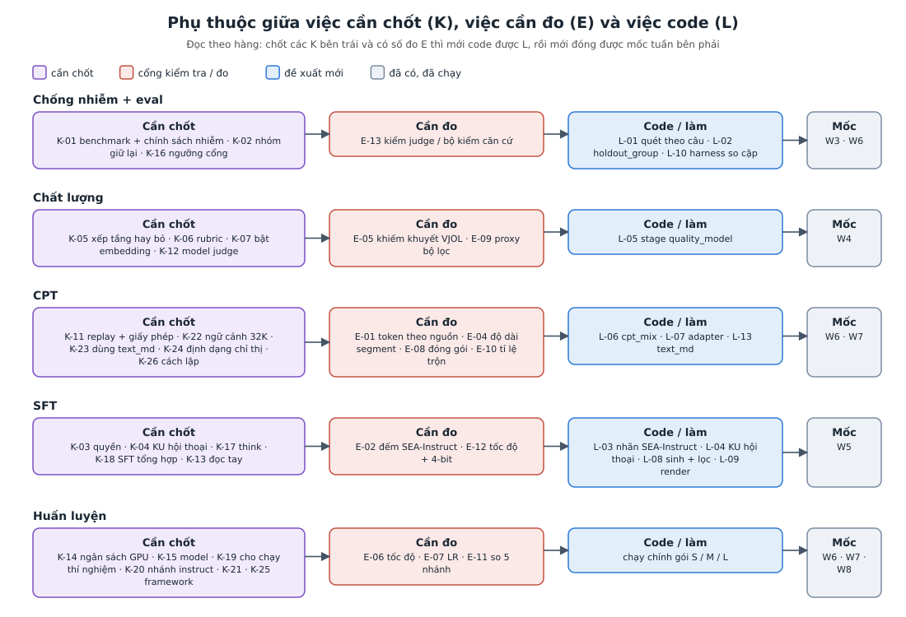

# TASKS: các điều cần chốt để chạy và chốt pipeline v2

> Đi kèm `docs/SUGGESTION_v2.md` (viết 2026-11-05). Ba loại việc:
> - **K-xx — cần chủ dự án chốt** (quyết định; không có thì không làm tiếp được).
> - **E-xx — cần đo** (số đo hoặc thí nghiệm; có số thì mới chốt được chỗ đang là "điểm xuất phát").
> - **L-xx — việc code** sau khi đã chốt.
>
> Mỗi dòng có: lựa chọn, **đề xuất của Claude** (chỉ là gợi ý), việc bị chặn, trạng thái (☐ chưa chốt / ☑ đã chốt). Khi chốt, ghi vào `docs/DECISION_LOG.md` rồi đổi ☐ thành ☑ kèm mã quyết định.
>
> **GPU-giờ là ước tính trên giấy, sai ±50%.**

## 0. Thứ tự đề xuất

1. **Ngay, không tốn GPU:** K-14, K-15 (ngân sách, model), K-08 (số W3), K-01, K-02 (benchmark, nhóm giữ lại), K-03, K-04 (quyền, KU SFT); chạy E-01…E-05.
2. **Trước W4:** K-05, K-06, K-07, K-12 → judge 50k → L-05.
3. **Trước W5:** K-17, K-18, K-13, K-27 → L-03, L-04, (L-08).
4. **Trước W6:** K-19, K-21, K-25 → E-06, E-07 → K-11, K-22…K-24, K-26 → E-08…E-11 → K-20.
5. **W7–W8:** E-14 (P5) → chạy gói S / M / L.

---

## A. Cần chốt để chạy được pipeline (K)

### A1. Phạm vi, ngân sách, model

| Mã | Cần chốt | Lựa chọn | Claude đề xuất | Chặn | TT |
|---|---|---|---|---|---|
| K-14 | **Ngân sách GPU thật** cho W6–W8. R-06 ghi "khoảng 30 giờ GPU", nhưng riêng chạy thử đã ~45 GPU-giờ, gói nhỏ nhất ~950 | (a) ~30 GPU-giờ: chỉ làm dữ liệu + P0–P2; (b) ~400: chạy thử + thí nghiệm, không chạy chính; (c) ~950: gói S; (d) ~1.100: gói M; (e) ~1.800: gói L; cộng ~520–830 nếu sinh SFT | (c) hoặc (d); nếu chưa chắc thì duyệt trước (b) rồi quyết tiếp sau E-11 | mục 12–13, mọi E từ E-06 | ☐ |
| K-15 | **Model thí nghiệm và model đích** (R-21 còn mở) | Qwen3-0.6B / 1.7B / 4B / 8B (bản Base + bản instruct cùng họ); họ khác | Proxy: Qwen3-0.6B + 1.7B Base; so nhánh (E-11) trên ≥1.7B, tốt nhất 4B; chạy chính 1.7B (gói S) hoặc 8B (gói M). Model ~27B không CPT full được trên 4× 40GB | E-06…E-11, L-07, L-09 | ☐ |
| K-08 | **Xác nhận số W3** (raw ≥30B / clean ≥15B đọc từ ảnh nhỏ, R-10 / N-12) | đúng / sai / thay bằng số khác | Lấy W7 ≥10B token sạch làm quy mô làm việc tới khi xác nhận; sửa CLAUDE.md theo kết quả | quy mô gói CPT, tỉ lệ lặp | ☐ |
| K-19 | Cho phép **chạy thử + thí nghiệm** trên server (E-06…E-11, ~245 GPU-giờ) | có / chỉ E-06, E-07 / không | Có, theo thứ tự rẻ trước; dừng lại báo số sau E-07 | mục 12 | ☐ |
| K-25 | **Framework huấn luyện** | HF Transformers / TRL + DeepSpeed hoặc FSDP2; LLaMA-Factory; Megatron-Bridge | CPT: TRL + adapter `cpt_pack`; SFT: LLaMA-Factory; Megatron chỉ khi 8B ≥10B token và MFU HF < ~30% | L-07, E-06 | ☐ |
| K-21 | 8B trên 40GB: **AdamW 8-bit hay offload optimizer sang CPU** | 8-bit (nhanh, có thể lệch chất lượng); offload (chậm, cần RAM lớn); bỏ 8B | Quyết sau E-06 (đo RAM máy, NVLink / PCIe) | gói M / L | ☐ |

### A2. Eval, nhóm giữ lại, chống nhiễm (làm đầu tiên)

| Mã | Cần chốt | Lựa chọn | Claude đề xuất | Chặn | TT |
|---|---|---|---|---|---|
| K-01 | **Danh sách benchmark + chính sách khi nhiễm** (Q9, R-16; `configs/benchmarks/` đang rỗng) | danh sách mục 7.1 SUGGESTION_v2, thêm / bớt; khi nhiễm: gắn cờ / xoá đoạn train / chỉ báo điểm phần sạch | Lấy danh sách mục 7.1; **xoá đoạn train trùng với bộ dùng làm cổng**, chỉ gắn cờ với bộ khác, luôn báo điểm phần sạch; VMLU test chỉ nộp vmlu.ai ở mốc cuối | L-01, L-10, L-11, mọi việc sinh dữ liệu | ☐ |
| K-02 | **Nhóm giữ lại** H1 / H2 / H3 | chỉ H1 (đang có); H1 + H2; cả ba | Cả ba. H2: ~3–5% (một số cuốn stbook, một số môn giáo trình, một số tạp chí + năm VJOL mới nhất); H3: ngưỡng cosine τ chọn sau khi xem phân bố | L-02, Eval A / B, sinh dữ liệu | ☐ |
| K-16 | **Ngưỡng cổng "không tụt"** (W6 ghi ≤1 điểm; bộ nhỏ dao động ±3–7) | ≤1 điểm theo điểm thô; ≤2 điểm; cận dưới CI 95% của mức tụt ≤ ngưỡng | Cổng đỏ khi **cận dưới CI 95%** của mức tụt vượt 1 điểm trên bộ gộp (IFEval + SEA-IFEval, GSM8K, HumanEval+ gộp MBPP+) | L-10, W6 | ☐ |

### A3. Chất lượng

| Mã | Cần chốt | Lựa chọn | Claude đề xuất | Chặn | TT |
|---|---|---|---|---|---|
| K-05 | **Điểm chất lượng dùng để bỏ hay để xếp tầng** | bỏ cứng dưới ngưỡng; xếp tầng (lặp / 1 lần / dự phòng / bỏ) | Xếp tầng cho web (giữ ~70% token); sách / giáo trình / VJOL chỉ bỏ ~5% thấp nhất; rule lỗi font / OCR vẫn là cổng cứng; thêm cờ nội dung người lớn / độc hại vào judge (I-05) | L-05, L-06, E-09 | ☐ |
| K-06 | **Rubric của judge** (thay bản nháp thang điểm Q6) | rubric cộng dồn 5 tiêu chí + cờ (mục 8 SUGGESTION_v2); giữ thang cũ | Rubric cộng dồn + cờ `vn_specific`, `factual_news`, `domain`, lỗi, người lớn / độc hại; prompt tiếng Việt, kiểm bằng prompt tiếng Anh trên 1.000 mẫu | judge 50k, L-05 | ☐ |
| K-07 | **Bật lại bước nhúng cho bản full** (đang `--embedder none`, J-59) | bật trong pipeline; chạy riêng chỉ để chấm (512 token đầu); không nhúng (chỉ fastText) | Chạy riêng để chấm + dùng lại cho chọn đa dạng SFT, H3, RAG: ~18–35 GPU-giờ cho 10B token | L-05 đầu MLP, K-02 H3, chọn SFT | ☐ |
| K-12 | **Model judge / model sinh / model kiểm** (chạy nội bộ, T-02) | judge Qwen3.5-27B (R-12); sinh Qwen3.6-35B-A3B hoặc Qwen3.6-27B / Qwen3-32B; kiểm khác họ (Gemma 3 27B…) | Giữ Qwen3.5-27B cho judge; model kiểm dữ liệu sinh **khác họ** với model sinh; chọn BF16 hay 4-bit theo E-12 | judge 50k, L-08 | ☐ |

### A4. CPT

| Mã | Cần chốt | Lựa chọn | Claude đề xuất | Chặn | TT |
|---|---|---|---|---|---|
| K-11 | **Bộ replay + giấy phép** (~25–30% token; ở 10B token Việt là ~3–4B token ngoài) và sách tiếng Anh của giáo trình nằm ở đâu | bộ replay chung tiếng Anh / toán / code cụ thể (cần kiểm giấy phép từng bộ); sách tiếng Anh giáo trình tính vào replay hay vào phần Việt | Replay có toán + code ≥ một nửa, chỉ bộ giấy phép rõ; sách tiếng Anh giáo trình tính vào phần replay (không đếm vào KPI token Việt) | L-06, E-10 | ☐ |
| K-22 | **Có cần giữ ngữ cảnh 32K** của Qwen3 không | không; có (thêm ~5% chuỗi 16–32K ở pha cuối + đo RULER / HELMET rút gọn) | Không, trừ khi sản phẩm cần đọc tài liệu dài; RAG chunk 1–2K đủ cho T-04 | L-06 | ☐ |
| K-23 | **Dùng `text_md` cho CPT** và **OCR lại stbook** để có `text_md` | dùng / không; OCR lại stbook (~64 GPU-giờ) / không | Dùng `text_md` khi có (bộ lọc vẫn chạy trên `text`); OCR lại stbook chỉ sau khi E-08 cho thấy markdown có lợi | L-13 | ☐ |
| K-24 | **Định dạng chỉ thị khi trộn vào CPT** | bỏ template (nối "câu hỏi / trả lời" thô); dùng chat template của base | Bỏ template trong CPT (trung lập model); chat template chỉ dùng ở SFT | L-06 | ☐ |
| K-26 | **Lượt lặp nguồn tốt: nguyên văn hay khác dạng** (bằng chứng trái nhau, mục 15) | nguyên văn; xáo câu / viết lại (tốn GPU sinh); trộn | Mặc định nguyên văn, chỉ lặp phần sạch nhất, trần 4; khác dạng là biến của E-10 | L-06 | ☐ |
| K-10 | **Mở rộng từ vựng** | không; có | Không (Qwen3 ~1,37 token / âm tiết; bằng chứng: model đa ngữ tốt lỗ khi mở rộng; chat vector cần cùng từ vựng) | — | ☐ |
| K-09 | **KPI token đếm bằng gì** | chỉ token Qwen3 (R-35); thêm số âm tiết và byte trong report | Giữ R-35, thêm âm tiết + byte để KPI không phụ thuộc tokenizer | L-12 | ☐ |

### A5. SFT

| Mã | Cần chốt | Lựa chọn | Claude đề xuất | Chặn | TT |
|---|---|---|---|---|---|
| K-03 | **Chính sách quyền** cho dữ liệu SFT và corpus | mức xanh / vàng / đỏ (mục 10.2); câu trả lời của model đóng (GPT / Gemini); giấy phép NC; `rights_status = unknown` của stbook / giáo trình / VJOL | Xanh: phát hành + thí nghiệm; vàng (có output model đóng): chỉ thí nghiệm; đỏ: không dùng. Stbook / giáo trình / VJOL `unknown`: cần chủ dự án quyết riêng cho bản phát hành W8 | L-04, L-08, phát hành W8 | ☐ |
| K-04 | **KU SFT = một hội thoại nguyên vẹn** (đổi định nghĩa R-09) | giữ cặp hỏi–đáp rời; hội thoại nguyên vẹn (`messages`, `mode`, `loss_turns`, `task`, `origin`, `rights_tier`…) | Hội thoại nguyên vẹn; bản cặp hỏi–đáp cho CPT dựng lúc xuất | L-04, K-27 | ☐ |
| K-27 | **Cách đếm "≥2M instruction" của W5** | đếm hội thoại; đếm lượt trợ lý; chỉ đếm mẫu xanh; có tính SEA-Instruct không | Đếm hội thoại đã qua dedup + quét nhiễm, tách số theo mức quyền và theo `origin` | W5 | ☐ |
| K-17 | **Chế độ suy nghĩ** khi SFT | không suy nghĩ; giữ cả hai (thêm ~30–45% mẫu có suy luận cho toán / code / lập luận) | Không suy nghĩ cho bản đầu; xem lại nếu model đích là Qwen3 bản lai và cần giữ chế độ suy nghĩ | L-09 | ☐ |
| K-18 | **Có sinh SFT tổng hợp từ corpus không**, quy mô bao nhiêu | không; chỉ `grounded_open`; cả `closed_book`; quy mô: thử 1.000 → 30–50K → đủ W5 (~520–830 GPU-giờ) | Có, chỉ `grounded_open` trước, trần 10–25% ngân sách CPT; `closed_book` chỉ sau khi có Eval B; quyết quy mô sau E-11 | L-08, W5 | ☐ |
| K-13 | **Ai đọc tay và ngưỡng cổng** (200 mẫu mỗi nguồn, ≥90% bám nguồn) | người trong nhóm (ai, bao nhiêu giờ); ngưỡng 85 / 90 / 95% | ≥90%, ~200 mẫu × số nguồn; cần tên người đọc và lịch | L-08 chạy hàng loạt | ☐ |
| K-20 | **Có thử nhánh bắt đầu từ instruct** (N5) | có / không | Có, chỉ trong E-11 (bằng chứng Latxa-Instruct, EstLLM) | E-11 | ☐ |

---

## B. Cần đo để chốt pipeline (E)

| Mã | Đo gì | Cách | Chi phí | Để chốt | TT |
|---|---|---|---|---|---|
| E-01 | **Token sạch thật theo nguồn** sau dedup vòng 2, theo band / tầng | chạy full rồi `dedup_global.py`; report thêm bảng nguồn × band | CPU | K-08, K-11, tỉ lệ trộn, lặp | ☐ |
| E-02 | **Thống kê SEA-Instruct-2602 phần Việt**: số dòng / token, `source`, loại tác vụ, số lượt, tỉ lệ dịch, độ nhạy cảm | script đọc theo lô (đọc cả ~20 cột nhãn) | CPU, vài phút | K-27, phần chỉ thị của pha 2, K-18 | ☐ |
| E-03 | **Fertility trên toàn văn** từng nguồn (âm tiết / token, byte / token) | tokenizer Qwen3 trên mẫu lớn mỗi nguồn | CPU | K-09, K-10 | ☐ |
| E-04 | **Phân bố độ dài `cpt_segments`** (p50, p90, % > 4K / 8K / 32K) từ run không lấy mẫu | report | CPU | K-22, E-08 | ☐ |
| E-05 | **Khiếm khuyết VJOL** (S-21 / S-22: `tone_shift`, `dropped_letters`, font group xấu) | lệnh trong `docs/SERVER_TASK.md` | CPU + ít GPU OCR lại | K-05 (band nào được lặp) | ☐ |
| E-06 | **P0–P2**: NVLink / PCIe, RAM; test adapter trên CPU; 50–100 bước mỗi cỡ ở 8K (tốc độ, bộ nhớ đỉnh, MFU) | script trên server | ~4 GPU-giờ | K-21, K-25, sửa bảng GPU-giờ | ☐ |
| E-07 | **P3–P4 quét LR**: 0,6B 3 LR × 200M token; 1,7B LR tốt ±1 nấc | CPT ngắn + eval cloze | ~40 | LR (mâu thuẫn mục 15) | ☐ |
| E-08 | **Đóng gói**: A nối-cắt 4K / B best-fit + che attention 4K / C ở 8K / D + tiền tố metadata | proxy 0,6B / 1,7B | ~10–15 | T-09 có bật tiền tố không, K-23 | ☐ |
| E-09 | **Bộ lọc chất lượng**: ngẫu nhiên / chỉ rule / top 30% / xếp tầng, 2 seed, khớp số lần lặp | proxy | ~12–25 | K-05 | ☐ |
| E-10 | **Tỉ lệ trộn**: replay {10, 30%} × lặp nguồn tốt {1, 2, 4} + trộn đều không chia pha (+ biến K-26) | proxy | ~15–20 | K-11, K-26, tỉ lệ 2 pha | ☐ |
| E-11 | **So công bằng 5 nhánh** N1–N5 cùng GPU-giờ kể cả giờ sinh (T-03) | ≥1,7B; đo kiến thức Việt + cổng không tụt | ~150 | K-18, K-20, hướng CPT / SFT / lai | ☐ |
| E-12 | **Model sinh**: tốc độ thật, BF16 so với AWQ 4-bit trên ~1.000 đoạn | vLLM | ~5–10 | K-12, ngân sách sinh | ☐ |
| E-13 | **Kiểm judge** trên FineWeb-C tiếng Việt (2.869 nhãn người; kiểm giấy phép) và **bộ kiểm căn cứ** trên ViHallu | chấm lại, Spearman / độ chính xác theo nguồn | ~5 | tin judge không (K-06), L-08 | ☐ |
| E-14 | **P5**: 1B token trên cỡ đã chọn, eval mỗi ~200M token | CPT thật ngắn | ~40–170 | có lên 5B / 10B (gói S / M / L) | ☐ |

Quy tắc chung cho E-07…E-11: thu nhỏ bằng lấy mẫu con mọi nguồn theo họ trùng **và giữ đúng số lần lặp**; chạy 2 seed nhánh đối chứng để đo nhiễu trước; chỉ mang **thứ hạng** lên model lớn; không quyết chỉ từ 0,6B.

---

## C. Việc code sau khi chốt (L)

| Mã | Việc | Cần chốt / đo trước | Ước lượng | TT |
|---|---|---|---|---|
| L-01 | Viết lại `contamination.py`: quét theo **từng câu** benchmark (gồm đáp án), 8-gram, > 50% token trùng, đoạn khớp dài nhất, NFC, vòng ngữ nghĩa khác ngôn ngữ, chạy trên mọi dữ liệu train; ghi `contamination_items.parquet` | K-01, K-07 (vòng ngữ nghĩa) | vừa | ☐ |
| L-02 | Cột `holdout_group` (H1 / H2 / H3) cạnh `split_bucket`; mọi mẫu sinh thừa hưởng | K-02 | nhỏ | ☐ |
| L-03 | Đọc đủ ~20 cột nhãn SEA-Instruct vào `meta` (kèm parse `conversations` bằng `ast.literal_eval`) | — | nhỏ | ☐ |
| L-04 | KU SFT dạng hội thoại (thay `sft_pairs`), có `rights_tier`, `origin`, `mode`, `loss_turns`; dedup theo câu hỏi đầu | K-03, K-04 | vừa | ☐ |
| L-05 | Stage `quality_model` (sau `dedup`, trước `finalize`): fastText + đầu MLP trên embedding, ensemble phân vị trong nguồn, ghi `quality_tier`, `judge_flags`; segment mang `quality_tier` | K-05, K-06, K-07, judge 50k | lớn | ☐ |
| L-06 | Stage `cpt_mix`: chọn theo bucket / holdout, số lần lặp theo nguồn × tầng (trần 4), pha 1 / 2, replay + chỉ thị, tách validation theo họ, manifest | K-11, K-22, K-24, K-26, E-01, E-10 | lớn | ☐ |
| L-07 | Adapter `cpt_pack` → HF / TRL: gom `seq_id`, `position_ids` về 0 mỗi mảnh, label −100 trên prefix, EOS theo cờ, cắt / đệm đúng 8.192; **test loss chuỗi ghép = tổng loss từng mảnh** | K-25 | vừa | ☐ |
| L-08 | Luồng sinh SFT có căn cứ: chọn đoạn nguồn, sinh có điều kiện, lọc 4 tầng, cổng đọc tay, `sft_synth.parquet` đủ lineage | K-12, K-13, K-18, E-12, E-13 | lớn | ☐ |
| L-09 | Render SFT theo chat template của base (bẫy `<think>` của Qwen3; tách lượt hoặc loss lượt cuối); đếm token sau render | K-15, K-17 | nhỏ | ☐ |
| L-10 | Harness eval: cấu hình cố định, cloze cho base / sinh văn bản cho instruct, so cặp McNemar / bootstrap, CI 95%, điểm phần sạch, điểm theo vị trí đáp án | K-01, K-16 | vừa | ☐ |
| L-11 | Tải benchmark vào `configs/benchmarks/` (cả bản gốc tiếng Anh nếu là bản dịch), kiểm giấy phép | K-01 | nhỏ | ☐ |
| L-12 | Report: token theo nguồn × tầng, phân bố độ dài segment, số âm tiết + byte | K-09 | nhỏ | ☐ |
| L-13 | Đưa `text_md` vào segment (`text_format = md`), bộ lọc vẫn trên `text` | K-23 | nhỏ | ☐ |

---

## D. Ghi chú

- Các mã K / E / L ở đây là mã việc, không trùng hệ mã quyết định trong `DECISION_LOG.md` (T-xx, R-xx…). Khi chốt một K, ghi quyết định với mã mới trong DECISION_LOG và ghi mã đó vào cột TT.
- Đã chốt trước, không cần chốt lại: T-01…T-10 (xem `docs/DECISION_LOG.md`, phiên 2026-11-03 và 2026-11-04).
