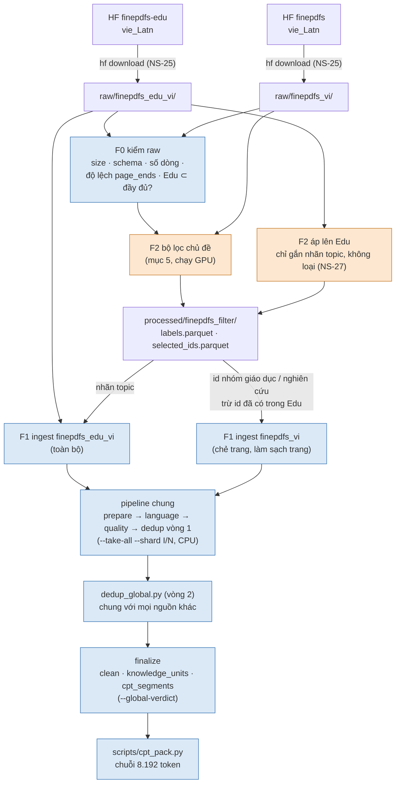
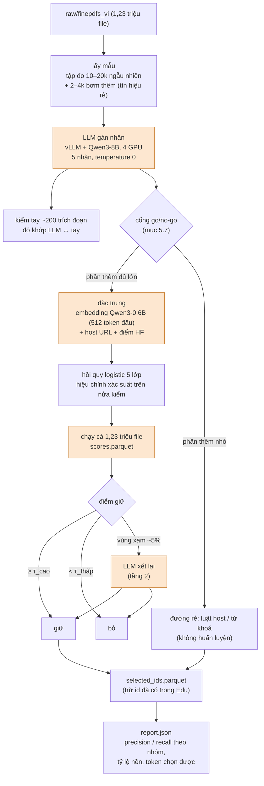

# FinePDFs (`finepdfs_edu_vi`, `finepdfs_vi`): thiết kế pipeline xử lý

> Lập 2026-11-20 sau khi chủ dự án chốt các quyết định NS-25 … NS-30 (`docs/project/DECISION_LOG.md`). **Trạng thái: raw đã tải; mọi thứ còn lại là thiết kế, chưa có dòng code nào.** Mục 12 liệt kê code sẽ viết và thứ tự. Mọi ngưỡng ở đây là điểm khởi đầu, chưa kiểm trên dữ liệu thật.
> Danh mục nguồn và lý do chọn: `docs/sources/SOURCES.md`, `docs/sources/SOURCE_CANDIDATES.md` (mục 6, số đo mẫu 300). Pipeline chung mà tài liệu này bám theo: `docs/design/PIPELINE.md`.

## 1. Tóm tắt

- **Hai bộ**, cùng nguồn gốc (PDF trên web, CommonCrawl; Hugging Face trích chữ bằng docling hoặc rolmOCR):
  - `finepdfs_edu_vi` = `HuggingFaceFW/finepdfs-edu`, config `vie_Latn`: **lấy toàn bộ** (NS-13), 131.190 văn bản.
  - `finepdfs_vi` = `HuggingFaceFW/finepdfs`, config `vie_Latn`: 1.229.248 văn bản, **chỉ lấy nhóm giáo dục + nghiên cứu** (NS-18, NS-20), qua một bước lọc chủ đề chạy **trước** pipeline.
- **Đã có chữ**, không có bước OCR hay trích PDF ở đây. Việc khó là (a) lọc chủ đề cho bộ đầy đủ, (b) tận dụng thông tin theo trang (`page_ends`, điểm từng trang) để làm sạch như sách / bài báo, (c) xếp thứ tự ưu tiên thấp nhất khi dedup (giữ bản tự trích nếu trùng).
- Quy mô dự kiến sau lọc: ~1,2 tỷ (Edu, ước từ mẫu 300, token Qwen3) + ~0,4 tỷ (phần thêm của bộ đầy đủ, **ước thô, sai số lớn**) ≈ 1,6 tỷ token trước dedup. Cổng go/no-go ở mục 5.7 sẽ thay con số 0,4 bằng số đo.
- Chạy toàn bộ bằng CPU theo kiểu chia phần (shard) như VJOL / VISTA; GPU chỉ cần cho bước lọc (gán nhãn LLM + embedding).

## 2. Quyết định đã chốt (chi tiết trong `DECISION_LOG.md`)

| Mã | Quyết định |
|---|---|
| NS-25 | Tải **cả hai** bộ về `data/raw/` nguyên bản (đã xong 2026-11-20). |
| NS-26 | LLM gán nhãn chủ đề chạy **local** trên 4×A100 bằng vLLM. Bản đầu dùng Qwen3-8B; đo độ khớp trên tập giữ riêng, nếu thấp thì lên Qwen3-30B-A3B (cần tensor parallel 2). |
| NS-27 | Áp bộ phân loại lên **cả Edu** để gắn nhãn `topic`, **không loại** (NS-13 vẫn là lấy toàn bộ Edu). |
| NS-28 | Giữ tiếng Anh / song ngữ (~10% Edu): `allowed_langs=("vi","en")`, nhất quán với giáo trình và VJOL. |
| NS-29 | Lọc **hai tầng** (bộ phân loại rẻ + LLM xử lý vùng xám); ngưỡng **theo nhóm** (giáo dục precision trước, nghiên cứu recall trước); tập đo 10–20 nghìn mẫu ngẫu nhiên; **cổng go/no-go** sau khi LLM gán nhãn xong mẫu đo. |
| NS-30 | Ghi thiết kế vào `docs/design/FinePDFs.md`, `VJOL.md`, `VISTA.md` (tài liệu này). |

## 3. Dữ liệu

### 3.1 Raw (đã đo 2026-11-20)

```
data/raw/finepdfs_edu_vi/data/vie_Latn/train/000_0000{0,1,2}.parquet   3 file, 2,8 GB, 131.190 dòng
data/raw/finepdfs_vi/data/vie_Latn/train/000_0000{0,1,2}.parquet       3 file, ~13 GB (4,4 GB / file)
data/raw/finepdfs_vi/data/vie_Latn/test/000_00000.parquet              952 dòng (tập test của HF, cũng lấy; xử lý như train)
```

Tải bằng `hf download --include "data/vie_Latn/*" --local-dir data/raw/<key>`; thư mục `.cache/huggingface/` do HF tạo, giữ nguyên (mọi code đọc file bỏ qua `.cache`). Nhật ký: `data/logs/finepdfs_download.log`.

### 3.2 Schema (đọc từ metadata parquet)

| Cột | Có ở | Ghi chú |
|---|---|---|
| `text` | cả hai | chữ đã trích, định dạng markdown (docling) hoặc text OCR (rolmOCR) |
| `id` | cả hai | dạng `<urn:uuid:…>`; **khoá nối giữa Edu và bộ đầy đủ** |
| `dump`, `url`, `date`, `file_path`, `offset` | cả hai | gốc CommonCrawl; `url` là bằng chứng nguồn |
| `token_count`, `language`, `full_doc_lid`, `page_average_lid(_score)`, `full_doc_lid_score` | cả hai | `token_count` theo tokenizer của HF, không phải Qwen3 |
| `per_page_languages` | cả hai | ngôn ngữ từng trang |
| `is_truncated` | cả hai | PDF dài bị cắt cụt |
| `extractor` | cả hai | `docling` (có lớp chữ) hoặc `rolmOCR` (OCR) |
| `page_ends` | cả hai | vị trí kết thúc từng trang trong `text` (xem 3.3) |
| `fw_edu_scores` | cả hai | điểm "giáo dục" từng trang |
| `fw_edu_v2_scores`, `dclm_scores`, `ocr_quality_scores` | **chỉ bộ đầy đủ** | Edu **không có** ba cột này |
| `minhash_cluster_size`, `duplicate_count` | cả hai | dedup của HF (tham khảo; dedup của ta mới là quyết định) |

### 3.3 Số đo trên Edu (quét cả 131.190 dòng, không dùng mẫu)

| Chỉ số | Giá trị |
|---|---|
| Tổng token (tokenizer HF) | 1,466 tỷ (ước Qwen3 ~1,2 tỷ từ mẫu trước) |
| `extractor` | docling 87.307 (66,5%), rolmOCR 43.883 (33,5%) |
| `is_truncated` | 21,0% (trong mẫu 2.000 dòng đầu, mọi bản cắt cụt đều là rolmOCR) |
| `duplicate_count > 0` | 18,7% |
| Số trang | trung vị 4, trung bình 20, lớn nhất 15.379 |
| `page_ends[-1] == len(text)` | ~83% (mẫu 2.000); 17% còn lại lệch nhỏ (vài ký tự đến ~2%, cả hai chiều) |

**Hệ quả cho thiết kế:** `page_ends` là vị trí ký tự **gần đúng**, không dùng làm ranh giới chính xác. Chẻ trang phải kẹp vào `[0, len(text)]`, snap về dấu xuống dòng gần nhất trong cửa sổ nhỏ, và trang cuối kéo tới hết văn bản. Độ lệch được đo ở bước F0 trên cả hai bộ trước khi code chẻ trang.

## 4. Sơ đồ tổng thể



Cam = cần GPU; xanh = chỉ CPU. Edu **không phải chờ** F2: ingest và pipeline của Edu chạy độc lập, nhãn `topic` chỉ được nối vào meta khi F2 xong (nối lại cần chạy lại từ ingest, nhờ vân tay stage).

## 5. F2: bộ lọc chủ đề (chỉ cho `finepdfs_vi`; áp lên Edu để gắn nhãn)

### 5.1 Vì sao phải có và vì sao khó

Dedup chỉ bỏ bản trùng, stage quality chỉ xét hình thức chữ, nên không bỏ được văn bản hành chính hay báo cáo tài chính sạch chữ (NS-20). Bộ lọc là cổng duy nhất quyết định corpus có lạc đề hay không.

**Tỷ lệ nền** khiến bài toán khó hơn vẻ ngoài: khoảng 92–94% bộ là "khác" (~6,8 tỷ token), phần thêm được chỉ ~0,4 tỷ. Một lỗi nhỏ trên số lớn các file "khác" tạo ra nhiều rác. Tính thô với recall 80% (giữ 0,32 tỷ token đúng):

| Tỷ lệ sai trên file "khác" | Rác lọt vào | Precision của phần thêm |
|---|---|---|
| 0,5% | ~0,035 tỷ | ~90% |
| 1% | ~0,07 tỷ | ~82% |
| 2% | ~0,14 tỷ | ~70% |
| 5% | ~0,34 tỷ | ~48% |

(Giữ file "khác" nhầm chỉ làm loãng corpus ~1–3%, mất recall 20% chỉ mất ~0,08 tỷ; xem 5.5 về cách chọn điểm làm việc.)

### 5.2 Hai thước đo

- **Precision** = trong số file được giữ, tỷ lệ thật sự là giáo dục hoặc nghiên cứu (đo rác lọt vào).
- **Recall** = trong số file giáo dục / nghiên cứu thật, tỷ lệ được giữ (đo dữ liệu tốt bị bỏ).
- Quyết định giữ là nhị phân trên **hợp** hai nhóm (nhầm giữa "giáo dục" và "nghiên cứu" không quan trọng vì cả hai đều giữ); báo cáo vẫn tách từng nhóm để theo dõi.

### 5.3 Nhãn

Năm nhãn (NS-21): `giao_duc`, `nghien_cuu`, `hanh_chinh_phap_luat`, `tai_chinh_doanh_nghiep`, `khac`.
Giữ: `giao_duc` (bài giảng, đề thi, giáo án, lời giải, giáo trình, tài liệu hướng dẫn học) và `nghien_cuu` (bài báo, luận văn, luận án, báo cáo khoa học). Hướng dẫn gán nhãn cho LLM ghi rõ ca biên: tài liệu hướng dẫn kỹ thuật → `khac` trừ khi là tài liệu dạy – học; báo cáo chuyên môn của cơ quan → `hanh_chinh_phap_luat`; tài liệu tôn giáo, thơ, hồi ký → `khac`. Bộ nhãn và prompt được lưu cùng `labels.parquet` (kèm hash) để tái lập.

### 5.4 Các bước

1. **Lấy mẫu** (`finepdfs_vi`, seed cố định, trải đều 4 file):
   - **Tập đo (unbiased)**: 10.000–20.000 file ngẫu nhiên (NS-29). Chỉ dùng để đo tỷ lệ nền và precision / recall, **không** dùng để huấn luyện.
   - **Tập huấn luyện bơm thêm**: ~2.000–4.000 file chọn theo tín hiệu rẻ để đủ ví dụ dương cho nhóm nghiên cứu: host `.edu.vn`, `.ac.*`, từ khoá "TÓM TẮT" / "Abstract" / "TÀI LIỆU THAM KHẢO" / "đề thi" / "giáo án" / "bài giảng", `fw_edu_scores` cao. Phần này **cộng** vào huấn luyện, tách khỏi tập đo.
   - Tập huấn luyện cuối = một nửa tập đo (chia theo hash `id`, nửa kia giữ nguyên làm kiểm) + phần bơm thêm.
2. **Gán nhãn bằng LLM** (NS-26): vLLM + Qwen3-8B trên 4 GPU (mỗi GPU một server, như `scripts/stbook/run_ocr_vlm.sh`), đầu vào = host của `url` + ~1.500 token đầu + ~300 token giữa + `token_count`; đầu ra = JSON `{"label": …, "confidence": …, "reason": …}`, `temperature=0`. Gán nhãn cả mẫu bơm thêm và tập đo. Lệch format → thử lại một lần, rồi nhãn `khac` + cờ `parse_error`.
3. **Đo độ khớp của LLM với nhãn tay**: tôi đọc ~200 trích đoạn (stratified theo nhãn LLM) và gán nhãn tay, đo độ khớp; đưa chủ dự án xem ~30 ca biên. Độ khớp thấp (ngưỡng đặt khi có số đầu tiên) → thử Qwen3-30B-A3B (TP2).
4. **Cổng go/no-go** (mục 5.7): sau khi có nhãn của tập đo, trước khi tốn công huấn luyện.
5. **Đặc trưng**: embedding `Qwen/Qwen3-Embedding-0.6B` của ~512 token đầu (dùng lại `vi_corpus/pipeline/embed.py`), host của `url` (bag of tokens của các nhãn tên miền), `fw_edu_scores` (max, mean), `token_count` (log), `is_truncated`, `extractor`, `ocr_quality_scores` (mean, chỉ bộ đầy đủ), tỷ lệ trang không phải tiếng Việt. Bộ phân loại: hồi quy logistic đa lớp (baseline); thử thêm LightGBM nếu hồi quy logistic yếu. Hiệu chỉnh xác suất (isotonic / Platt) trên nửa kiểm.
6. **Chạy cả 1,23 triệu file**: embed 512 token × 1,23 triệu ≈ 0,63 tỷ token qua mô hình 0,6B (ước vài chục phút đến ~1 giờ trên 4 GPU; chưa đo, R-06), ghi `scores.parquet` (xác suất 5 lớp mỗi `id`).
7. **Tầng 2: LLM xử lý vùng xám**: file có điểm giữ nằm giữa hai ngưỡng (xem 5.5; ước ~5% = ~60 nghìn file) gửi cho LLM bước 2 để quyết định. Ước chi phí ~90 triệu token đầu vào (vài chục phút đến vài giờ trên 4 GPU, chưa đo).
8. **Xuất kết quả**: nhãn cuối của mỗi `id` (từ bộ phân loại hoặc từ LLM, ghi rõ `tier`), `selected_ids.parquet` (nhãn giữ, trừ id đã có trong Edu), `report.json` (precision / recall theo nhóm trên nửa kiểm, ma trận nhầm lẫn, tỷ lệ nền, số token chọn được theo tokenizer HF).

### 5.5 Chính sách ngưỡng (NS-29)

Hai kiểu sai không đắt như nhau, và hai nhóm giữ không có giá trị như nhau:

| Nhóm | Vì sao | Thiên về | Mục tiêu ban đầu |
|---|---|---|---|
| `giao_duc` | ~60% đã nằm sẵn trong Edu; phần thêm chỉ là phần Edu bỏ sót, mất ít không đáng kể | **precision** | ≥ 85% |
| `nghien_cuu` | gần như chưa có trong Edu, đây là loại khan hiếm nhất (hướng STEM); rác lọt vào rẻ vì quality bắt thêm | **recall** | precision ≥ 75% |

- Mỗi nhóm có hai ngưỡng: `τ_cao` (xác suất ≥ → giữ luôn) và `τ_thấp` (xác suất < → bỏ luôn). Ở giữa là **vùng xám**, đưa LLM xét (tầng 2). Ngưỡng chọn trên nửa kiểm sao cho đạt mục tiêu precision của nhóm; `τ_thấp` chọn sao cho vùng xám khoảng 5% bộ.
- Con số mục tiêu là điểm khởi đầu; chỉnh theo số đo thật và báo cáo cho chủ dự án (không tự đặt lại).
- **Đảo ngược được**: `scores.parquet` lưu xác suất cho cả 1,23 triệu file nên đổi ngưỡng chỉ cần chạy lại bước chọn, không chạy lại GPU.
- Precision / recall tính **so với nhãn LLM** (và nhãn tay của ~200 mẫu để biết LLM đúng đến đâu); báo cáo nói rõ điều này.

### 5.6 Sơ đồ F2



### 5.7 Cổng go/no-go

Ước "~0,4 tỷ token thêm" đến từ mẫu 300 file, trong đó nhóm nghiên cứu chỉ khoảng 6 file: có thể là 0,2 hoặc 0,8 tỷ. Sau khi LLM gán nhãn xong tập đo:

| Phần thêm đo được | Việc làm |
|---|---|
| ≥ ~0,3 tỷ token (≥ ~3% mục tiêu 10 tỷ) | chạy tiếp đầy đủ F2 |
| < ~0,3 tỷ | đưa chủ dự án chọn: vẫn chạy đầy đủ, hoặc đường rẻ (chỉ lấy file có host `.edu.vn` / mẫu "Tóm tắt – Abstract – Tài liệu tham khảo", không huấn luyện bộ phân loại) |

Ngưỡng 0,3 tỷ là gợi ý để thảo luận, chủ dự án quyết khi có số.

### 5.8 Áp lên Edu (NS-27)

Chạy cùng bộ phân loại cho 131.190 file Edu (embedding + hồi quy logistic, không cần LLM tầng 2), ghi nhãn vào cột `topic` và `topic_prob` trong meta. **Không loại file nào.** Mục đích: sau này muốn cắt tôn giáo, biểu mẫu, bài phát biểu thì đã có nhãn; theo dõi tỷ lệ nhãn trong report. Edu được gán nhãn bằng bộ phân loại đã huấn luyện trên bộ đầy đủ; một mẫu ~500 file Edu cũng gán bằng LLM để kiểm bộ phân loại không lệch trên miền này.

### 5.9 Đầu ra trên đĩa

```
processed/finepdfs_filter/
├── samples/{eval,train_extra}.parquet     id, seed, cách chọn
├── labels_llm.parquet                     id, label, confidence, reason, model, prompt_hash, parse_error
├── hand_labels.csv                        ~200 nhãn tay + ghi chú
├── scores.parquet                         id, p_giao_duc, p_nghien_cuu, p_hanh_chinh, p_tai_chinh, p_khac (cả hai bộ)
├── classifier/                            mô hình, bảng ngưỡng, hiệu chỉnh
├── selected_ids.parquet                   id, label, tier (clf | llm), nguồn (full | edu_topic_only)
└── report.json                            số đo, ma trận nhầm lẫn, token chọn được
```

## 6. F1: adapter ingest (`vi_corpus/finepdfs/`, sẽ viết)

### 6.1 Đăng ký

Hai `SourceSpec` trong `registry.py`: `fmt="parquet"`, `path="raw/finepdfs_edu_vi/data/vie_Latn"` và `"raw/finepdfs_vi/data/vie_Latn"`, `owner="Hugging Face (từ CommonCrawl)"`, `license="ODC-By 1.0 + CommonCrawl ToU"`, `rights_status="unknown"` (PDF gốc có bản quyền của bên thứ ba; theo R-01 chỉ gắn nhãn), `domain` theo nguồn. Thêm vào `SOURCE_PRIORITY`: **4** (thấp hơn mọi nguồn khác, kể cả mức mặc định 3).

### 6.2 Bản ghi

- **Một bản ghi / văn bản.** `doc_id = "finepdfs_edu_vi:<uuid>"` hoặc `"finepdfs_vi:<uuid>"` (uuid trong `id` của HF), ổn định giữa các lần chạy, không phụ thuộc thứ tự dòng. `source_path` = đường dẫn parquet; `source_sha256` = sha256 của `text` gốc (đủ lineage).
- `meta`: `hf_id`, `url`, `host`, `dump`, `date`, `extractor`, `is_truncated`, `token_count_hf`, `n_pages`, `fw_edu_scores` (max, mean), `ocr_quality_mean` (bộ đầy đủ), `duplicate_count`, `topic`, `topic_prob`, `topic_tier`, và số đếm từng bước làm sạch trang (`page_lines_removed`, `pages_dropped_lang`, `pages_dropped_ocr`).
- Đọc theo lô (`iter_batches`, cột cần dùng), không nạp cả parquet vào RAM (văn bản dài tới hàng trăm nghìn ký tự).

### 6.3 Chẻ trang và làm sạch theo trang

Dùng cơ chế "nguồn sách đã có trang" (`chunked=True`, như giáo trình / VJOL):
1. Chẻ `text` thành các trang theo `page_ends` (kẹp, snap về `\n` gần nhất, trang cuối đến hết văn bản; xem 3.3).
2. Trang bị loại khỏi văn bản (thành trang rỗng, giữ chỉ số trang) nếu:
   - `per_page_languages[i]` không thuộc `{vie_Latn, eng_Latn}` (NS-28);
   - `ocr_quality_scores[i]` dưới ngưỡng (chỉ bộ đầy đủ; ngưỡng đặt sau khi xem phân bố ở F3);
   - trang gần như rỗng chữ cái.
3. `clean_pages` dùng chung (`vi_corpus/common/pdf_text.py`): bỏ tiêu đề / chân trang lặp ≥ 3 trang, bỏ dòng chỉ có chữ số (số trang), ghép dòng xuyên ranh giới trang. **Chỉ áp cho văn bản docling nhiều trang**; với văn bản rolmOCR dạng markdown (có tiêu đề `#`, bảng), cần kiểm ở F3 rằng ghép dòng không phá cấu trúc markdown (nếu phá thì bỏ bước 3 cho nguồn này và chỉ giữ bước 1–2). Văn bản một trang bỏ qua bước 3.
4. Không sửa nội dung khác (giữ bảng markdown, LaTeX; `keep_table_cells=True` ở profile).

### 6.4 Lọc id và chia phần

- `finepdfs_vi`: chỉ phát bản ghi có `id` trong `selected_ids.parquet` (nạp vào một tập hợp; ~100 nghìn id, nhỏ) và **không** thuộc tập id của Edu (`edu_ids` đọc một lần, chỉ cột `id`). Bản ghi bị bỏ được đếm theo lý do (`not_selected`, `in_edu`) và ghi log.
- `finepdfs_edu_vi`: phát tất cả; nối `topic` từ `scores.parquet` nếu có.
- Chia phần: `--shard I/N` theo hash của `id` (như VJOL chia theo sha256), đọc từng file parquet rồi lọc dòng thuộc phần; mở rộng `--shard` / `--take-all` hiện chỉ chấp nhận vjol / vista.
- Vân tay đầu vào của ingest (`input_files`) = các file parquet + `selected_ids.parquet` + `scores.parquet`: đổi lựa chọn lọc → stage tự chạy lại.

## 7. F3: hồ sơ pipeline

```python
PROFILES["finepdfs_edu_vi"] = PROFILES["finepdfs_vi"] = SourceProfile(
    chunked=True, min_words=80, allowed_langs=("vi", "en"), min_lang_score=0.5,
    keep_table_cells=True,   # docling ra bảng markdown
)
SOURCE_PRIORITY["finepdfs_edu_vi"] = SOURCE_PRIORITY["finepdfs_vi"] = 4   # NS-06: trùng bản tự trích thì giữ bản tự trích
```

Các stage còn lại dùng nguyên pipeline chung; đặc điểm riêng của nguồn này:

| Stage | Lưu ý cho FinePDFs |
|---|---|
| prepare | NFC, xoá dòng lặp (24% bộ đầy đủ là `repetitive`, thường bảng biểu; `keep_table_cells` giữ ô bảng ngắn lặp cạnh nhau), cắt đoạn ~1.024 token Qwen3 (tối đa 2.048). Văn bản dài (sách, hàng nghìn trang) thành rất nhiều đoạn; cần kiểm RAM ở bước chạy mẫu. |
| language | fastText `lid.176` theo đoạn; giữ `vi` + `en`; đoạn ngôn ngữ khác bị loại (`lang_not_allowed`). |
| quality | Chưa bật `odd_words` / `perplexity` ở bản đầu. Theo dõi các mã: `repeated_ngrams`, `duplicate_lines`, `lost_diacritics`, `reversed_text`, `private_use_chars`, và LaTeX hỏng (7% mẫu Edu, ngưỡng chưa có; chỉ đo). Văn bản rolmOCR có thể có vòng lặp do mô hình sinh (đã có mã bắt). `is_truncated` không loại, chỉ ghi meta. |
| dedup | Vòng 1 + vòng 2. Độ ưu tiên 4: khi trùng với VJOL, VISTA, giáo trình, stbook, SEA thì giữ bản kia. Trùng giữa Edu và bộ đầy đủ đã được chặn từ ingest (theo `id`); dedup văn bản (exact + MinHash) bắt nốt bản gần trùng giữa hai bộ và với các nguồn khác. Ghi nhận: PDF của VJOL / VISTA gần như không xuất hiện trong FinePDFs (0/600 URL mẫu), nhưng giáo trình, luận văn có thể trùng. |
| embed + reduce | Tắt khi chạy toàn bộ (như VJOL); bật ở lần chạy mẫu để xem bản đồ. |
| finalize | `clean.parquet`, `knowledge_units.parquet`, `cpt_segments.parquet` như mọi nguồn; `topic` được giữ trong meta để cắt sau. |

## 8. Cách chạy (dự kiến)

```bash
# F0: kiểm raw (CPU, sẽ viết)
uv run python scripts/finepdfs/check_raw.py --data-root <root>
# F2: bộ lọc chủ đề (GPU, sẽ viết; từng bước chạy lại được)
uv run python scripts/finepdfs/filter.py --data-root <root> --step sample|label|measure|features|train|score|adjudicate|select
# F3: chạy mẫu 10.000 đoạn cho từng bộ, xem report.html và chỉnh ngưỡng
uv run python scripts/run_pipeline.py --data-root <root> --mix finepdfs_edu_vi=10000 --total 10000 --run-name finepdfs_edu_10k
# toàn bộ, chia phần, CPU (cùng lệnh với VJOL / VISTA)
make pipeline-cpu ROOT=<root> SOURCES="finepdfs_edu_vi finepdfs_vi" [JOBS=..] [SHARDS=..]
```

`make pipeline-cpu` cần chỉnh: `SOURCES` hiện được truyền cho `run_pipeline.py --shard`, vốn chỉ chấp nhận vjol / vista; `scripts/pipeline_progress.py` và `summarize_runs.py` cũng chỉ biết hai nguồn đó.

## 9. Thứ tự việc

| Bước | Việc | Máy | Phụ thuộc |
|---|---|---|---|
| **F0** | `check_raw.py`: size, số dòng, schema, độ lệch `page_ends`, Edu ⊂ đầy đủ?, số id trùng; bọc tải vào `DatasetSpec` / checkpoint (không để `download_all.py` tự tải hai bộ này) | CPU | raw (xong) |
| **F1** | registry + adapter ingest (chia trang, làm sạch trang, lọc id, chia phần) + test không mạng | local | F0 |
| **F3a** | chạy mẫu 10.000 đoạn cho Edu → xem `report.html`, chỉnh ngưỡng, kiểm ghép dòng với markdown | CPU | F1 |
| **F2** | bộ lọc chủ đề (lấy mẫu → nhãn LLM → go/no-go → bộ phân loại → vùng xám → chọn) | 4 GPU | F0 |
| **F3b** | chạy mẫu cho phần thêm của bộ đầy đủ, chỉnh ngưỡng | CPU | F1, F2 |
| **F4** | chạy toàn bộ chia phần + dedup vòng 2 chung với VJOL / VISTA + `cpt_pack` | CPU | F3 |
| **F5** | cập nhật `SOURCES.md`, `PROGRESS.md`, `CLAUDE.md`, `docs/README.md`, vẽ lại sơ đồ bằng `draw_diagrams.py`, thêm mục `S-xx` vào `SERVER_TASK.md` | local | mỗi bước |

F1 và F2 độc lập, làm song song được; Edu đi hết F1 → F3a → F4 mà không chờ F2.

## 10. Rủi ro và điểm mở

- **Số liệu mẫu nhỏ**: 0,4 tỷ token thêm dựa trên ~6 file nghiên cứu; cổng go/no-go (5.7) giải quyết.
- **Nhãn LLM không phải chân lý**: precision / recall đo so với nhãn LLM; có kiểm tay 200 mẫu nhưng đó chỉ cho thấy xu hướng.
- **`page_ends` gần đúng**: chẻ trang có thể lệch; ảnh hưởng chỉ ở bước loại trang / xoá tiêu đề lặp, không làm mất chữ (kẹp biên).
- **rolmOCR**: 33% Edu; có thể có vòng lặp, LaTeX hỏng, bảng hỏng; chưa có thước đo riêng. Nếu mẫu cho thấy nặng, cân nhắc ngưỡng riêng theo `extractor`.
- **Văn bản bị cắt cụt (21%)** vẫn vào corpus; đoạn cuối cụt giữa câu. Chấp nhận (chỉ ghi meta).
- **Bản quyền PDF bên thứ ba**: giấy phép ODC-By + CommonCrawl ToU chỉ phủ phần của HF; `rights_status=unknown`, chỉ gắn nhãn.
- **Bộ lọc áp lên Edu** có thể cho nhãn khác với kỳ vọng (Edu lọc bằng classifier giáo dục của HF, miền hơi khác); kiểm bằng ~500 file Edu gán LLM.
- **RAM khi chạy toàn bộ**: chưa đo; chia phần (`--shard`) giống VJOL / VISTA.

## 11. Mọi thứ nằm ở đâu trên đĩa

```
data/
├── raw/finepdfs_edu_vi/data/vie_Latn/train/*.parquet            nguyên bản, không sửa
├── raw/finepdfs_vi/data/vie_Latn/{train,test}/*.parquet         nguyên bản, không sửa
├── processed/finepdfs_filter/                                   kết quả F2 (mục 5.9)
├── processed/pipeline_runs/finepdfs_{edu_vi,vi}_full_s<i>of<N>/ kết quả pipeline từng phần
├── state/dedup_index/finepdfs_{edu_vi,vi}/<run>.parquet         dấu vân tay dedup (cho vòng 2)
└── logs/finepdfs_download.log, finepdfs_filter_*.log, finepdfs_{…}_pipe_s<i>of<N>.log
```

## 12. Code sẽ viết (chưa viết)

| File | Việc |
|---|---|
| `vi_corpus/finepdfs/` (`records.py`, `pages.py`, `topic/…`) | adapter ingest, chẻ trang, bộ lọc chủ đề (lấy mẫu, gán nhãn qua vLLM, đặc trưng, huấn luyện, chọn) |
| `vi_corpus/common/registry.py` | hai `SourceSpec` |
| `vi_corpus/pipeline/config.py` | `PROFILES`, `SOURCE_PRIORITY` |
| `vi_corpus/pipeline/ingest.py` | nhánh `finepdfs_*` trong `iter_book_source`, `input_files`; nâng `INGEST_VERSION` |
| `scripts/run_pipeline.py`, `scripts/run_pipeline_cpu.sh`, `Makefile`, `scripts/pipeline_progress.py`, `scripts/vista/summarize_runs.py` | mở `--shard` / `--take-all` / `SOURCES` cho hai nguồn mới |
| `vi_corpus/sea/datasets.py` (hoặc registry tải riêng) + `scripts/finepdfs/download.py` | tải có checkpoint / `--status`, tách khỏi `download_all.py` |
| `scripts/finepdfs/{check_raw,filter}.py` | F0, F2 |
| `tests/test_finepdfs_*.py` | chẻ trang (kể cả `page_ends` lệch), lọc id, chia phần, bộ lọc chủ đề với dữ liệu giả |

Quy ước repo vẫn áp dụng: docstring đầu file và mọi hàm bằng tiếng Việt có dấu; ghi mọi quyết định mới vào `DECISION_LOG.md`.
