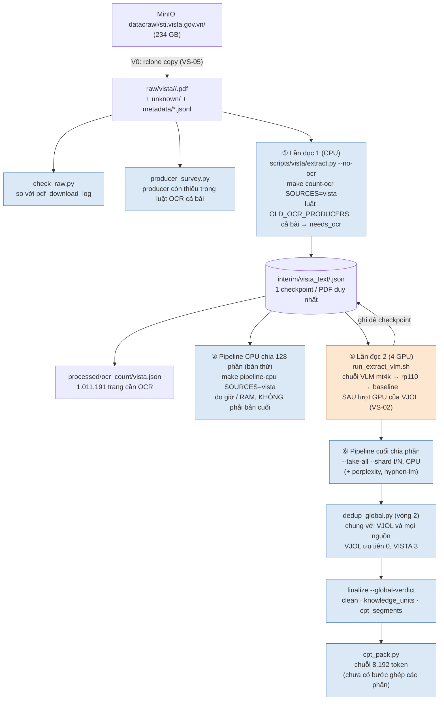

# VISTA: pipeline xử lý bài báo khoa học (PDF → clean corpus)

> Lập 2026-11-20 từ mã nguồn, `docs/sources/VISTA.md` (khảo sát dữ liệu, kế hoạch V0–V5, quyết định VS-01 … VS-06), `docs/project/SERVER_TASK.md` S-26 … S-28 và số đo thật trong `data/processed/ocr_count/vista*` và `data/processed/vista_full_summary.json` (2026-11-19).
> VISTA **dùng chung bộ xử lý bài báo PDF với VJOL** (VS-02, không chép code). Tài liệu này chỉ ghi phần **khác**; phần dùng chung (trích 2 lượt, bộ dò chữ hỏng, chuỗi OCR VLM, làm sạch bài báo, pipeline chung) mô tả ở `docs/design/VJOL.md`, đừng đọc VISTA mà bỏ qua file đó.

## 1. Tóm tắt

- **Đầu vào**: PDF của `sti.vista.gov.vn` (Cục Thông tin KH&CN quốc gia), chép từ MinIO `datacrawl/sti.vista.gov.vn/` về `raw/vista/`. Tải đã xong, **chỉ xử lý**.
- **Khác VJOL ở bốn điểm**: (1) tên file là `publication_id`, một PDF có thể thuộc nhiều bài; (2) **rất nhiều trang phải OCR** (scan trước 2009, lớp chữ OCR đời cũ không dấu 2009–2019); (3) metadata có tóm tắt tiếng Việt / Anh (thước đo chất lượng OCR miễn phí); (4) trùng ~20% tiêu đề với VJOL, để dedup toàn cục xử lý.
- **Trạng thái**: code xong (VS-04, VS-06); lớp chữ cả kho đã trích và pipeline CPU chia 128 phần đã chạy (PP-01, PP-03); **GPU OCR chưa chạy** (chờ sau VJOL, PP-04, VS-02); chưa có V2 (đo CPU producer cũ, độ trùng tóm tắt) và bảng font / lệch dấu riêng của VISTA.

## 2. Dữ liệu (khảo sát VS-01, 2026-11-05)

```
raw/vista/
├── 1998/ … 2026/<publication_id>.pdf      # KHÁC VJOL: tên file = publication_id
├── unknown/<sha256>.pdf                   # 19 file, không có trong log tải, giữ (VS-03), bản ghi thiếu metadata
└── metadata/{vista_detail,vista_listing,pdf_download_log}.jsonl, vista_partitions.json
```

| Mục | Số |
|---|---|
| Bài có metadata chi tiết (`vista_detail.jsonl`, khoá `publication_id`) | 323.513 (2.774 tên tạp chí), đều `has_fulltext=true`; **không có** trường ngôn ngữ, không có DOI |
| Có tóm tắt tiếng Việt / tiếng Anh | 153.795 / 104.206 |
| PDF tải thành công (log) | 283.239 (233,7 GB; trung vị 341 KB) |
| Nhóm PDF dùng chung cho nhiều bài (cùng sha256) | 9.708 nhóm, 19.807 bài, lớn nhất 15 bài |
| Bài có metadata nhưng chưa tải | 40.988, dồn ở 1998–2001, 2003, 2014, 2018–2020 |
| Trùng tiêu đề nguyên văn với VJOL | ~64.700 (~20%), chủ yếu 2020–2026 |

## 3. Số đo trên server (2026-11-19)

Đếm trang (`make count-ocr`, `data/processed/ocr_count/vista.json`, **sau khi bật luật producer OCR đời cũ**, VS-05):

| Chỉ số | Giá trị |
|---|---|
| File PDF thấy được / nội dung khác nhau (sha256) | 283.261 / **273.158** |
| Lỗi / thiếu | 92 / 94 |
| Tổng số trang | 1.626.494 |
| Trang theo `method` | `text` 615.041 · `needs_ocr` **1.011.191** · `empty` 174 · `tcvn3` 88 · `ocr_vlm` 0 |
| Bài theo tỷ lệ trang cần OCR | không cần 78.330 · một phần 9.211 · **toàn bài 185.472** (68%) · rất ít 53 |

| Giai đoạn | Số PDF | Tổng trang | Trang cần OCR | Tỷ lệ |
|---|---|---|---|---|
| ≤ 2008 | 47.940 | 224.803 | 224.777 | 100% |
| 2009–2019 | 124.959 | 664.226 | 619.314 | 93% |
| ≥ 2020 | 110.343 | 737.321 | 167.084 | 23% |

(Tỷ lệ 93% cho 2009–2019 là hệ quả của luật "producer OCR đời cũ thì OCR cả bài" đã bật ngay, VS-05.)

**Giờ GPU ước**: 1.011.191 trang / (4 GPU × ~1,55 trang/giây, đo trên stbook, O-22) ≈ **45 giờ** (~2 ngày); chưa đo trên VISTA (bước V3).

Pipeline CPU chia 128 phần (bản thử trước OCR, `data/processed/vista_full_summary.json`): 128/128 phần xong, đã áp verdict toàn cục, RAM đỉnh 676 MB mỗi phần, ≤ 6.050 giây mỗi phần.

| Phễu (tổng 128 phần) | Đoạn |
|---|---|
| Tổng đoạn | 471.778 |
| Giữ | 194.432 (≈ 217 triệu token) |
| Loại do trùng | 269.848 |
| Loại do chất lượng | 7.498 |

**Điểm đáng chú ý, chưa điều tra:** 57% đoạn bị loại vì trùng là cao. Có thể phần lớn do (a) trùng với VJOL (~20% tiêu đề trùng), (b) bài trùng trong chính VISTA (nhóm PDF dùng chung), (c) bản thử này bỏ qua trang `needs_ocr` nên các bản ghi còn lại ngắn và dễ trùng đầu trang. Cần tách số trùng theo nguyên nhân trước khi tin con số này; đây **không phải** số cuối vì 62% số trang chưa có chữ.

## 4. Khác biệt so với VJOL (chỉ những chỗ có code riêng)

| Điểm | VJOL | VISTA | Cách làm trong code |
|---|---|---|---|
| Tên file | `<năm>/<article_id>_<galley_id>.pdf` | `<năm>/<publication_id>.pdf`, `unknown/<sha256>.pdf` | `PaperLayout` (`vi_corpus/vjol/layout.py`) + `vi_corpus/vista/layout.py` (`publication_id_of`) |
| Nối metadata | `vjol_merged.jsonl` theo `article_id` | `vista_detail.jsonl` theo `publication_id`, đọc theo luồng một lượt | `RecordAdapter` (`vi_corpus/vjol/records.py`) + `vi_corpus/vista/records.py` |
| Một PDF ↔ nhiều bài | hiếm | 9.708 nhóm | checkpoint theo sha256 (trích một lần); **một bản ghi / PDF**, `meta.publication_ids`, `meta.shared_pdf` khi > 1 bài; metadata lấy từ bài mã nhỏ nhất có dòng trong `vista_detail.jsonl` |
| Lớp chữ OCR đời cũ không dấu | ít | rất nhiều (2009–2019) | `OLD_OCR_PRODUCERS` = OCR Manager, ORPALIS, GdPicture; `OCR_ALL_PRODUCERS` = của VJOL (ABBYY + ScanGate) + danh sách này; checkpoint mang hậu tố `+op<hash>` trong `extract_version`; `scripts/vista/producer_survey.py` tìm producer còn thiếu |
| Thư mục | `interim/vjol_text`, `state/vjol_extract/claims` | `interim/vista_text`, `state/vista_extract/claims`, `processed/vista/vista.parquet` | `VISTA_LAYOUT`; checkpoint VJOL không bị đụng |
| Hồ sơ pipeline | `PROFILES["vjol"]` | `PROFILES["vista"] = PROFILES["vjol"]` (điểm khởi đầu, chưa kiểm trên bài VISTA thật, bước V3) | `vi_corpus/pipeline/config.py` |
| Ưu tiên dedup | 0 | nhóm "các dataset khác" (mức 3): VJOL giữ trước | `SOURCE_PRIORITY` |
| Nhóm font xấu / bảng lệch dấu | học trên VJOL | chưa có | chạy lại `font_canary` / `learn_tone_shift` trên mẫu VISTA, ghi file riêng (V3) |

Chưa code: `meta.whole_issue` (PDF cả số tạp chí: số trang PDF lớn hơn nhiều so với trường `pages`), thước đo độ trùng tóm tắt ↔ trang đầu, cờ `PROFILES["vista"]` riêng.

## 5. Sơ đồ



Bản đồ VJOL / VISTA đã vẽ: `docs/diagrams/22_vjol_vista.svg` (từ PDF tới bản ghi) và `docs/diagrams/23_shard_run.svg` (chạy chia phần, dedup toàn cục).

## 6. Kế hoạch các bước (V0–V5 trong `docs/sources/VISTA.md`)

| Bước | Việc | Trạng thái (2026-11-20) |
|---|---|---|
| V0 | Chép `sti.vista.gov.vn/` về `raw/vista/`, kiểm kê | ✅ (VS-05); `check_raw.py` |
| V1 | Code dùng chung + `vi_corpus/vista/`, registry, ingest, `run_all.py` | ✅ (VS-04; 8 test trong `tests/test_vista.py`) |
| V2 | Đo trên CPU trước khi tốn GPU: tỷ lệ trang bị gắn cờ theo producer, độ trùng tóm tắt ↔ trang đầu, đếm PDF cả số tạp chí | ⬜ chưa làm |
| V3 | Trích mẫu 3.000 PDF trên 4 GPU **sau** lượt GPU của VJOL; đo trang/giây thật; `font_canary` + `learn_tone_shift` riêng; pipeline `vista_10k`; đọc tay 30 bài | ⬜ |
| V4 | Trích text cả kho trên GPU (~273.000 PDF, ~45 giờ ước) | ⬜ chờ PP-04 |
| V5 | Pipeline cả kho + dedup vòng 2 chung với VJOL, báo cáo phần trùng | 🟡 bản CPU thử đã chạy; bản cuối chờ V4 |

Chạy từng bước: `scripts/vista/run_vista.sh <check|survey|sample-extract|sample-pipeline|full-extract|full-pipeline|dedup|summary>` (S-26). Chạy toàn kho bằng CPU: `make count-ocr ROOT=<root> SOURCES="vista"` rồi `make pipeline-cpu ROOT=<root> SOURCES="vista" SHARDS=128` (S-27, S-28). `--shard I/N` chia PDF theo sha256 thành N lần chạy độc lập vừa RAM; `dedup_global.py` gộp rồi mỗi phần chạy lại với `--global-verdict`.

## 7. Rủi ro và điểm mở

- **Bản sao chưa đủ**: ~41.000 bài (chủ yếu 1998–2001) chưa tải; chủ dự án đã chốt không tải thêm (VS-02). `check_raw.py` so lại với nhật ký.
- **Lớp chữ OCR đời cũ không dấu** mà bộ dò bỏ sót sẽ lọt vào corpus dưới dạng chữ không dấu; luật producer đã bật, nhưng producer chưa có trong danh sách vẫn lọt (`producer_survey.py`).
- **Khối GPU lớn** (~45 giờ ước), phải chờ lượt GPU VJOL; chưa đo tốc độ thật trên trang VISTA (tạp chí 2 cột khổ nhỏ, scan).
- **PDF cả số tạp chí** (tới 151 MB) gán cho nhiều bài: lineage theo bài không chính xác; giữ text, `meta.shared_pdf`; `whole_issue` chưa code.
- **57% đoạn loại vì trùng** trong bản CPU thử (mục 3) cần được giải thích trước khi chạy bản cuối.
- **Quyền**: `rights_status = unknown`, chỉ gắn nhãn (R-01) như VJOL.
- **Ghép đầu ra**: chưa có bước ghép các `cpt_segments.parquet` của các phần thành một đầu vào cho `cpt_pack.py` (đọc từng phần).
