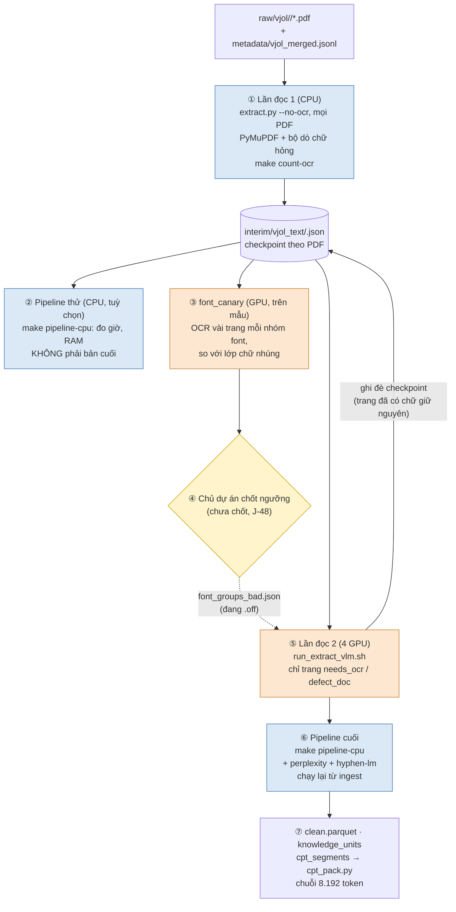
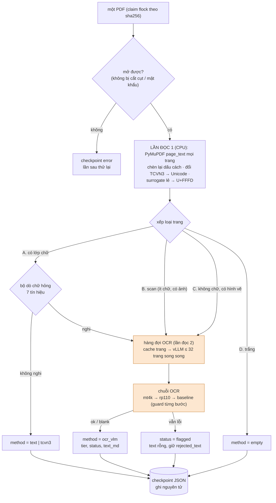
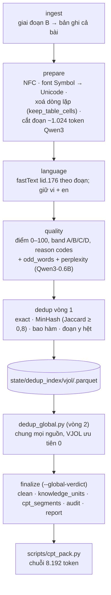

# VJOL: pipeline xử lý bài báo khoa học (PDF → clean corpus)

> Lập 2026-11-20 từ mã nguồn, `docs/sources/VJOL_PIPELINE.html` (giải thích dài, có hình, số đo ngày 2026-11-05), `docs/project/DECISION_LOG.md` (J-xx, PP-xx) và số đo thật trong `data/processed/ocr_count/` (2026-11-19). Tài liệu này là **bản tóm lược thiết kế dạng Markdown**; chi tiết từng cơ chế và lý do (mục "10. Mỗi cơ chế sinh ra từ lỗi nào") nằm ở trang HTML.
> VISTA dùng chung bộ xử lý này: xem `docs/design/VISTA.md` (chỉ ghi phần khác). Pipeline chung: `docs/design/PIPELINE.md`.

## 1. Tóm tắt

- **Đầu vào**: PDF bài báo của `vjol.info.vn`, đã chép vào `raw/vjol/<năm>/<article_id>_<galley_id>.pdf` + `raw/vjol/metadata/vjol_merged.jsonl`. **Chỉ xử lý, không crawl.** Không có bản text, nên phần khó nhất là lấy chữ đúng ra khỏi PDF.
- **Nguyên tắc**: mỗi trang đọc **tối đa hai lần**: lần 1 (PyMuPDF, CPU) cho mọi trang; lần 2 (OCR bằng chuỗi VLM, GPU) chỉ cho trang là ảnh scan hoặc trang có lớp chữ không đáng tin (lỗi font).
- **Ba giai đoạn**:
  - **A. Trích text** → checkpoint JSON theo sha256 PDF (`interim/vjol_text/`). Tốn GPU, làm một lần.
  - **B. Dựng bản ghi + làm sạch bài báo** (bỏ bìa, mục lục, tham khảo, tiêu đề tạp chí; khôi phục "ư"; che email / điện thoại; nối metadata) lúc ingest, **không lưu xuống đĩa** → sửa luật làm sạch không phải OCR lại.
  - **C. Pipeline chung**: prepare → language → quality → dedup → finalize (+ `cpt_pack`).
- **Kết quả**: `clean.parquet`, `knowledge_units.parquet`, `cpt_segments.parquet` cho từng phần chạy; `cpt_pack.py` ghép thành chuỗi 8.192 token.

## 2. Trạng thái (số đo `data/processed/ocr_count/vjol.json`, 2026-11-19)

| Chỉ số | Giá trị |
|---|---|
| File PDF thấy được / nội dung khác nhau (theo sha256) | 201.826 / **190.661** |
| Lỗi (PDF hỏng, mật khẩu) / file thiếu | 505 / 507 |
| Tổng số trang | 1.509.757 |
| Trang theo `method` | `text` 1.154.505 · `tcvn3` 6.691 · `ocr_vlm` 158.998 · `empty` 385 · `needs_ocr` **189.178** |
| OCR VLM đã làm | `ok` 158.291 · `blank` 693 · `flagged` 14 (0,009%) |
| Tổng trang cần OCR (ước) | 349.196 (đã làm 158.998, còn **189.178**) |
| Bài theo tỷ lệ trang cần OCR | không cần 155.990 · một phần 14.005 · toàn bài 19.970 · rất ít 191 |

- Lớp chữ (`--no-ocr`) đã trích cho cả kho (PP-01, 2026-11-17); **GPU OCR cho 189.178 trang `needs_ocr` còn lại là việc kế (PP-04)**. Ước giờ GPU theo tốc độ đo trên stbook (~1,55 trang/giây/GPU, O-22): 189.178 / (4 × 1,55) ≈ **8,5 giờ trên 4 GPU** (chưa đo trên VJOL).
- Pipeline CPU chia 128 phần đã chạy cho cả kho (bản thử trước OCR, trang `needs_ocr` thành trang rỗng; `data/processed/vjol_full_summary.json`): 128/128 phần xong, **934.721 đoạn**, RAM đỉnh 658 MB mỗi phần, ≤ 4.600 giây mỗi phần, mọi phần đã áp verdict dedup toàn cục. Bảng tổng hợp VJOL chưa có số đoạn giữ lại (`kept = null`, `funnel` rỗng), nên **chưa có số token giữ lại của VJOL**; đây là bản thử để đo giờ và RAM, **không phải bản cuối** (xem bước ⑥ ở mục 3).
- Chưa làm: nhóm font xấu bật lại (file `font_groups_bad.json.off` đang tắt), ngưỡng loại cho bốn bộ dò chỉ-đo (`joined_words`, `gibberish`, `tone_shift`, `dropped_letters` ở bước quality), lọc trang `baseline` theo tỷ lệ âm tiết, bộ phân tích bố cục, đọc `text_md` trong pipeline.

## 3. Các bước chạy thật (theo thứ tự)



- ② và ③ độc lập, đều chỉ cần ①. Bước ⑤ làm đổi checkpoint, nên ⑥ luôn chạy lại từ ingest (vân tay ingest = danh sách file + kích thước).
- Chạy lại đúng lệnh cũ thì chỉ làm phần còn thiếu (checkpoint theo file, vân tay theo stage).

## 4. Giai đoạn A: trích text từ PDF

Code: `scripts/vjol/extract.py` → `vi_corpus/vjol/cli.py` / `extract.py`; khung chạy theo lô `vi_corpus/common/batch_extract.py`; đọc PDF `vi_corpus/common/pdf_text.py`; OCR `vi_corpus/common/ocr_cascade.py`.

### 4.1 Chọn file

Liệt kê PDF theo thư mục năm; kiểm kê sha256 song song, gom file cùng nội dung vào một nhóm (cache `state/inventory_vjol_text.json`). `--sample-docs N --seed S` chia đều theo năm, mẫu N nhỏ luôn là tiền tố của mẫu N lớn (tăng N chỉ làm phần mới); bỏ cờ này = cả kho.

### 4.2 Đường đi của một trang



Trang `A` = có ≥ 30 ký tự chữ **hoặc** không có ảnh nhúng. Trang không có chữ chưa chắc là trắng (ảnh có thể nằm trong form XObject, hoặc vẽ bằng nét), nên được vẽ thử ở 0,5×: có nội dung → đi OCR (`no_text_layer`), không → `empty`.

### 4.3 Bộ dò chữ hỏng (`vi_corpus/common/garbled.py`, chỉ VJOL / VISTA bật)

Bảy tín hiệu trên lớp chữ từng trang; trang nghi nếu ít nhất một tín hiệu vượt ngưỡng. OCR thừa một trang sạch gần như vô hại, bỏ sót một trang hỏng thì chữ rác vào kho, nên ngưỡng hơi nhạy.

| Tín hiệu | Ngưỡng trên một trang | Bắt kiểu hỏng |
|---|---|---|
| `tone` | ≥ 5% từ (trang ≥ 10 từ) có ≥ 2 dấu thanh | "Baỷng, hieọu" (âm tiết đúng chỉ có ≤ 1 dấu thanh) |
| `case` | ≥ 5% từ ≥ 4 chữ cái có chữ hoa đứng sau chữ thường | chữ lệch mã ASCII ("xuAáT") |
| `foreign` | ≥ 0,3% chữ cái là ñ ö ï ø å (và ≥ 5 chữ, trang ≥ 100 chữ cái) | font VNI |
| `unknown` | ≥ 30% từ Latinh (trang ≥ 30 từ) không có trong `syllables.json` | sai dấu kiểu Windows-1258 |
| `nodiac` | ≥ 2% từ Latinh (trang ≥ 50 từ) thuộc danh sách từ không dấu (sinh từ dữ liệu, `unaccented.json`) | mất dấu từng phần; trang tiếng Anh được miễn |
| `hyphen` | ≥ 4 chỗ và ≥ 0,4% từ dạng "đ-ợc", "th- viện" | font mất ư / ơ thành "-" |
| `control` | ≥ 10% ký tự không-trắng là ký tự điều khiển C0 | font ghi mã glyph thành ký tự điều khiển |

Ba cách kéo **cả bài** đi OCR (`reason` ghi trên trang):

| Cách | Điều kiện | `reason` |
|---|---|---|
| Theo tỷ lệ trang nghi | ≥ 30% số trang chữ của bài bị nghi | `garbled_doc` |
| Theo phần mềm tạo PDF | producer / creator thuộc danh sách OCR đời cũ (VJOL: ABBYY FineReader 11 + ScanGate; `OLD_OCR_PRODUCERS`) | `old_ocr_producer` |
| Theo lỗi chữ không vá được | `tone_shift` hoặc `dropped_letters` trúng ở ≥ max(2; 15%) số trang chữ (`REOCR_SIGNALS`, `vi_corpus/vjol/reocr.py`) | `defect_doc` |

Cố ý **không** dùng để quyết định OCR lại cả bài: `joined_words` (độ chính xác 0,077), `gibberish` (công thức dàn phẳng gây báo nhầm), `hyphen` ở cấp bài (ảnh trang cũng in "-", OCR vô ích), nhóm font xấu theo (producer, creator) (chỉ dựa trên mẫu; `font_groups_bad.json` phải ở trạng thái `.off`).

### 4.4 Chuỗi OCR

| Tầng | Engine | Ghi chú |
|---|---|---|
| 1 `qwen3vl_8b_mt4k` | Qwen3-VL-8B-Instruct (vLLM), `temperature 0`, `max_tokens 4096`; prompt chép nguyên văn, đọc từng cột, bảng HTML | không phạt lặp, vì phạt lặp có thể sai chữ lặp hợp lệ (bảng số) |
| 2 `qwen3vl_8b_rp110` | cùng server, `repetition_penalty 1,10` | chỉ chạy cho trang bị guard báo |
| 3 `baseline` | PaddleOCR (tìm dòng) + VietOCR (đọc dòng) | tầng dự phòng; vẫn bị báo thì trang bị loại (`flagged`) |

Guard (`vi_corpus/ocr_bakeoff/guard.py`) bắt trang hỏng hẳn: `length` (bị cắt cụt), `empty`, `embedded_image` (base64), `english_meta`, `loop`, `too_long` (> 12.000 ký tự), `error`. Trang kết thúc ở `baseline` hoặc `flagged` được **xoay thử** 180° / 90° / 270°, giữ bản xoay nếu tỷ lệ âm tiết hợp lệ tăng ≥ 0,20 và đạt ≥ 0,50. Ảnh gửi đi: trang scan dùng ảnh nhúng gốc (jpg / png / webp / jp2), trang lỗi chữ hoặc không lớp chữ luôn vẽ lại cả trang 200 dpi. Server vLLM dựng **lười** ở trang scan đầu tiên (~9 phút khởi động mỗi GPU). Câu rác của VLM ("There is no text in the image") bị lọc (`ocr_noise.py`). Cache OCR theo trang: `interim/vjol_ocr_cache/`.

### 4.5 Chạy 4 GPU

Một server vLLM + một tiến trình mỗi GPU, chia việc bằng khoá `flock` theo sha256 (`state/vjol_extract/claims/`). `ServerDown` / `EngineUnavailable` dừng cả lượt (không bỏ trang âm thầm). Ghi checkpoint nguyên tử (file tạm riêng mỗi tiến trình → fsync → `os.replace`). Hai lỗi thật đã gặp và sửa khi chạy cả kho: tên file tạm chung làm 3/4 tiến trình chết; surrogate lẻ làm cả 4 chết khi ghi JSON.

### 4.6 Checkpoint

`interim/vjol_text/<sha256>.json`: `sha256`, `size`, `paths[]` (mọi đường dẫn cùng nội dung), `year_dir`, `article_id`, `galley_id`, `pages[]` (`text`, `method` = `text|tcvn3|ocr_vlm|empty|needs_ocr`, với `ocr_vlm`: `tier`, `status`, `rotation`, `text_md`; trang nghi chữ hỏng thêm `reason`, `signals`, `garbled_text`), `extract_version` (hiện nâng tới 7; checkpoint cũ hơn được làm lại; hậu tố `+vocab` khi có `syllables.json`). Mọi đường dẫn tương đối so với `--data-root`.

## 5. Giai đoạn B: dựng bản ghi và làm sạch (CPU, lúc ingest)

Code: `vi_corpus/vjol/records.py` (`iter_records`), `vi_corpus/vjol/clean.py`. Đọc checkpoint, làm sạch trong bộ nhớ, nối metadata, ra một bản ghi / checkpoint.

```mermaid
flowchart LR
    CK[("checkpoint")] --> P0["0 chọn checkpoint\nbỏ lỗi / bỏ qua;\nneeds_ocr → trang rỗng"]
    P0 --> P1["1 restore_u\n'-' → 'ư'"]
    P1 --> P2["2 strip_vlm_noise"]
    P2 --> P3["3 drop_front_matter\nbìa · mục lục · ban biên tập"]
    P3 --> P4["4 strip_running_headers\nhọc từ chính bài"]
    P4 --> P5["5-6 strip_front/mid_headers\ntiêu đề tạp chí"]
    P5 --> P7["7 strip_junk_lines"]
    P7 --> P8["8-9 strip_references\ncó / không tiêu đề"]
    P8 --> P10["10 strip_boilerplate\nche email / điện thoại"]
    P10 --> P11["11 clean_pages (dùng chung)\nbỏ tiêu đề lặp, số trang;\nghép dòng thành đoạn"]
    P11 --> REC["bản ghi + meta\n(nối vjol_merged.jsonl theo article_id)"]
```



| # | Bước | Làm gì |
|---|---|---|
| 1 | `restore_u_in_pages` | font cũ vẽ "ư" thành "-" (ảnh cũng in "-", OCR vô ích). Quy tắc: "-" trong chữ là "ư", có ba lớp kiểm: đứng sau phụ âm đầu thật, kết quả phải là âm tiết thật trong `syllables.json`, dạng có khoảng trắng chỉ sửa khi cả bài có nhiều chỗ sửa được. Chỗ mơ hồ ("ph-ơng": phương / phường / phượng) gỡ bằng bằng chứng cả bài, hoặc bằng mô hình ngôn ngữ nhỏ (Qwen3-0.6B, margin ≥ 4,0 nat, `--hyphen-lm-model`); không chắc thì **để nguyên**, đoạn bị `lost_letters` loại ở quality |
| 3 | `drop_front_matter` | bìa (trang đầu < 40 từ khi bài ≥ 3 trang), mục lục, ban biên tập; trang bị bỏ thành rỗng, giữ chỉ số trang |
| 4–6 | `strip_running_headers` / `front` / `mid` | tiêu đề tạp chí lặp (học từ chính bài, không dựa vào tên trong metadata); cắt ở mức dòng thay vì loại cả đoạn sạch |
| 7 | `strip_junk_lines` | dòng ≥ 8 từ, ≥ 85% là từ rác, không có từ Latinh ≥ 3 chữ cái |
| 8–9 | `strip_references` / `strip_trailing_references` | khối "Tài liệu tham khảo / References…" có và không có tiêu đề; giữ tóm tắt tiếng Anh đứng sau |
| 10 | `strip_boilerplate` | dòng khuôn mẫu ("Ngày nhận bài", "Received"), khối tác giả (dòng ngắn có email), che email → `<EMAIL>`, số điện thoại → `<PHONE>` (chỉ che số có định dạng thật) |
| 11 | `clean_pages` | bỏ tiêu đề / chân trang lặp ≥ 3 trang, bỏ dòng chỉ có chữ số, ghép dòng xuyên ranh giới trang |

Metadata: nối theo luồng một lượt `vjol_merged.jsonl` (chỉ giữ dòng của bài có checkpoint). Năm = năm metadata, nếu không hợp lệ (ngoài 1900–2100 hoặc 1970) thì năm của thư mục. `meta` gồm: `article_id`, `galley_id`, `journal_slug`, `journal_title`, `year`, `doi`, `title`, `keywords`, `pages`, `garbled_pages`, `no_text_layer_pages`, `page_lines_removed`, số đếm từng bước làm sạch và `repairs` (mỗi luật chạm vào bài bao nhiêu chỗ). `rights_status = unknown` (chỉ gắn nhãn).

## 6. Giai đoạn C: pipeline chung cho VJOL



Hồ sơ: `SourceProfile(chunked=True, min_words=80, allowed_langs=("vi","en"), min_lang_score=0.5, odd_words=True, perplexity=True, keep_table_cells=True)`, `SOURCE_PRIORITY["vjol"] = 0` (khi trùng, giữ bản VJOL). `chunked=True`: đọc hết bài rồi cắt đoạn; "10.000 mẫu" nghĩa là 10.000 đoạn.

Mã lỗi chất lượng quan trọng cho VJOL (ngưỡng khởi điểm):

| Loại | Mã | Bắt gì |
|---|---|---|
| Cứng | `too_short` (< 80 từ) · `lang_not_allowed` · `low_alpha` (< 55% chữ cái) | đoạn ngắn / sai ngôn ngữ / toàn số |
| Cứng | `garbled_font` (≥ 8% từ có ≥ 2 dấu thanh) | lưới an toàn của bộ dò (ngưỡng cao hơn 5% ở giai đoạn A) |
| Cứng | `private_use_chars` · `math_font_junk` · `lost_diacritics` (≥ 2%) · `reversed_text` · `lost_letters` (≥ 3 chỗ "-" thay ư/ơ) · `odd_words` (≥ 15%, hoặc ≥ 8% kèm perplexity ≥ 120) · `repeated_ngrams` · `duplicate_lines` · `replacement_chars` | rác font, chữ ngược, chữ hỏng, vòng lặp |
| Mềm | `high_perplexity` (−10) · `low_lang_score` (−10) · `low_diacritic` (−15) | một mình chưa đủ loại |
| Gắn nhãn | `reference_list` · `mixed_language` | không trừ điểm |
| Chỉ đo | `gibberish` · `tone_shift` · `dropped_letters` · `joined_words` | `HARD_DETECTOR_THRESHOLDS = None`: chưa bộ nào qua cổng precision 0,9 trên 400 nhãn chuẩn |

## 7. Đĩa

```
data/
├── raw/vjol/<năm>/<article_id>_<galley_id>.pdf, metadata/vjol_merged.jsonl   nguyên bản
├── interim/vjol_text/<sha256>.json                  checkpoint trích text
├── interim/vjol_ocr_cache/<2 ký tự>/<sha256>.json   OCR theo trang
├── state/{inventory_vjol_text.json, vjol_extract/claims/, dedup_index/vjol/}
├── processed/ocr_bakeoff/{syllables,unaccented}.json   từ điển cho bộ dò (dựng từ SEA-PILE v2)
├── processed/ocr_count/vjol.json, vjol_by_year.csv     đếm trang cần OCR (make count-ocr)
├── processed/vjol_font_canary/font_groups_bad.json.off nhóm font xấu: ĐÃ TẮT
└── processed/pipeline_runs/vjol_full_s<i>of128/        kết quả từng phần
```

## 8. Lệnh chạy

```bash
# ① lớp chữ cả kho, CPU
make count-ocr ROOT=<root> JOBS=16 SOURCES="vjol vista"
# ⑤ OCR 4 GPU (bỏ SAMPLE_DOCS = cả kho; chạy lại đúng lệnh cũ để làm tiếp)
DATA_ROOT=<root> VLLM_BIN=$(which vllm) [SAMPLE_DOCS=3000] ./scripts/vjol/run_extract_vlm.sh
uv run python scripts/vjol/extract.py --data-root <root> --status
# ②/⑥ pipeline cả kho chia phần, CPU (⑥ thêm perplexity + hyphen-lm)
make pipeline-cpu ROOT=<root> JOBS=128 SHARDS=128 [PIPE_ARGS="--perplexity-model Qwen/Qwen3-0.6B --hyphen-lm-model Qwen/Qwen3-0.6B"]
make pipeline-progress ROOT=<root> SHARDS=128
# mẫu 10.000 đoạn + công cụ đo
uv run python scripts/run_pipeline.py --data-root <root> --mix vjol=10000 --total 10000 --run-name vjol_10k
uv run python scripts/vjol/audit_run.py --run-dir <root>/processed/pipeline_runs/vjol_10k
uv run python scripts/vjol/compare_runs.py --paired --old <run cũ> --new <run mới>
# CPT
uv run python scripts/cpt_pack.py --segments <run>/cpt_segments.parquet --out <root>/processed/cpt_packed/vjol.parquet
```

Công cụ đo (không sửa dữ liệu): `check_garbled.py`, `check_garbled_missed.py`, `plan_reocr.py`, `font_canary.py`, `diagnose.py`, `audit_run.py`, `groundtruth.py` (400 nhãn do mô hình gán, không phải người), `compare_runs.py --paired`, `learn_tone_shift.py`, `eval_hyphen_lm.py`, `seed_ocr_cache.py`. Nguyên tắc: **đo trước, chỉnh ngưỡng sau, không chỉnh theo mẫu thi cuối.**

## 9. Hạn chế và điểm mở

- Bốn bộ dò chỉ-đo chưa có ngưỡng loại; lỗi chữ lọt vào kho ở mức chưa đo cho cả kho.
- Khoảng 0,2% bài có lớp chữ hỏng mà bộ dò bỏ sót (7/3.000 ở một phép thử); mới thêm tín hiệu `control` cho một kiểu.
- Trang `baseline` chưa có bộ lọc theo tỷ lệ âm tiết (O-27 c).
- Bản Việt và bản Anh của cùng một nghiên cứu không bị dedup bắt (khác ngôn ngữ); giữ cả hai.
- Tên tác giả ngoài khối đầu bài không bị che; chỉ email / điện thoại được che.
- Quyền sử dụng chưa xác nhận (`unknown`, chỉ gắn nhãn).
- Số trong trang HTML (177.031 PDF, ~7,3 trang/bài) là của mẫu / lượt chạy ngày 2026-11-05; số đo hiện hành là bảng ở mục 2.
